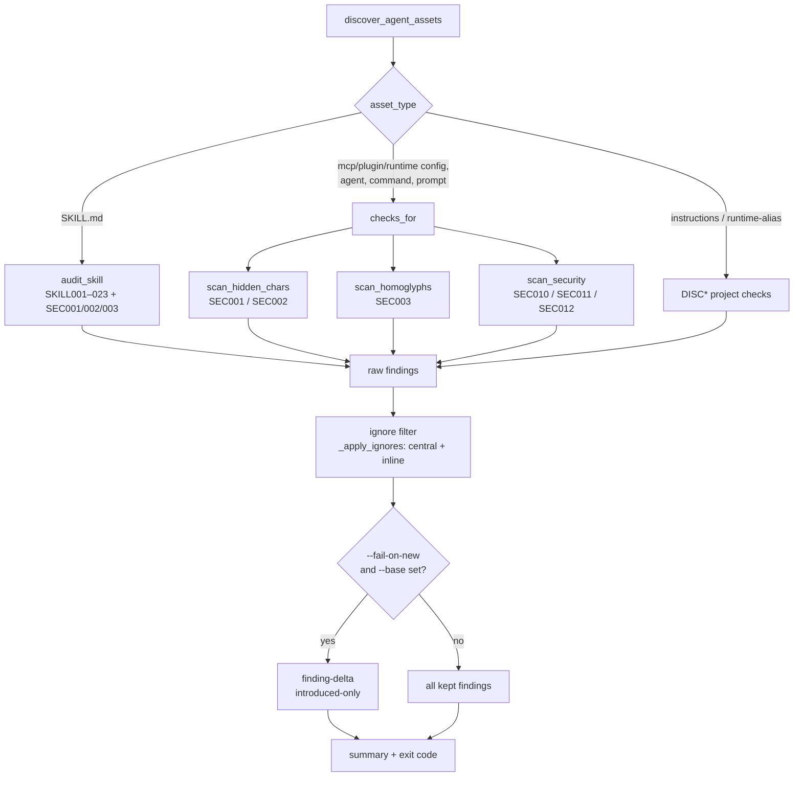
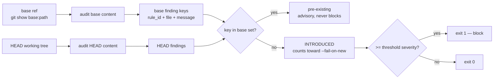

# Agent Governance CLI, MCP, and Docker

This repository includes a deterministic read-only audit engine for agent
assets. It is intentionally split into three layers:

| Layer | Entrypoint | Purpose |
|---|---|---|
| Core + CLI | `scripts/agent_audit.py` | Local and CI discovery/audit commands |
| MCP stdio server | `scripts/agent_governance_mcp.py` | Tool calls from Codex, Claude Desktop, Cursor, VS Code agents, or other MCP clients |
| Docker runner | `Dockerfile` | Reproducible local/CI execution with a read-only project mount |
| Rule catalog | `references/agent-audit-rules.json` | Shared rule metadata returned by CLI/MCP |

## Which one do I use? (decision guide)

Same engine, same rules, same findings — only the **delivery** differs. Pick by
*who* triggers the audit and *where* it runs.

| | **CLI** | **MCP** | **Docker** |
|---|---|---|---|
| Triggered by | a human or a script | an AI agent, mid-conversation | a human/CI, but sandboxed |
| Runs where | your shell / CI runner | your editor or chat client | an isolated container |
| Needs | Python 3.8+ on PATH | an MCP-capable client | Docker; no local Python |
| Network | n/a | n/a | `--network none` (locked down) |
| Best when | you want a yes/no gate or JSON in a pipeline | you want the agent to check a skill *while you edit it* | you can't/won't run the toolkit's Python locally, or need a pinned, reproducible image |

**Concrete use cases → mode**

- *"Block a PR/MR when a skill has a high-severity issue."* → **CLI** in CI (`audit-project . --changed-only --fail-on high`). This is what `sgt ci-init` generates.
- *"Fail my local commit before I push."* → **CLI** in a pre-commit hook (`scripts/install-pre-commit-hook.sh`).
- *"While I'm writing a skill in Cursor/Claude Desktop, have the agent audit it on demand."* → **MCP** (the agent calls `audit_skill` / `audit_project` as tools).
- *"Score one skill and pipe the JSON into another tool."* → **CLI** (`audit-skill <path> --format json`).
- *"Run it on a locked-down build box with no Python and no network, with a byte-for-byte reproducible engine."* → **Docker** (`--network none`, read-only mount).
- *"Our CI images are minimal/Alpine and we don't want to manage Python deps."* → **Docker** (the image carries the stdlib-only engine).

**Rule of thumb:** default to **CLI** (it covers local + CI, ~zero setup). Add
**MCP** when you want an agent to audit interactively. Reach for **Docker** only
for isolation/reproducibility or when local Python isn't an option. The three are
complementary, not exclusive — most teams use CLI in CI *and* MCP in their editor.

## CLI

```bash
python3 scripts/agent_audit.py discover .
python3 scripts/agent_audit.py audit-skill skills/skill-evaluate/SKILL.md --format json
python3 scripts/agent_audit.py audit-project . --profile release-ready --format json
python3 scripts/agent_audit.py audit-project . --profile release-ready --fail-on high
python3 scripts/agent_audit.py audit-project . --changed-only --base origin/main --fail-on high
python3 scripts/agent_audit.py rules
python3 scripts/agent_audit.py explain-rule SKILL009
```

`--changed-only` scopes the audit to assets changed against `--base` (a git ref,
default `origin/main`) — the merge-request gate. See the
[checks reference](checks-reference.md) for every rule and rationale.

Profiles:

| Profile | Use |
|---|---|
| `security` | Focus on tool safety, destructive commands, secrets, external trust, hardcoded paths |
| `quality` | Skill structure and usability checks |
| `maintainability` | Full rule set, same current behavior as release-ready |
| `release-ready` | Full rule set for pre-release audits |

The JSON report contains:

```json
{
  "kind": "skill-audit",
  "profile": "release-ready",
  "generated_at": "2026-06-05T12:00:00Z",
  "engine_version": "1.8.1",
  "rules_version": "0.1.0",
  "target": "/repo/skills/example/SKILL.md",
  "summary": {"total": 1, "by_severity": {"high": 1}},
  "findings": [
    {
      "severity": "high",
      "rule_id": "SKILL009",
      "file": "/repo/skills/example/SKILL.md",
      "line": 4,
      "message": "allowed-tools appears in frontmatter.",
      "suggestion": "Remove it and document tool restrictions in the body as guidance."
    }
  ]
}
```

Every `audit-skill`/`audit-project` report carries `engine_version` (from the
root `VERSION`) and `rules_version` (from the catalog) so a verdict is traceable
to the engine and policy that produced it.

## Per-asset pipeline

Every audit walks the same pipeline per discovered asset. Discovery classifies
each path into an asset type (`asset_type`), the type selects which checks run
(`checks_for` for non-skills, `audit_skill` for skills), suppressions are
applied, and — when a base ref is supplied — only newly introduced findings
reach the fail set.



The security scan (`SEC010`/`SEC011`/`SEC012`) runs **only** on non-skill asset
types (`checks_for` `security_types` set). Hidden-char and homoglyph scans run on
**every** asset, skills included, because a skill body can be copy-pasted or
imported just like a config.

## Finding-delta gate

`--fail-on-new` (and `sgt gate`) computes findings the merge request **introduced**
rather than every finding present. The engine audits the asset at `--base`
(`git show base:path`) and at HEAD, then diffs the two finding sets by a stable
key. The key is `(rule_id, file, message)` — it **excludes line number**, so a
finding that merely shifted down when surrounding text changed counts as
pre-existing, not introduced.



A path that is new on HEAD (no base content) has **all** its findings treated as
introduced — there is nothing to grandfather. This is the model that lets a team
enable the suite over a legacy library without an avalanche; see
[`security-rollout-guide.md`](security-rollout-guide.md).

## Asset-type × checks coverage matrix

Which checks run on which asset type, derived from `checks_for` (non-skills) and
`audit_skill` (skills). `✓` = runs; blank = does not run.

| Asset type | Hidden-char<br/>SEC001/002 | Homoglyph<br/>SEC003 | Security<br/>SEC010/011/012 | References<br/>REF001–004 | Skill structure<br/>SKILL/D1–D9 |
|---|---|---|---|---|---|
| `skill` (`SKILL.md`) | ✓ | ✓ | | ✓ | ✓ (SKILL001–023; LLM D1–D9 via `skill-evaluate`) |
| `agent` (`agents/*.md`) | ✓ | ✓ | ✓ | ✓ | |
| `mcp-config` (`.mcp.json`) | ✓ | ✓ | ✓ | | |
| `plugin-config` (`*-plugin/plugin.json`) | ✓ | ✓ | ✓ | | |
| `runtime-config` (`gemini-extension.json`) | ✓ | ✓ | ✓ | | |
| `command` (`commands/*.md`) | ✓ | ✓ | ✓ | ✓ | |
| `prompt` (`prompts/*`) | ✓ | ✓ | ✓ | | |

> Skills run the **skill-only** secret/dangerous detectors (`SKILL014`/`SKILL015`)
> with the prose exemption enabled, not the non-skill `SEC010`/`SEC011`. Non-skill
> assets disable that prose exemption — a config is not documentation. The D1–D9
> dimensions are LLM-scored by `skill-evaluate`, not by the deterministic engine.
>
> **Referenced-script content (`SCR001`–`SCR003`)** is not a per-asset-type column:
> it scans the *scripts an asset body references* (or scripts changed in the MR),
> resolved within the repo root — never a blanket `scripts/` sweep.
>
> **MCP consistency (`MCP001`/`MCP002`)** runs on `skill` assets (tool usage vs
> `metainfo.requires.mcp`); MCP server `command + args` in `mcp-config` assets get
> a structural dangerous-scan. **Hook commands (`HOOK001`/`HOOK002`)** run on the
> `hook` asset type — `.claude/settings*.json`, `plugin.json` `hooks`, and `hooks/*`.

## MCP server

The MCP server exposes these read-only tools:

| Tool | Purpose |
|---|---|
| `discover_agent_assets` | Find `AGENTS.md`, `SKILL.md`, prompts, agent configs, runtime aliases, MCP configs, and plugin manifests |
| `audit_skill` | Audit one `SKILL.md` |
| `audit_project` | Audit all discovered skills and instruction aliases |
| `explain_rule` | Explain one rule by `rule_id` |
| `get_rule_catalog` | Return the full rule catalog |

Example MCP client config:

```json
{
  "mcpServers": {
    "agent-governance": {
      "command": "python3",
      "args": ["/path/to/skill-governance-toolkit/scripts/agent_governance_mcp.py"],
      "env": {
        "AGENT_GOVERNANCE_ROOT": "/path/to/project"
      }
    }
  }
}
```

By default, the MCP server accepts only paths under its process working
directory. Set `AGENT_GOVERNANCE_ROOT` to make that boundary explicit.
Set `AGENT_GOVERNANCE_DEBUG=1` only while debugging; otherwise MCP errors are
sanitized and do not include tracebacks.

The public rule metadata is loaded from
`references/agent-audit-rules.json`. Set `AGENT_GOVERNANCE_RULES_PATH` to test
or ship a different catalog without editing Python code. Override catalogs must
define every `rule_id` used by the engine; missing IDs fail startup instead of
silently weakening audits.

## Docker

Build the image:

```bash
docker build -t agent-governance-mcp:local .
```

Run as a stdio MCP server against the current project:

```bash
docker run --rm -i \
  --network none \
  -v "$PWD:/workspace:ro" \
  agent-governance-mcp:local
```

The image runs as a non-root user. If your CI checkout uses restrictive file
permissions, run with the host UID/GID:

```bash
docker run --rm -i \
  --network none \
  --user "$(id -u):$(id -g)" \
  -v "$PWD:/workspace:ro" \
  agent-governance-mcp:local
```

Example MCP client config using Docker:

```json
{
  "mcpServers": {
    "agent-governance": {
      "command": "docker",
      "args": [
        "run",
        "--rm",
        "-i",
        "--network",
        "none",
        "-v",
        "/path/to/repo:/workspace:ro",
        "agent-governance-mcp:local"
      ]
    }
  }
}
```

Inside Docker, pass `root` as `/workspace`.

## GitHub Actions

The repository includes `.github/workflows/ci.yml` with two baseline jobs:

| Job | Checks |
|---|---|
| `audit` | `scripts/audit.sh`, audit-engine behavior tests, and `release-ready` CLI gate |
| `docker` | Docker build, MCP `tools/list`, and Docker `audit_project /workspace` |

For local reproduction, run the commands in `docs/user-guide.md` or
`docs/user-guide.ru.md` under the component status section.

## GitLab CI

For a GitLab merge-request gate, copy `references/ci/gitlab-ci.yml` into the
consuming repo as `.gitlab-ci.yml`. It runs `--changed-only` with a tiered
block/advisory policy and posts findings via `scripts/post_mr_comment.py`. Full
walk-through: `docs/user-guide.md` § GitLab CI - Merge Request gate.

## Design constraints

- Read-only by default.
- No network required.
- No pip dependencies.
- No automatic patch application.
- LLM agents interpret findings and decide whether to propose edits.
- Rule metadata lives in `references/agent-audit-rules.json`; detector logic
  stays in stdlib Python.
- Policy data (thresholds, vocabularies, profile membership, dangerous/secret
  pattern packs) is overridable via an optional `config` block in the same
  catalog — see `docs/checks-reference.md` § Extending the checks. Detection
  algorithms stay in code; only data is configurable.
