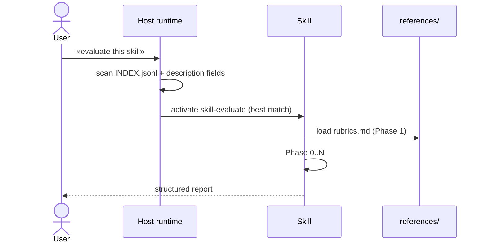

# Architecture Overview

How the Skill Governance Toolkit is structured and why.

## Three layers

```
L1 — Project rules    (always-on, every turn)
L2 — Procedural skills (activated by trigger phrases)
L3 — Sub-agents       (dispatched via Task tool — host-dependent)
```

| Layer | File pattern | Loaded when | Scope |
|---|---|---|---|
| L1 | `AGENTS.md` | every turn | universal project rules |
| L2 | `skills/{name}/SKILL.md` | description matches user phrasing | bounded procedure |
| L3 | `agents/{name}.md` | orchestrator skill calls `Task` | specialized expertise |

The three layers map to three different loading mechanisms across all five
supported runtimes. AGENTS.md is the **single source of truth** — CLAUDE.md
and GEMINI.md are aliases via `@AGENTS.md` import; Copilot reads AGENTS.md
natively; Cursor v2.2+ auto-discovers it from project root.

## Source vs Target vs Runtime dirs

The installer (v1.6.1+) explicitly separates three directory roles:

- **SOURCE** — where the toolkit code lives (the cloned repo)
- **TARGET_PROJECT** — where YOUR project lives (cwd by default)
- **RUNTIME_DIR** — per-host install dir (`~/.{host}/` global OR
  `$TARGET_PROJECT/.{host}/` project)

The «root-first» layout (v1.6.2+) places `skills/`, `agents/`, `references/`,
`scripts/`, `commands/` at TARGET_PROJECT root in project-scope installs.
This lets Copilot/Cursor auto-discover from workspace root AND lets
`.codex-plugin/plugin.json`'s `./skills/` reference resolve correctly.
Per-host runtime dirs still get their own copies for host-specific
conventions (Claude reads `.claude/skills/`).

### Skill subset selection (since 1.8.0)

The installer applies a filter over `skills/INDEX.jsonl` before copying:

1. `resolve_skill_subset()` in `scripts/install.sh` calls
   `scripts/filter_skills.py` with the parsed `--category` / `--tier` /
   `--skill` flags (or runs the interactive menu if `--interactive`).
2. The helper reads `metainfo.category` and `metainfo.tier` from each
   index entry, intersects with the filter, and returns the surviving
   skill names.
3. `_copy_filtered_skills()` then copies only the matching subdirs and
   writes a **filtered `INDEX.jsonl`** to the destination (so
   `skill-find` in the target environment never reports skills that
   weren't installed).

Default tier filter is `stable,preview` — `experimental` and `internal`
require explicit opt-in. Default category filter is empty (all categories).
`--skill` is a hard list that overrides category and tier (explicit names
mean «I know what I want»).

## User-owned vs toolkit-owned files

The install contract distinguishes who can edit each file:

| File | Owner | Install behavior |
|---|---|---|
| `$TARGET_PROJECT/AGENTS.md` | **USER** | Append/replace block between markers (`marker_block.py`) |
| `$TARGET_PROJECT/CLAUDE.md` | **USER** | Same |
| `$TARGET_PROJECT/GEMINI.md` | **USER** | Same |
| `$TARGET_PROJECT/.github/copilot-instructions.md` | **USER** | Same |
| `$RUNTIME_DIR/AGENTS.md`, `$RUNTIME_DIR/CLAUDE.md`, etc. | **TOOLKIT** | Full file replace OK |

User content OUTSIDE the markers is NEVER modified by the installer across
fresh installs, upgrades, and uninstalls.

## Skill activation flow



Activation cost is determined by:
1. `INDEX.jsonl` size (fast-path discovery)
2. AGENTS.md size (always-on context)
3. Selected skill body size (loaded on activation)
4. references/ loaded on-demand by skill itself

## Resumable runs

Multi-phase skills checkpoint state to `${CWD}/.skill-state/{skill-name}/`
after every expensive phase. On crash / timeout / re-invocation, the skill
can resume from the last checkpoint.

| Skill | Resume mode default |
|---|---|
| library-audit, skill-evaluate, skill-build-portable, skill-compare | `auto` (read-mostly, never asks) |
| integration-init | `ask` (gateway, user expects prompts) |

See `references/checkpointing.md` for the canonical pattern + helper CLI.

## Parallelization model

Skills use **batched tool calls** (multiple `tool_use` blocks in one
message) for embarrassingly parallel work, NOT `Task` sub-agent dispatch.
Reason: Gemini CLI has no sub-agent support, so `Task` would break
portability. Cross-skill insights (collision detection, cross-dim scoring)
also benefit from being in one agent context.

See `AGENTS.md` § Parallelization patterns for the full rule.

## Versioning + upgrade safety

- Versions follow semver (X.Y.Z). Breaking changes (skill renames,
  manifest schema) → major or minor bump with explicit «🔴 BREAKING»
  markers in `CHANGELOG.md`.
- The append-with-markers install contract means upgrades NEVER destroy
  user content outside our markers — see `docs/skill-authoring-standard.md`
  § «User-owned vs toolkit-owned files».

## Why not multi-agent for skill management

We deliberately chose NOT to layer sub-agent orchestration on top of
the meta-skills. Reasons:

- **Sub-agent support is uneven.** Gemini CLI has none. Adding agents
  breaks the «works in all 5 runtimes» promise.
- **Cross-skill insights need single context.** Trigger collisions,
  cross-dim scoring (D3+D4, D5 vs D9) require one agent holding all
  state. Sub-agent fragmentation loses this.
- **Skills already do the work procedurally.** library-audit → skill-evaluate
  → skill-build-portable IS the orchestration. Wrapping it in agents adds
  complexity without speed gain on small libraries.

If we ever add an orchestrator skill (e.g. `library-cleanup`), it stays
a skill (visible to all 5 runtimes), not an agent.
