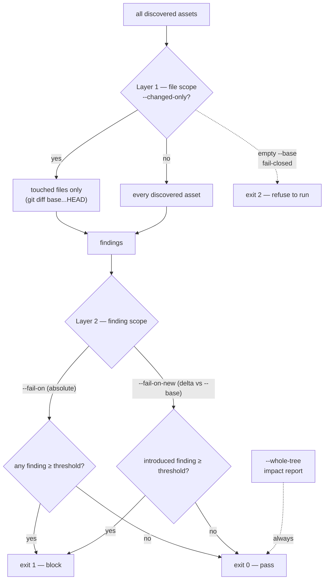

# CLI Reference

Complete, code-verified reference for the two command-line entry points the toolkit ships (`agent_audit.py` engine + `sgt` facade) — every flag, default, and exit code.

> Audience: gate adopters & CI authors · Type: reference · Prerequisite: [agent-governance-engine.md](agent-governance-engine.md) for which delivery mode to use

The deterministic audit **engine** is `scripts/agent_audit.py` — the CLI invoked by CI and by local pre-merge checks. The `sgt` **facade** (`scripts/sgt.py`) is a thin, user-facing wrapper that runs the same engine for the common workflows (install, gate, scaffold). Both share one detector core, so a verdict produced locally matches the one produced in CI.

`sgt <cmd>` is shorthand for `python3 <toolkit>/scripts/sgt.py <cmd>`. Where this doc writes `sgt gate`, the literal runnable form is `python3 scripts/sgt.py gate` from the toolkit checkout (or the installed wrapper if you put one on `PATH`).

Every flag, default, choice, and exit code below is verified against the argparse definitions in `scripts/agent_audit.py` and `scripts/sgt.py` and against each subcommand's `--help`.

---

## `agent_audit.py` — the engine

```bash
python3 scripts/agent_audit.py <subcommand> [flags]
```

A top-level `--format {text,json,github}` exists on the root parser, but each subcommand redefines its own `--format` (with subcommand-appropriate choices); pass `--format` **after** the subcommand.

| Subcommand | Purpose |
|---|---|
| `discover` | List the agent-governance assets found under a root (skills, aliases, agents, hooks, MCP/plugin configs). |
| `audit-project` | Audit all discovered assets; the main gate command. |
| `audit-skill` | Audit one `SKILL.md` file. |
| `list-suppressions` | List central + inline suppressions; flag expired/expiring ones. |
| `report-trends` | Summarize `out/security/findings.jsonl` — top rules, severities, introduced ratio. |
| `explain-rule` | Explain one rule (what it checks). |
| `explain-finding` | Author-facing fix + the correct suppression path for a rule (floor vs advisory). |
| `rules` | Print the full rule catalog. |
| `validate-config` | Validate org audit-config / overlay patterns against a ReDoS time budget. |

### `discover`

List governed assets under a root.

```bash
python3 scripts/agent_audit.py discover .
python3 scripts/agent_audit.py discover ./some/project --format json
```

| Flag | Values / Default | What it does | When to use |
|---|---|---|---|
| `root` (positional) | path, default `.` | Root directory to scan. | Point at a project other than the CWD. |
| `--format` | `text` \| `json` (default `text`) | Output format. | `json` for machine consumption. |

### `audit-project`

Audit every discovered asset. This is the gate command — see the in-depth section below.

```bash
python3 scripts/agent_audit.py audit-project . --fail-on high
```

| Flag | Values / Default | What it does | When to use |
|---|---|---|---|
| `root` (positional) | path, default `.` | Root to audit. | Audit a project other than the CWD. |
| `--format` | `text` \| `json` \| `github` (default `text`) | Output format; `github` emits PR-diff annotations. | `github` in GitHub Actions; `json` for artifacts. |
| `--profile` | `security` \| `quality` \| `maintainability` \| `release-ready` (default `release-ready`) | Which rule set / severity weighting to apply. | `release-ready` for the pre-merge gate. |
| `--fail-on` | `none` \| `high` \| `medium` \| `low` \| `info` \| `any` (default `none`) | Exit 1 when **any** finding meets or exceeds this severity. | Absolute gate (no legacy baseline). |
| `--fail-on-new` | `none` \| `high` \| `medium` \| `low` \| `info` \| `any` (default `none`) | Exit 1 only when findings **introduced vs `--base`** meet or exceed this severity. Requires `--base`. | Delta gate over a legacy library. |
| `--changed-only` | flag | Audit only assets changed vs `--base` (three-dot diff). | MR/PR scope. |
| `--base` | git ref (default `origin/main`) | Ref to diff against for `--changed-only` / `--fail-on-new`. | Set to the MR base SHA in CI. |
| `--whole-tree` | flag | Impact-report mode: force a FULL audit, add a per-rule histogram, **never blocks (always exit 0)**. | Measure blast radius before flipping `--fail-on-new` across repos. |
| `--record` | flag | Append one JSON line per finding to `out/security/findings.jsonl` under the audited root. | Opt-in observability / trend data. |
| `--include-install-dirs` | flag | Also audit per-host install dirs (`.claude`/`.codex`/`.gemini`/`.cursor`). **Excluded by default** so a fresh install's copied governance assets don't manufacture findings; security configs there (hooks, `.mcp.json`, `plugin.json`) are always audited. | Set when you author skills/agents *under* a host dir and want them audited. |

### `audit-skill`

Audit a single `SKILL.md`.

```bash
python3 scripts/agent_audit.py audit-skill skills/skill-evaluate/SKILL.md --fail-on high
```

| Flag | Values / Default | What it does | When to use |
|---|---|---|---|
| `path` (positional) | path (required) | The `SKILL.md` to audit. | Score one file. |
| `--format` | `text` \| `json` \| `github` (default `text`) | Output format. | `json`/`github` for tooling. |
| `--profile` | `security` \| `quality` \| `maintainability` \| `release-ready` (default `release-ready`) | Rule set to apply. | Match the gate profile. |
| `--fail-on` | `none` \| `high` \| `medium` \| `low` \| `info` \| `any` (default `none`) | Exit 1 when findings meet or exceed this severity. | Block locally on a single file. |

### `list-suppressions`

List central (`references/audit-ignore.json`) and inline suppressions; flag expired/expiring ones.

```bash
python3 scripts/agent_audit.py list-suppressions --root . --expiring-within 30
```

| Flag | Values / Default | What it does | When to use |
|---|---|---|---|
| `--format` | `text` \| `json` (default `text`) | Output format. | `json` for inventory tooling. |
| `--root` | path, default `.` | Root to scan for suppressions. | Non-CWD project. |
| `--expiring-within` | integer DAYS (default none) | Exit 2 if any suppression expires within DAYS (in addition to already-expired). | Periodic suppression-hygiene CI job. |

Exit 2 also fires when any suppression is already expired.

### `report-trends`

Summarize the recorded findings log.

```bash
python3 scripts/agent_audit.py report-trends --root . --format json
```

| Flag | Values / Default | What it does | When to use |
|---|---|---|---|
| `--format` | `text` \| `json` (default `text`) | Output format. | Dashboards. |
| `--root` | path, default `.` | Root whose `out/security/findings.jsonl` is summarized. | Non-CWD project. |

### `explain-rule`

Explain what a rule checks.

```bash
python3 scripts/agent_audit.py explain-rule SEC011
```

| Flag | Values / Default | What it does | When to use |
|---|---|---|---|
| `rule_id` (positional) | rule id (required) | The rule to explain. | Look up rule semantics. |
| `--format` | `text` \| `json` (default `text`) | Output format. | Tooling. |

### `explain-finding`

Author-facing fix plus the correct suppression path for a rule (distinguishes blocking floor vs advisory).

```bash
python3 scripts/agent_audit.py explain-finding SEC011
```

| Flag | Values / Default | What it does | When to use |
|---|---|---|---|
| `rule_id` (positional) | rule id (required) | The rule to explain. | A finding blocks your MR and you need the fix. |
| `--format` | `text` \| `json` (default `text`) | Output format. | Tooling. |

### `rules`

Print the full rule catalog.

```bash
python3 scripts/agent_audit.py rules --format json
```

| Flag | Values / Default | What it does | When to use |
|---|---|---|---|
| `--format` | `text` \| `json` (default `text`) | Output format. | `json` to diff catalogs across versions. |

### `validate-config`

Validate org audit-config / overlay regex patterns against a ReDoS time budget. Exit 2 if any issue is found.

```bash
python3 scripts/agent_audit.py validate-config
python3 scripts/agent_audit.py validate-config --config references/agent-audit-config.example.json
```

| Flag | Values / Default | What it does | When to use |
|---|---|---|---|
| `--format` | `text` \| `json` (default `text`) | Output format. | Tooling. |
| `--config` | path (default none) | Also validate this single config/overlay file standalone. | Lint a new overlay before committing it. |

---

## `audit-project` flags in depth

`audit-project` is the gate command, and it has **two independent scoping layers**. Conflating them is the most common source of confusion.



### Layer 1 — file scope: `--changed-only` (which FILES are audited)

`--changed-only` restricts the audit to assets changed in a three-dot diff (`git diff <base>...HEAD`) against `--base`. Without it, the engine audits every discovered asset under `root`. This is purely a *file selection* — it does not decide which findings block.

```bash
# Audit only assets this MR touches, vs the MR base
python3 scripts/agent_audit.py audit-project . --changed-only --base "$CI_MERGE_REQUEST_DIFF_BASE_SHA"
```

**Empty `--base` with `--changed-only` fails CLOSED (exit 2).** If `--base` is empty or whitespace (e.g. `CI_MERGE_REQUEST_DIFF_BASE_SHA` unset on the first pipeline of a new MR, or a non-merge-request pipeline), the engine **refuses to run** and exits 2 with a diagnostic. It does **not** silently fall back to a whole-tree audit — a silent switch could block unrelated MRs on legacy assets, or (under `--fail-on none`) produce a green pipeline that audited nothing. Supply a real base or drop `--changed-only`.

### Layer 2 — finding scope: `--fail-on` vs `--fail-on-new` (which FINDINGS block)

- `--fail-on <sev>` — **absolute.** Exit 1 if *any* finding (in whatever file scope is active) meets or exceeds `<sev>`.
- `--fail-on-new <sev>` — **delta.** Exit 1 only if a finding **introduced vs `--base`** meets or exceeds `<sev>`. Pre-existing findings stay advisory. Requires a non-empty `--base`; otherwise exit 2.

The two layers compose freely. `--changed-only` limits *which files* are read; `--fail-on-new` limits *which findings* block. The CI block job uses both together (`--changed-only --base <ref> --fail-on-new high`): audit only touched assets, and block only on high-severity findings that touched assets introduce.

```bash
# The exact CI block verdict: changed-only file scope + introduced-only finding scope
python3 scripts/agent_audit.py audit-project . \
  --changed-only --base origin/main --fail-on-new high --profile release-ready
```

### Impact report: `--whole-tree`

`--whole-tree` forces a full audit regardless of `--changed-only`/delta, adds a per-rule histogram to the summary, and **never blocks (always exit 0)**. Use it to size the blast radius of a rule before enabling it as a gate across repos.

```bash
python3 scripts/agent_audit.py audit-project . --whole-tree --format json
```

### Profiles and formats

- `--profile`: `security` \| `quality` \| `maintainability` \| `release-ready` (default `release-ready` — the pre-merge gate profile).
- `--format`: `text` (human) \| `json` (artifacts) \| `github` (PR-diff annotations in GitHub Actions).

---

## `sgt` — the facade

```bash
python3 scripts/sgt.py [--root ROOT] <subcommand> [flags]
```

`--root` (on the top-level parser, before the subcommand) sets the project root the facade operates on.

| Subcommand | Purpose | Most useful flags |
|---|---|---|
| `init` | Guided one-command install, then verify with `doctor`. | `--host`, `--scope`, `--category`, `--tier`, `--skill`, `--yes`, `--dry-run` |
| `gate` | Reproduce the CI block verdict locally (changed-only delta gate). | `--base`, `--check-setup` |
| `ci-init` | Generate a changed-only PR/MR gate workflow, SHA pre-filled. | `--github`, `--gitlab`, `--ref`, `--repo`, `--output`, `--force` |
| `doctor` | Quick local health check. | `--format` |
| `quickstart` | Print next steps + the intent-to-skill map. | `--format` |
| `skills` | List indexed skills. | `--format` |
| `audit` | Run the full self-audit. | — |
| `new-skill` | Scaffold a governance-clean `SKILL.md` skeleton. | `--category` (required), `--force` |
| `uninstall` | Remove toolkit-owned files; never touches your own content. | `--scope`, `--host`, `--target-project`, `--dry-run`, `--yes` |

### `sgt gate`

Reproduces the exact CI block verdict locally: it runs `audit-project . --changed-only --base <ref> --fail-on-new high --profile release-ready`. Block-on-introduced-high, scoped to changed assets.

```bash
# Block verdict against the default base (main)
python3 scripts/sgt.py gate --base main

# Validate the repo is wired for the gate (audits nothing)
python3 scripts/sgt.py gate --check-setup
```

| Flag | Values / Default | What it does |
|---|---|---|
| `--base` | git ref (default `main`) | Ref to diff against for the delta gate. |
| `--allow-dirty` | flag | Audit `HEAD` even when the working tree has uncommitted changes. By default `sgt gate` fails fast on a dirty tree (the diff would be ambiguous and read as a false green). |
| `--check-setup` | flag | Verify the repo is wired so the gate cannot weaken itself — a CODEOWNERS file must cover the suppression list (`references/audit-ignore.json`). Audits nothing. |

### `sgt ci-init`

Generate a ready-to-commit CI workflow (GitHub Actions or GitLab CI) with the toolkit SHA pinned.

```bash
python3 scripts/sgt.py ci-init --github
python3 scripts/sgt.py ci-init --gitlab --ref <sha> --output .gitlab-ci.yml --force
```

| Flag | Values / Default | What it does |
|---|---|---|
| `--github` | flag | Emit a GitHub Actions workflow. |
| `--gitlab` | flag | Emit a GitLab CI pipeline. |
| `--ref` | sha (default: current HEAD) | Toolkit commit SHA to pin. |
| `--repo` | URL (default: detected origin) | Toolkit repo URL. |
| `--output` | path (relative to `--root`) | Override the output path. |
| `--force` | flag | Overwrite an existing file. |

### `sgt init`

```bash
python3 scripts/sgt.py init --host claude --yes
python3 scripts/sgt.py init --host all --category governance --dry-run
```

| Flag | Values / Default | What it does |
|---|---|---|
| `--host` | `claude` \| `copilot` \| `codex` \| `gemini` \| `cursor` \| `all` (default `claude`) | Target host(s) to wire. |
| `--scope` | `project` \| `global` | Install scope. |
| `--target-project` | path | Project to install into (project scope). |
| `--category` | closed-vocab category | Skill category filter. |
| `--tier` | tier (default `stable,preview`) | Skill tier filter. |
| `--skill` | name(s) | Explicit skill names to install. |
| `--yes` | flag | Non-interactive: accept defaults. |
| `--dry-run` | flag | Print the install plan, write nothing. |

### `sgt doctor`

```bash
python3 scripts/sgt.py doctor
python3 scripts/sgt.py doctor --format json
```

| Flag | Values / Default | What it does |
|---|---|---|
| `--format` | `text` \| `json` (default `text`) | Output format. |

### `sgt new-skill`

```bash
python3 scripts/sgt.py new-skill prompt-evaluate --category governance
```

| Flag | Values / Default | What it does |
|---|---|---|
| `name` (positional) | `entity-action[-qualifier]` | Skill name (kebab-case, closed verb vocab). |
| `--category` | required, closed vocab: `code-review` \| `docs` \| `testing` \| `governance` \| `discovery` \| `research` \| `delivery` (comma-separated) | metainfo categories. |
| `--force` | flag | Overwrite an existing `SKILL.md`. |

### `sgt uninstall`

```bash
python3 scripts/sgt.py uninstall --scope project --host claude --dry-run
```

| Flag | Values / Default | What it does |
|---|---|---|
| `--scope` | `project` \| `global` | Removal scope. |
| `--host` | `claude` \| `codex` \| `gemini` \| `cursor` \| `copilot` \| `all` | Host wiring to remove. |
| `--target-project` | path (default `--root`) | Project to clean (project scope). |
| `--dry-run` | flag | Print the plan, remove nothing. |
| `--yes` | flag | Skip the confirmation prompt. |

---

## Environment variables

| Variable | Read by | Values | Effect |
|---|---|---|---|
| `SGT_FAIL_MODE` | `agent_audit.py` (`_gate_exit_code`) | `enforce` (default) \| `advisory` | Fleet kill-switch. `advisory` forces a non-blocking exit 0 even when findings meet the threshold — the audit still runs and reports. `enforce` (or unset) keeps blocking. |
| `AGENT_GOVERNANCE_RULES_PATH` | `agent_audit.py` (`default_rules_path`) | path | Override the rule-catalog path. When set, the engine loads the catalog (and config overlays) from here instead of the bundled `references/agent-audit-rules.json`. |
| `SGT_GUARD_PATHS` | secret-guard PreToolUse hook (`skills/integration-init/assets/secret-guard-hook.py`) | colon- **or** comma-separated path list | Extends the hook's guarded-path set. A tool call touching any listed path is blocked (hook exits 2). |

### CI base-ref variables

The generated CI templates pass the merge-request base ref into `--base`. These are **auto-set by the CI platform** on merge-request / pull-request pipelines — you do not set them yourself.

| Variable | Platform | Used as |
|---|---|---|
| `CI_MERGE_REQUEST_DIFF_BASE_SHA` | GitLab CI | `--base "$CI_MERGE_REQUEST_DIFF_BASE_SHA"` in `references/ci/gitlab-ci.yml`. Unset outside a merge-request pipeline → empty `--base` → engine fails closed (exit 2). |
| `GITHUB_BASE_REF` | GitHub Actions | `--base "origin/${GITHUB_BASE_REF}"` in `references/ci/github-pr.yml`. The base branch is fetched into a tracking ref so the three-dot diff resolves. |

A shallow clone breaks `--changed-only` — both templates fetch full history so the merge-request base is reachable.

---

## Exit codes

Confirmed from `agent_audit.py main()`.

| Code | Meaning |
|---|---|
| `0` | Clean / pass. No findings at or above the threshold, or a non-gating command (`discover`, `report-trends`, `explain-*`, `rules`) succeeded. `--whole-tree` always returns 0. `SGT_FAIL_MODE=advisory` forces 0 even when findings would otherwise block. |
| `1` | Findings at or above the threshold block. `audit-project` / `audit-skill` with `--fail-on` (or `--fail-on-new`) met. |
| `2` | Usage / config error. Includes: empty `--base` with `--changed-only`; empty `--base` with `--fail-on-new`; a bad/unreachable ref or malformed config raising `FileNotFoundError`/`OSError`/`ValueError`/`KeyError`/`UnicodeError`; `validate-config` finding ReDoS issues; `list-suppressions` with an expired or (with `--expiring-within`) expiring suppression. |

---

## Report format

Every finding the engine emits carries the same fields across all output formats:

- `rule_id` — the rule that fired (e.g. `SEC011`).
- **title** — the rule's human title.
- `message` — the specific problem at this location.
- `Why:` / rationale — the rule's purpose (why it matters).
- `suggestion` — the concrete fix.

The same data appears in `--format text`, `--format json`, `--format github` (PR-diff annotations), and the GitLab MR comment posted by the advisory job. To get the full fix plus the correct suppression path (blocking floor vs advisory) for any rule, run:

```bash
python3 scripts/agent_audit.py explain-finding <rule_id>
```

For the complete rule catalog and severity tiers, see [`checks-reference.md`](checks-reference.md).

---

## Auxiliary scripts

Beyond the two main entry points above, the toolkit ships small single-purpose
helpers. They are install-time / diagnostic tooling, not the primary surface —
their key flags are summarized here so the reference is complete.

| Script | Purpose | Key flags |
|---|---|---|
| `filter_skills.py` | Decode the install selection over `skills/INDEX.jsonl` | `--index` (required), `--category`, `--tier`, `--skill`, `--list-categories`, `--filtered-index`, `--info-summary` |
| `build_index.py` | Regenerate `skills/INDEX.jsonl` from `SKILL.md` frontmatter | `--skills-dir`, `--output` |
| `post_mr_comment.py` | Post the advisory findings as an idempotent GitLab MR comment | reads CI env (`CI_API_V4_URL`, `CI_PROJECT_ID`, `CI_MERGE_REQUEST_IID`); token from the env var named by `--token-env` (default `GITLAB_TOKEN`), sent as the `PRIVATE-TOKEN` header; `--dry-run`; `--allow-insecure-http` (explicit opt-in — by default a non-HTTPS API URL is refused so the token never travels unencrypted) |
| `doctor.py` | Health check (auto-detects toolkit checkout vs consumer install) | `--root`, `--mode {auto,checkout,consumer}`, `--format` |
| `quickstart.py` | Print the next-step guide for the current directory | `--root`, `--format` |

These are also documented inline where they appear in [`user-guide.md`](user-guide.md);
this table is the consolidated flag-level view.

---

## See also

- [checks-reference.md](checks-reference.md) — go here for what each rule a flag gates actually checks
- [agent-governance-engine.md](agent-governance-engine.md) — go here to pick a delivery mode (CLI / MCP / Docker)
- [github-onboarding.md](github-onboarding.md) — go here to wire these flags into a GitHub Actions gate
- [gitlab-onboarding.md](gitlab-onboarding.md) — go here to wire these flags into a GitLab CI gate
- [extending-checks.md](extending-checks.md) — go here when `validate-config` rejects your org pattern or you want a new rule
