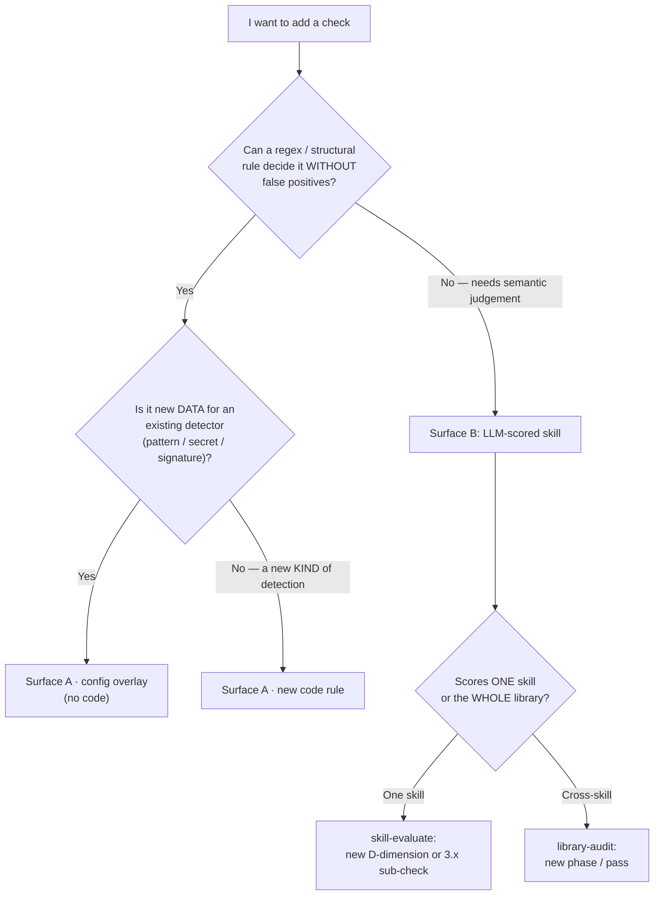

# Extending checks — where does my check go?

A single decision page for adding, removing, tuning, or contributing a check — it routes you to the right surface (deterministic gate vs LLM-scored skill) and the detailed doc for each step.

> Audience: rule authors & toolkit contributors · Type: how-to / decision guide · Prerequisite: [checks-reference.md](checks-reference.md) for what already exists

The toolkit runs checks on **two surfaces**; picking the wrong one is the most
common mistake.

| Surface | Engine | Runs | Nature | Source of truth |
|---|---|---|---|---|
| **A — deterministic gate** | `agent_audit.py` + `references/agent-audit-rules.json` | per-MR CI, blocking | regex / structural — must be **false-positive-free** | [checks-reference.md](checks-reference.md) |
| **B — LLM-scored skills** | `skill-evaluate` (D1–D9), `library-audit` (phases) | on demand, advisory | **semantic judgement** | rubric / phase markdown in the skill bundle |

**The rule of thumb:** if a deterministic regex can decide it without crying wolf,
it belongs in the gate (A). If deciding needs reading meaning and judging intent,
it belongs in an LLM-scored skill (B). A semantic check forced into the gate
becomes a false-positive machine; a security invariant left to the LLM is not a
gate at all.

## Decision tree



## Surface A — deterministic gate

### A1. New data for an existing detector (no code change)

A new dangerous command, secret shape, env-exfil signature, MCP allow-server, or
hook denylist entry is **policy data**, not a new algorithm. Ship it through the
catalog `config` block / a `references/audit-config.*.json` overlay — no Python
fork.

```jsonc
// org catalog or audit-config overlay
"config": { "patterns": { "dangerous": [
  {"label": "kubectl delete", "regex": "kubectl\\s+delete", "suggestion": "No cluster deletion in assets.", "ignore_case": false}
] } }
```

Always validate before CI — the ReDoS budget guard rejects a catastrophic regex:

```bash
python3 scripts/agent_audit.py validate-config
python3 scripts/agent_audit.py rules --format json   # catalog still loads
```

Full schema + merge/overlay semantics: [checks-reference.md § Configurable policy](checks-reference.md#configurable-policy-no-code-change).
Governance for an **org** rule (reserve id, advisory-first, promotion): [§ Contributing an org governance rule](#contributing-an-org-governance-rule) below.

> Overlays load from the **pinned toolkit mirror**, not the audited repo — a
> consumer-side `audit-config.*.json` is ignored (the CI gate now warns when an MR
> edits one). See [security-rollout-guide.md § Where config overlays live](security-rollout-guide.md).

### A2. A new KIND of detection (code change)

A genuinely new detector (not just data) needs code:

1. Write a `scan_*` function emitting `finding(RULE_ID, …)`; register it in
   `checks_for` / the default scanner list (keyed by `asset_type`).
2. Add severity to `SEVERITY` (and `SEVERITY_FLOOR` only for core safety).
3. Add a catalog entry to `agent-audit-rules.json` — `title` + `description`;
   `description` is what `explain-finding <RULE>` shows the author, so write the
   actionable fix there.
4. Ship a **triggering** fixture and a **clean near-miss** fixture in
   `scripts/test_*.py` — a rule without a clean fixture cannot prove it is not
   over-broad.
5. Document the rule in [checks-reference.md](checks-reference.md).
6. `bash scripts/audit.sh` (P-phases) must stay green.

Detail: [checks-reference.md § New check types](checks-reference.md#new-check-types-code-change).

## Contributing an org governance rule

The governance path for the **engine-rule branch** (Surface A) of the decision
tree above: how an adopter proposes an **organization-specific** rule, ships it
safely (advisory-first), and earns promotion to a stable, possibly floor-level,
rule. Most org rules are policy data and ship via [§ A1](#a1-new-data-for-an-existing-detector-no-code-change)
with no Python change; a brand-new *kind* of detection is a code change
([§ A2](#a2-a-new-kind-of-detection-code-change)) and is out of scope for this path.

### 1. Reserve a rule_id

Pick an **org prefix** — never the core families (`DISC`, `SKILL`, `SEC`, `REF`,
`SCR`, `MCP`, `HOOK`, `IGNORE`). Reusing a core prefix collides with the shipped
catalog on the next toolkit bump. Use a short org tag, e.g. `ACME001`, `ACME002`.
A reserved id is unique within your org catalog and stable across releases — once
published, never renumber it (tooling and suppressions key on the id).

### 2. Write test fixtures

Ship a **triggering** fixture (an asset that must fire the rule) and a **clean**
fixture (a near-miss that must NOT fire — the false-positive guard). A rule without
a clean fixture is incomplete: it cannot prove it is not over-broad. Keep fixtures
minimal and self-explanatory.

### 3. Justify severity and floor membership

State the severity (`info` / `low` / `medium` / `high`) and whether the rule should
join the **floor**. Be conservative:

- **Advisory (`medium`/`low`/`info`)** is the default for a contributed rule. It
  surfaces in reports and never blocks a pipeline.
- **Floor membership is reserved for core safety rules** (secrets, dangerous shell,
  hidden characters, traversal). A floor rule cannot be downgraded or
  inline-suppressed — that is a strong commitment. Org rules join the floor only
  after a track record, and only with governance-owner sign-off, because a floor
  addition is a **breaking change** for every pinned consumer (see
  [checks-reference.md § Rule lifecycle](checks-reference.md#rule-lifecycle--deprecation-policy)).

### 4. Ship advisory-first via config `patterns`

A data rule ships through the catalog's `config` block — the [§ A1](#a1-new-data-for-an-existing-detector-no-code-change)
mechanism, no fork. Add the rule metadata to your org catalog's `rules` list and
the detection data to the matching `config.patterns` bucket (`dangerous` /
`secrets` / `env_exfil`). These **extend** the shipped baseline; they never weaken it:

```json
{
  "rules": [
    {
      "rule_id": "ACME001",
      "severity": "medium",
      "title": "ACME: kubectl delete in an asset",
      "description": "Cluster-deletion commands must not be embedded in governed assets.",
      "stability": "candidate"
    }
  ],
  "config": {
    "patterns": {
      "dangerous": [
        {"label": "kubectl delete", "regex": "kubectl\\s+delete", "suggestion": "Avoid cluster deletion in assets.", "ignore_case": false}
      ]
    }
  }
}
```

Point the engine at your catalog via `AGENT_GOVERNANCE_RULES_PATH`, or layer a
`references/audit-config.*.json` overlay. Then validate before CI with the §A1
commands (`validate-config` for the ReDoS budget, `rules --format json` for
catalog load).

### 5. Run the advisory window, then propose promotion

Leave the rule advisory for **at least one minor release** so adopters see it in
reports without merges blocking. Then, if the false-positive rate is acceptable,
propose promotion (to `stable`, or — for a genuine safety rule — to `high`/floor)
with a **🔴 BREAKING** CHANGELOG entry and upgrade notes.

### Optional `stability` field

A contributed rule MAY carry an optional `stability` marker on its rule object to
signal lifecycle stage:

| Value | Meaning |
|---|---|
| `candidate` | New / contributed; may change or be withdrawn. A rule ships here. |
| `stable` | Proven over ≥1 release without breaking changes; safe to depend on. |

```json
{ "rule_id": "ACME001", "severity": "medium", "title": "…", "description": "…", "stability": "candidate" }
```

**This is a documented convention only — the engine does not read or enforce it.**
The catalog loader (`load_rule_catalog`) only reads `rule_id`, `severity`, `title`,
and `description` from each rule object; any other key (including `stability`) is
tolerated and ignored. Adding `stability` to a rule does **not** change validation
or behavior, so it is safe in an org catalog.

> The shipped core catalog does **not** carry `stability` on its rules — adding it
> there would change the catalog and is out of scope. The field is reserved for
> contributed org rules that want to record their lifecycle stage explicitly.

## Surface B — LLM-scored skills

A check here is a **rubric / phase entry in markdown** — the LLM executes it. No
code, no recompile. Add a worked example (a triggering case + a near-miss) as the
executable spec, then wire the scoring.

### B1. Per-skill — `skill-evaluate`

Two shapes:

- **A new D-dimension** (D1–D9): add to `references/rubrics.md` with a 0–5 scale,
  add the column to the Phase 4 summary table + JSONL `dims`, update Total math.
- **A new Phase 3 sub-check** (`3.x`) that **caps** a dimension: add the detection
  logic to `references/structural-analysis.md`, a row to the SKILL.md sub-check
  table, the cap wiring (the "do NOT parallelize" cross-dim note), a JSONL flag,
  and the self-exclusion if the skill's own body would self-flag.

Worked precedent — the `3.7` activation-coherence sub-check (description ↔ body
`When to use`, caps D8 ≤ 3) was added exactly this way; copy its shape.

### B2. Cross-skill — `library-audit`

Checks that need the **whole library** in one context (trigger collisions across
descriptions, handoff-contract asymmetry, naming drift, token budget). Add a phase
or pass to the relevant reference: `handoff-spec.md` (Phase 1), `security-spec.md`
(Phase 5), or the metainfo/portability phases. Never sub-agent-shard these — the
cross-skill insight must surface in one context.

## Removing or disabling a check

You rarely delete; you **scope** or **suppress**:

| Want | Mechanism | Surface |
|---|---|---|
| Stop a rule blocking, keep it visible | lower `severity` / move out of the gating profile (`--profile`, `profiles.quality_exclude`) | A |
| Silence one finding, one place | inline `<!-- sgt-ignore: RULE reason=… -->` (advisory rules only) | A |
| Silence a floor finding | central `references/audit-ignore.json`, CODEOWNER-gated, with `expires` | A |
| Turn the whole gate advisory (incident) | `SGT_FAIL_MODE=advisory` kill-switch | A |
| Ship a B check without enforcing (R&D) | give it `info` severity — runs, records, never caps (see [Info / experimental lane](#info--experimental-lane)) | B |
| Drop a dimension / sub-check | delete its rubric / phase entry | B |
| Retire a rule permanently | deprecation policy (BREAKING CHANGELOG + upgrade notes) | A |

Suppression is not removal — an expired or CODEOWNER-gated suppression keeps an
audit trail. See [security-suppression-runbook.md](security-suppression-runbook.md)
and [checks-reference.md § Rule lifecycle](checks-reference.md#rule-lifecycle--deprecation-policy).

## Info / experimental lane

A new LLM-scored check (Surface B) is rarely ready to **enforce** on day one — you
need evidence of how often it fires across real skills before it caps a score.
Shipping it as enforcing on a hypothesis fails skills on a guess; deleting it
loses the signal entirely. The middle lane is **`info` severity**.

**Contract (non-negotiable):** an `info` finding is recorded (report «Info (no
action required)» section + an `info_flags` JSONL field) but has **zero** effect
on the Score, tier, dimension caps, or any gate. Not «usually advisory» — *never*.
This is what lets it ship into a stable skill without risk: by definition it
cannot change a verdict.

**Why not just disable it.** A check that never runs produces no data, so you can
never tell whether its effect is real — and it bit-rots unseen. `info` keeps a
faint signal flowing (collapsed to a one-line count by default, so it adds no
noise) while you watch the aggregate. You cannot feel the effect of a check that
never fires.

**Info is a stage, not a graveyard.** Every `info` check needs an exit:

```text
info  →  advisory / capping        (promote: evidence shows it catches real defects)
info  →  retire                     (demote: it fires on noise, never actionable)
```

**Accrue the evidence** — don't promote on a hunch. The `info_flags.*` written to
`out/scores/index.jsonl` aggregate across a corpus with:

```bash
python3 scripts/filter_skills.py --index out/scores/index.jsonl --info-summary
# info<TAB>negative_rule_placement<TAB>{total fires}<TAB>{skills affected}
```

A high total across many skills that, on inspection, are real defects → promote.
A flag that rarely fires or fires on false signals → retire.

Promotion = raise the check's output severity (info → a dimension cap), add the
cap-wiring in `references/structural-analysis.md`, and move its JSONL field out of
`info_flags`. Without a planned exit the «Info» section grows and stops being
read — which defeats its own purpose («look here if you hit problems»).

**Worked precedent:** `3.8` negative-rule placement (skill-evaluate) is the first
`info` resident — it surfaces passive prose prohibitions buried in a body that
would be more reliable in the `description` (activation) or `AGENTS.md`
(execution), without ever capping a dimension. Copy its shape for the next
R&D-stage check.

| Severity | Effect on score / gate | Suppressible | Home |
|---|---|---|---|
| floor / capping | blocks or caps a dimension | CODEOWNER-gated only | promoted checks |
| advisory | visible, no block | inline ignore | mature non-gating checks |
| **info** | **none, ever** | n/a (already zero-impact) | **R&D-stage checks accruing evidence** |

## See also

- [checks-reference.md](checks-reference.md) — go here for every shipped check (engine rules + LLM dims) with rationale
- [cli-reference.md](cli-reference.md) — go here for `validate-config`, `rules`, `explain-finding`, `--profile`, `--fail-on*` flag details
- [skill-authoring-standard.md](skill-authoring-standard.md) — go here for the section shapes the checks score against
- [security-suppression-runbook.md](security-suppression-runbook.md) — go here when you need to suppress (not remove) a finding
- [agent-governance-engine.md](agent-governance-engine.md) — go here for how the gate engine is delivered (CLI / MCP / Docker)
