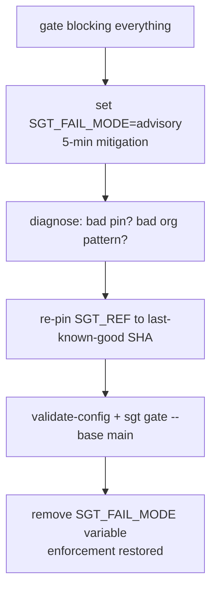

# Security Incident Runbook (OPS2) — "the gate is blocking everything"

What to do when the governance gate starts blocking merges across the fleet — a
bad toolkit pin, an over-broad org pattern, or a rule regression. Goal: unblock in
5 minutes, then fix durably.

## Detection signals

- Multiple unrelated MRs/PRs failing the `skill-gate:block` job at once.
- The block job fails on assets the author **did not touch** (the delta gate
  should only block on introduced findings — a flood implies a config/pin issue).
- A spike in identical findings right after an `SGT_REF` bump or an
  `audit-config.*.json` change.
- `validate-config` errors in the pipeline log (a malformed org pattern).

## 5-minute mitigation — fleet kill-switch

Set one CI/CD variable at the org or project level. **No template edit, no
CODEOWNERS approval, no per-finding suppression.**

```text
SGT_FAIL_MODE = advisory
```

Every pipeline that runs the engine immediately stops blocking:

```text
SGT_FAIL_MODE=advisory: not blocking despite findings at/above threshold.
```

The engine still audits and still publishes the report and MR comment — only the
exit code is forced to 0. This is the lever to pull first; it buys time to
diagnose without merges piling up.

## Durable fix — re-pin `SGT_REF`

The kill-switch is a stopgap, not a resolution. Restore enforcement by pinning the
toolkit back to a known-good revision:

1. Identify the last-known-good 40-char SHA (the pin that was green before the
   incident — check the gate workflow's git history).
2. Update `SGT_REF` in the gate workflow (`.gitlab-ci.yml` / `skill-gate.yml`),
   or regenerate it: `sgt ci-init --gitlab --ref <good-sha>` (or `--github`).
3. If the trigger was an org overlay, run `python3 scripts/agent_audit.py
   validate-config` against the config and fix the offending pattern.
4. Verify locally before re-enabling: `sgt gate --base main`.
5. Remove the `SGT_FAIL_MODE=advisory` variable to restore blocking.



## Who to page

| Role | Responsibility |
|---|---|
| **Gate / governance owner** (`CODEOWNERS` security group) | Owns `agent-audit-rules.json`, the engine, the CI template, and the suppression list; approves the durable fix |
| **CI/CD admin** | Can set the org-level `SGT_FAIL_MODE` variable and re-pin `SGT_REF` in the protected workflow |

Page the gate owner and the CI/CD admin together. The CI/CD admin can apply the
kill-switch immediately; the gate owner drives the re-pin and root-cause review.

## Related

- [security-suppression-runbook.md](security-suppression-runbook.md) — per-finding
  exceptions and the OPS5 break-glass (use for one bad finding, **not** a fleet
  outage).
- [security-rollout-guide.md](security-rollout-guide.md) — staged rollout and the
  `SGT_REF` adoption procedure.
