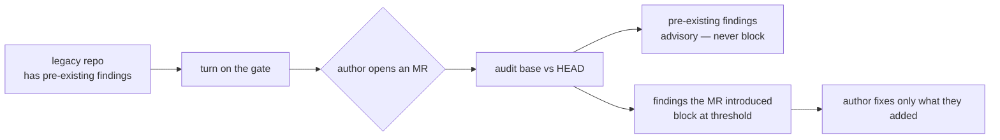

# Security Rollout Guide — enable over an existing library

How to turn on the asset-security suite (`SEC*` rules + delta gate) over a repo
that already has assets, without an avalanche of failures on day one.

## The finding-delta model — why it won't avalanche

The block gate uses `--fail-on-new`, not absolute `--fail-on`. It blocks **only**
on findings the merge request **introduced** versus its base ref. Every finding
that already existed before the MR is **advisory** — it surfaces in the report and
the MR comment, but it does not fail the pipeline.



The identity key for "introduced" is `(rule_id, file, message)` — it excludes the
line number, so a pre-existing finding that merely shifted when surrounding text
changed stays pre-existing. An author is accountable only for what they add.

This means you can flip the suite on against a legacy library and the **next** MR
only has to be clean about the lines it touches — the backlog of pre-existing
findings is paid down opportunistically, not all at once.

## Staged rollout

### Stage 1 — advisory for N weeks

Run the gate in non-blocking mode so the team sees findings without merges being
blocked. Two equivalent ways:

```bash
# Per-pipeline: never exit non-zero, just publish the report + MR comment
python3 scripts/agent_audit.py audit-project . --changed-only --base "$BASE" --fail-on none --format json

# Fleet-wide: a single CI variable forces advisory across every pipeline
#   set SGT_FAIL_MODE=advisory as an org/project CI variable
```

Watch the advisory MR comments for **2–4 weeks**. Confirm the false-positive rate
is acceptable and that authors know how to use the
[suppression runbook](security-suppression-runbook.md).

### Stage 2 — flip to enforce

Once the team is comfortable, switch the block job to the delta gate:

```bash
python3 scripts/agent_audit.py audit-project . --changed-only --base "$BASE" --fail-on-new high
```

This is exactly what `sgt gate` and the shipped CI templates run. New high-severity
findings now block; pre-existing ones remain advisory.

## Adopting new rules — re-pin `SGT_REF`

The CI templates pin the toolkit to an immutable 40-char commit SHA (`SGT_REF`),
not a tag, so gate behavior never changes under you. The asset-security suite ships
in **rules catalog 0.2.0**. To adopt it (or any future rules), bump the pin:

```bash
# Regenerate the gate workflow with the toolkit's current HEAD SHA pre-filled
sgt ci-init --gitlab    # or --github

# Or edit the SGT_REF value in your existing .gitlab-ci.yml / skill-gate.yml
```

Every audit report stamps `rules_version` so you can confirm which catalog a given
verdict ran against. Bump deliberately and review the [CHANGELOG](../CHANGELOG.md)
entry for the target SHA before adopting.

## Fast mitigation — the fleet kill-switch

If the gate misbehaves after a rollout (a bad pin, an over-broad org pattern),
the fastest mitigation is **not** to revert the template or touch CODEOWNERS — set
one CI variable:

```bash
# org or project CI/CD variable
SGT_FAIL_MODE=advisory
```

Every pipeline immediately stops blocking (exit 0 with a stderr notice) while
still publishing reports. Then fix the root cause — re-pin `SGT_REF` to the
last-known-good SHA — and remove the variable. Full procedure:
[security-incident-runbook.md](security-incident-runbook.md).
