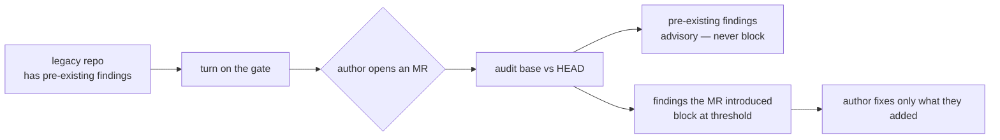

# Security Rollout Guide — enable over an existing library

How to turn on the asset-security suite (`SEC*` rules + delta gate) over a repo that already has assets, without an avalanche of failures on day one.

> Audience: platform-devops · Type: how-to · Prerequisite: complete [github-onboarding.md](github-onboarding.md) or [gitlab-onboarding.md](gitlab-onboarding.md) first.

## The finding-delta model — why it won't avalanche

The block gate uses `--fail-on-new`, not absolute `--fail-on`. It blocks **only**
on findings the merge request **introduced** versus its base ref. Every finding
that already existed before the MR is **advisory** — it surfaces in the report and
the MR comment, but it does not fail the pipeline.



The identity key for "introduced" is `(rule_id, file, message)` — it excludes the
line number, so a pre-existing finding that merely shifted when surrounding text
changed stays pre-existing. An author is accountable only for what they add.

This means you can flip the suite on against a legacy library and the **next** MR
only has to be clean about the lines it touches — the backlog of pre-existing
findings is paid down opportunistically, not all at once.

## Staged rollout

### Stage 1 — advisory for N weeks

Run the gate in non-blocking mode so the team sees findings without merges being
blocked. Two equivalent ways:

```bash
# Per-pipeline: never exit non-zero, just publish the report + MR comment
python3 scripts/agent_audit.py audit-project . --changed-only --base "$BASE" --fail-on none --format json

# Fleet-wide: a single CI variable forces advisory across every pipeline
#   set SGT_FAIL_MODE=advisory as an org/project CI variable
```

Watch the advisory MR comments for **2–4 weeks**. Confirm the false-positive rate
is acceptable and that authors know how to use the
[suppression runbook](security-suppression-runbook.md).

### Stage 2 — flip to enforce

Once the team is comfortable, switch the block job to the delta gate:

```bash
python3 scripts/agent_audit.py audit-project . --changed-only --base "$BASE" --fail-on-new high
```

This is exactly what `sgt gate` and the shipped CI templates run. New high-severity
findings now block; pre-existing ones remain advisory.

## Adopting new rules — re-pin `SGT_REF`

The CI templates pin the toolkit to an immutable 40-char commit SHA (`SGT_REF`),
never a tag — the rationale lives where the pin is set, in the onboarding setup
step ([GitLab](gitlab-onboarding.md#2-fill-in-two-variables-in-the-template-header)
· [GitHub](github-onboarding.md#2-fill-in-two-values-in-the-template-header)). The
asset-security suite ships in **rules catalog 0.4.0**. To adopt it (or any future
rules), bump the pin:

```bash
# Regenerate the gate workflow with the toolkit's current HEAD SHA pre-filled
sgt ci-init --gitlab    # or --github

# Or edit the SGT_REF value in your existing .gitlab-ci.yml / skill-gate.yml
```

Every audit report stamps `rules_version` so you can confirm which catalog a given
verdict ran against. Bump deliberately and review the [CHANGELOG](../CHANGELOG.md)
entry for the target SHA before adopting.

## Fleet rollout

Rolling a ruleset across many repositories at once needs two extra moves: measure
the blast radius **before** flipping the gate, and automate the `SGT_REF` bump so
each repo gets an auto-PR when the org publishes a new approved toolkit SHA.

### Impact preview before flipping a ruleset

Before you enable `--fail-on-new` (or raise a rule to the floor) across a fleet,
measure how many findings each repo already carries. The `--whole-tree` mode runs
a **full** audit (ignoring `--changed-only`), emits a per-rule histogram under
`summary.by_rule`, and **never blocks** (always exits 0) — so it is safe to run in
a read-only reporting job:

```bash
python3 scripts/agent_audit.py audit-project . --whole-tree --format json
```

Look at `summary.by_rule` — the per-rule histogram of every finding in the tree:

```json
{
  "summary": {
    "total": 37,
    "by_rule": { "SEC003": 21, "SEC012": 9, "REF004": 5, "SEC011": 2 }
  }
}
```

This is the blast radius. A high `SEC011`/`SEC010` count (floor rules) means the
delta gate will block the **next** MR that touches those assets — pay that backlog
down, or stage centrally-approved suppressions, before enabling `--fail-on-new`.
Advisory-only rules (`SEC003`, `REF004`) never block, so a large count there is
backlog to triage, not a rollout blocker. Add `--record` to append one JSON line
per finding to `out/security/findings.jsonl`, then `report-trends` to summarize
across runs.

### Renovate auto-bump of `SGT_REF`

The CI templates pin the toolkit to an immutable 40-hex commit SHA (`SGT_REF`). To
roll a newly-approved org SHA across every repo without hand-editing each pipeline,
let [Renovate](https://docs.renovatebot.com/) track the pin and open an auto-PR.
Add a `customManagers` (formerly `regexManagers`) entry to each repo's
`renovate.json`:

```json
{
  "customManagers": [
    {
      "customType": "regex",
      "fileMatch": ["^\\.gitlab-ci\\.yml$", "^\\.github/workflows/skill-gate\\.yml$"],
      "matchStrings": ["SGT_REF:\\s*\"(?<currentDigest>[0-9a-f]{40})\""],
      "depNameTemplate": "skill-governance-toolkit",
      "packageNameTemplate": "https://github.com/your-org/skill-governance-toolkit",
      "datasourceTemplate": "git-refs",
      "currentValueTemplate": "main"
    }
  ]
}
```

Renovate watches `main` of the toolkit repo and opens a PR bumping `SGT_REF` to the
new 40-hex `currentDigest` whenever the tracked ref advances. The `git-refs`
datasource resolves the branch to its commit SHA, so the PR carries an immutable
pin — never a moving tag.

The `fileMatch` entries cover the two consumer gate files as the onboarding docs
install them: `.gitlab-ci.yml` (GitLab MR gate) and
`.github/workflows/skill-gate.yml` (the GitHub workflow `sgt ci-init --github`
writes from `references/ci/github-pr.yml`). If your repo placed the workflow under
a different name, adjust the pattern accordingly.

**Private GitLab hosting:** when the toolkit mirror lives on an internal GitLab
instance, point `packageNameTemplate` at that host instead of github.com —
`"https://gitlab.example.com/your-group/skill-governance-toolkit"`. The `git-refs`
datasource works over any reachable git remote; for a private mirror give the
Renovate runner (e.g. the self-hosted Renovate-on-GitLab app) a `hostRules` entry
with a read-only token for that host.

**Manual approval is still required.** The Renovate PR only *proposes* the new pin;
it does not bypass review. The CI template files (`.gitlab-ci.yml` / the gate
workflow) are covered by [`CODEOWNERS`](../CODEOWNERS), so the governance owner
group must approve the bump before it merges — the same control-plane gate that
stops the gate from weakening itself. Pair the Renovate bump with an
[impact preview](#impact-preview-before-flipping-a-ruleset) on the target SHA, and
review the [CHANGELOG](../CHANGELOG.md) entry (severity escalations / floor
additions are marked **🔴 BREAKING**) before approving.

### Where config overlays live (not the audited repo)

Config overlays (`audit-config.*.json`) load from the **toolkit catalog directory**
— the directory holding `agent-audit-rules.json`, resolvable via
`AGENT_GOVERNANCE_RULES_PATH`. In CI the gate runs from the SHA-pinned toolkit
mirror (`$SGT_DIR`), so overlays are governed there, not in the consumer repo: an
overlay placed in the audited tree never loads. This is intentional — an overlay in
the audited tree would let a merge request self-weaken its own gate. Only the
suppression list (`references/audit-ignore.json`) loads from the audited consumer
root (so authors can request suppressions), and it is gated by
[`CODEOWNERS`](../CODEOWNERS). The `sgt ci-init` CODEOWNERS stub therefore gates
only `audit-ignore.json` + the CI gate file in the consumer repo, not the catalog
or overlays.

## Fast mitigation — the fleet kill-switch

If the gate misbehaves after a rollout (a bad pin, an over-broad org pattern), the
fastest mitigation is the CI/CD variable `SGT_FAIL_MODE=advisory` — every pipeline
stops blocking while still publishing reports. Detection signals, the full
procedure, and the durable re-pin fix: [security-incident-runbook.md](security-incident-runbook.md).

## See also

- [security-incident-runbook.md](security-incident-runbook.md) — go here when the gate blocks merges fleet-wide.
- [security-suppression-runbook.md](security-suppression-runbook.md) — go here for per-finding exceptions (inline vs central, SLA, break-glass).
- [gitlab-onboarding.md](gitlab-onboarding.md) / [github-onboarding.md](github-onboarding.md) — go here to wire the gate before rolling it out.
- [cli-reference.md](cli-reference.md) — go here for `--fail-on-new`, `--whole-tree`, and exit-code semantics.
- [checks-reference.md](checks-reference.md) — go here for what each `SEC*` rule detects.
