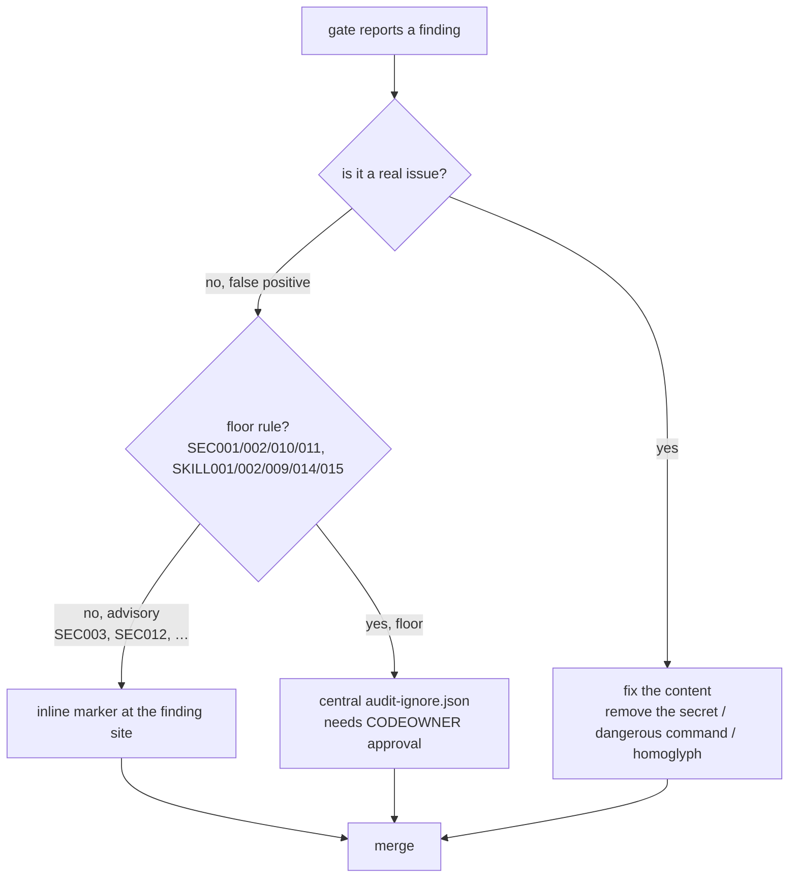

# Security Suppression Runbook — "I got a false positive"

Author-facing runbook for handling a security finding from the governance gate.
Read the [checks reference](checks-reference.md) for what each rule detects; read
[gate-for-authors.md](gate-for-authors.md) for the one-page overview.

## Decision tree



**Default to fixing the content.** Suppression is for genuine false positives and
sanctioned exceptions — not for silencing a real finding under deadline pressure.

## Mechanism 1 — inline marker (advisory rules only)

For an advisory finding (`SEC003`, `SEC012`, or any non-floor rule), add a marker
on the offending line or the line directly above it. The `reason=` is required by
convention so reviewers understand the exception.

```text
brand: pаypal  <!-- sgt-ignore: SEC003 reason=quoting a known typosquat in a phishing-awareness example -->
```

An inline marker targeting a **floor** rule (e.g. `SEC011`) does **not** suppress
it — the marker lives in the same file an attacker could edit, so the engine
ignores it and emits a visible `IGNORE003` record instead. Use Mechanism 2 for
floor findings.

## Mechanism 2 — central file (any rule, CODEOWNER-gated)

For a floor finding, or any finding you want tracked centrally, add an entry to
`references/audit-ignore.json`. This file is owned by the security group in
`CODEOWNERS`, so the suppression requires a separate approver — an author cannot
self-approve silencing their own finding.

```json
{
  "version": "1.0",
  "ignores": [
    {
      "rule_id": "SEC011",
      "path": "config/example.mcp.json",
      "reason": "documented placeholder token in an onboarding sample, not a live credential",
      "expires": "2026-09-01"
    }
  ]
}
```

| Field | Required | Notes |
|---|---|---|
| `rule_id` | yes | The rule to suppress |
| `path` | yes | Repo-relative path of the asset |
| `reason` | yes | Non-empty rationale; without it the entry is ignored → `IGNORE002` |
| `expires` | recommended | `YYYY-MM-DD`; a past/malformed date stops suppressing → `IGNORE001` |
| `line` | optional | Restrict to one line; omit to suppress the rule for the whole file |

**`expires` is strongly recommended on floor suppressions** so a bypass
self-expires instead of becoming a permanent hole. Once the date passes, the
finding returns and `IGNORE001` flags the stale entry.

## OPS5 — SLA, approval, and break-glass

| Item | Policy |
|---|---|
| **Who approves central suppressions** | The `CODEOWNERS` security-owner group on `references/audit-ignore.json`. Branch protection must require code-owner review for the gate to be enforced. |
| **Target turnaround** | Review a suppression request within **1 business day**. A blocked author should not wait longer; if the SLA is at risk, use break-glass below. |
| **Break-glass** | A security owner may add a **short-`expires`** central entry (≤ 7 days) to unblock an urgent merge, with `reason=BREAK-GLASS: <ticket>`. The short expiry forces the entry back through normal review when it lapses. |
| **Fleet-wide bypass** | For "the gate is blocking everything," do **not** suppress per-finding — set `SGT_FAIL_MODE=advisory` (see [security-incident-runbook.md](security-incident-runbook.md)). |

### Break-glass example

```json
{
  "rule_id": "SEC010",
  "path": "agents/deploy.md",
  "reason": "BREAK-GLASS: INC-4821 — confirmed false positive, full review tracked in INC-4821",
  "expires": "2026-06-16"
}
```

State the ticket in `reason`. When `expires` lapses, `IGNORE001` re-surfaces the
finding so the exception cannot quietly become permanent.

## Expiry enforcement — what blocks which MR

The CI gate splits suppression-expiry enforcement so a feature MR is never blocked
on someone else's soon-to-expire entry:

| Condition | Scope | Rationale |
|---|---|---|
| A suppression is **already expired** (`expires` < today, or malformed date) | Blocks **every** governed MR | The floor finding it silenced has resurfaced and the gate is OFF for that rule/path right now — any merge inherits the hole. Renew or remove it. |
| A suppression **expires within 30 days** | Blocks **only an MR that edits `references/audit-ignore.json`** | The author touching suppressions is the right owner to renew them. Unrelated MRs are not gated on a third party's future expiry. |
| Proactive fleet-wide expiry sweep | A **scheduled** pipeline running `list-suppressions --root . --expiring-within 30` | Catches drift before entries lapse, without adding per-MR friction. Add a `schedule:` trigger (GitLab) / `on: schedule` workflow (GitHub) running the same command. |

This is deliberate fleet hygiene policy, not a missing check: expired = broken now
(block everyone), expiring-soon = owner's job (block the suppression author) or a
scheduled sweep.

## Verify a suppression locally

```bash
# Reproduce the exact CI verdict after editing audit-ignore.json
sgt gate --base main

# Confirm the central file is CODEOWNERS-gated
sgt gate --check-setup
```
