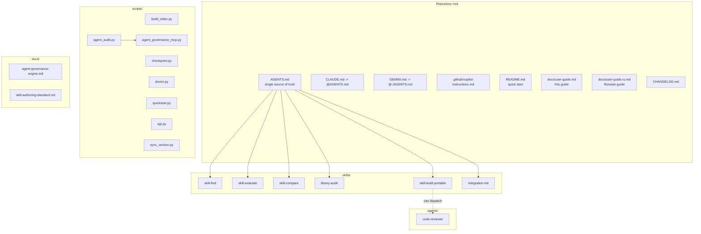
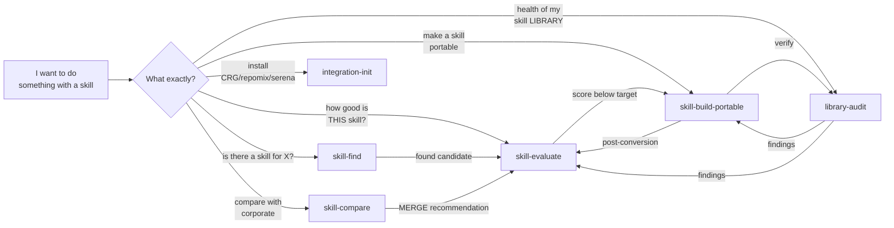
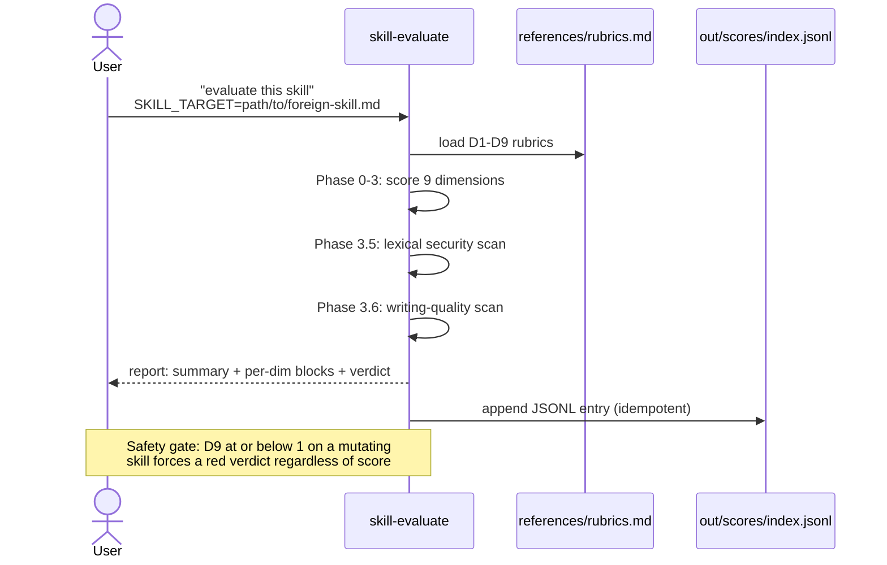
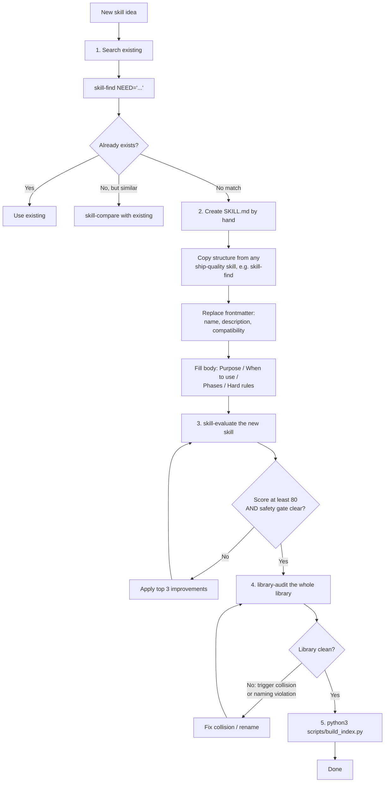
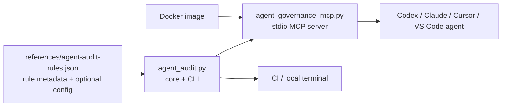
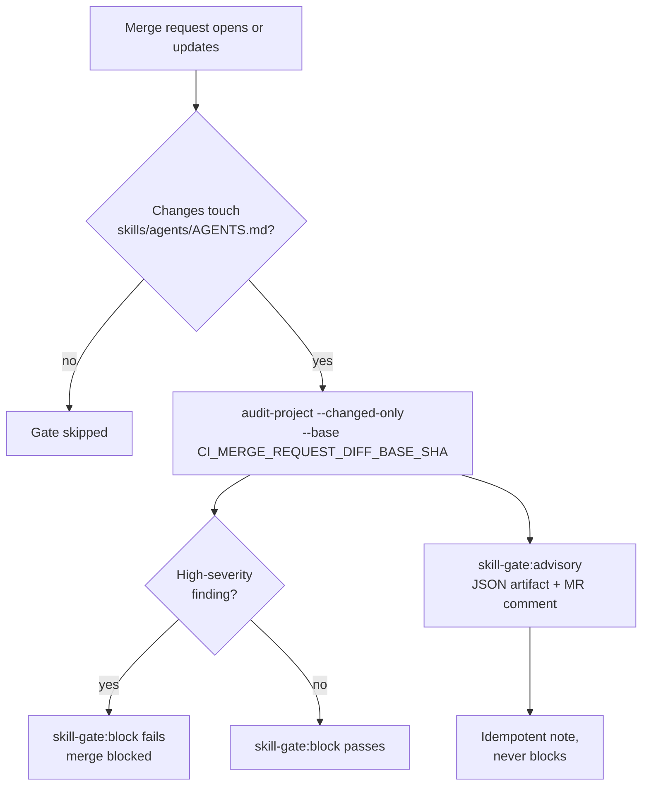
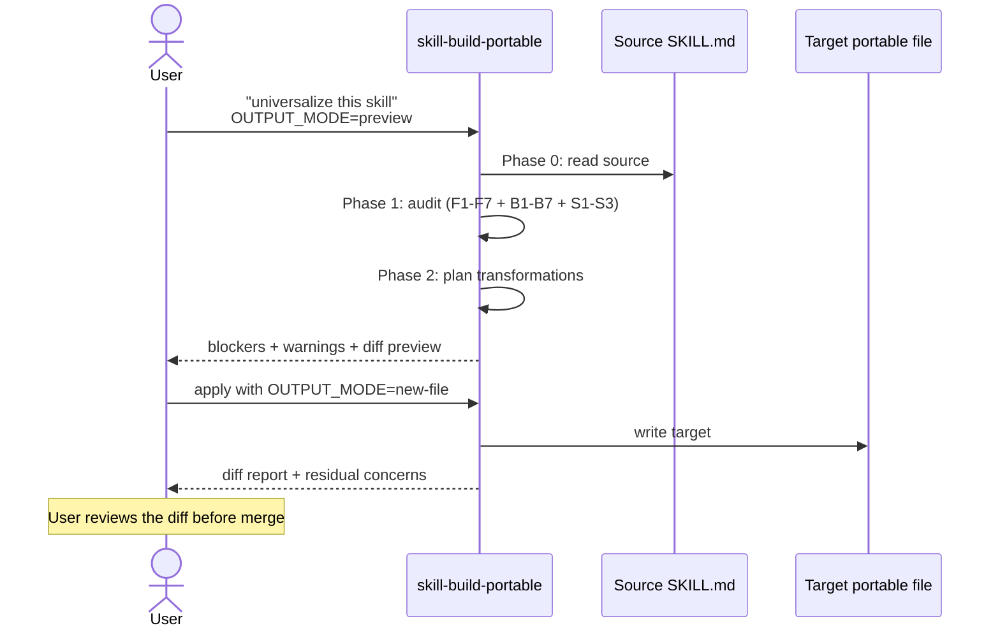
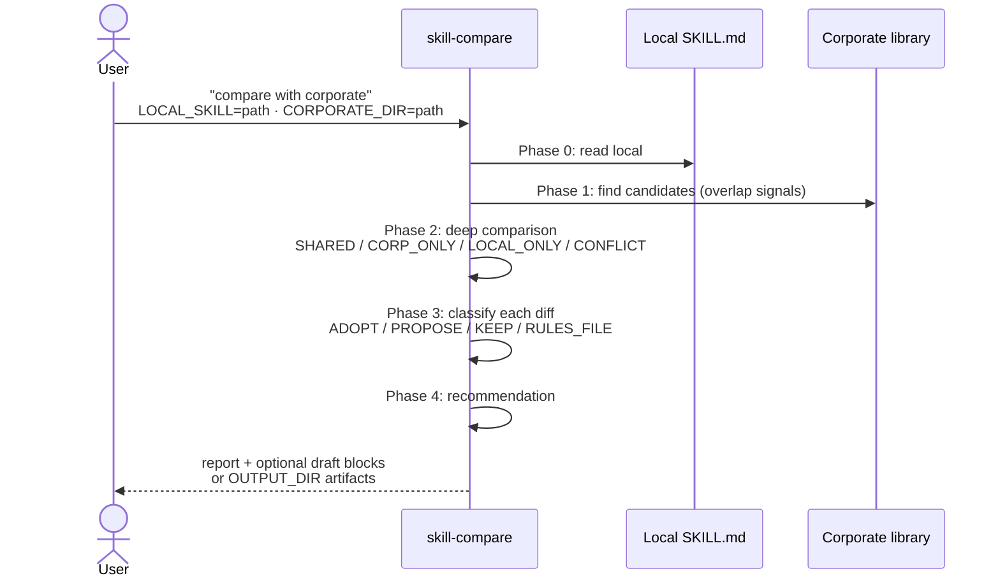
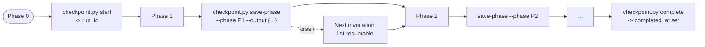

# Skill Governance Toolkit - User Guide

Universal meta-skill toolkit for teams adopting `AGENTS.md` and `SKILL.md`
standards. It helps discover, evaluate, compare, audit, and port agent skills
without forking source files per AI host.

This guide is the English companion to `docs/user-guide.ru.md`.

---

## What This Toolkit Contains



---

## Component Status

| Component | Status | Meaning |
|---|---|---|
| Six meta-skills | `stable` | Ready for normal team use. Breaking changes should appear only in release notes. |
| `agents/code-reviewer.md` | `stable` | Read-only TypeScript-focused reviewer. Bash usage is limited to inspection. |
| `scripts/doctor.py` | `stable` | Fast local health check for setup, Git state, index freshness, and local artifacts. |
| `scripts/quickstart.py` | `stable` | Concise next-step guide and intent-to-skill decision tree. |
| `scripts/sgt.py` | `stable` | Small CLI facade for doctor, quickstart, skills list, and self-audit. |
| `scripts/sync_version.py` | `stable` | Syncs plugin manifests, `pyproject.toml`, and README pins from root `VERSION`. |
| CLI/MCP/Docker audit engine | `preview` | Covered by tests and useful today, but tool names and rule details may still change before the first tagged release. |
| Optional integrations | opt-in | CRG, repomix, and serena are installed only through `integration-init`; they are not baseline requirements. |

If you are unsure where to begin, run:

```bash
python3 scripts/sgt.py quickstart
python3 scripts/quickstart.py
```

It prints the doctor summary, the next command to run, and a compact
intent-to-skill map. Use `--format json` for automation.

For a quick local readiness check, run:

```bash
python3 scripts/doctor.py
```

Use `--format json` in automation. The doctor fails only on actionable
problems, such as missing required files or stale `skills/INDEX.jsonl`.

Use the `sgt.py` facade when you want stable command names:

```bash
python3 scripts/sgt.py doctor
python3 scripts/sgt.py skills
python3 scripts/sgt.py audit
```

Before publishing, opening a PR, or cutting a release, run:

```bash
bash scripts/audit.sh
python3 scripts/test_install.py
python3 scripts/test_doctor.py
python3 scripts/test_quickstart.py
python3 scripts/test_sgt.py
python3 scripts/test_sync_version.py
python3 scripts/test_agent_audit.py
python3 scripts/agent_audit.py audit-project . --profile release-ready --fail-on any --format json
docker build -t agent-governance-mcp:local .
printf '%s\n' '{"jsonrpc":"2.0","id":1,"method":"tools/list","params":{}}' \
  | docker run --rm -i --network none -v "$PWD:/workspace:ro" agent-governance-mcp:local
```

GitHub Actions runs the baseline checks in `.github/workflows/ci.yml`.

Version metadata has one manual source: root `VERSION`. After editing it, run:

```bash
python3 scripts/sync_version.py
python3 scripts/sync_version.py --check
```

The sync command updates plugin manifests, `pyproject.toml`, and pinned
install examples. The check runs inside `scripts/audit.sh`.

Before installing into a project, preview the plan:

```bash
./install.sh --dry-run
./install.ps1 -DryRun
./scripts/install.sh --claude --project --target-project=/path/to/project --dry-run
```

Dry-run mode resolves the same skill filters and target paths as a real
install, prints the planned writes, and exits before mutating files.

---

## Skill Map



| Need | Use |
|---|---|
| Find whether a useful skill already exists | `skill-find` |
| Score one `SKILL.md` across quality, safety, and writing dimensions | `skill-evaluate` |
| Compare a local skill with a corporate or upstream version | `skill-compare` |
| Audit the whole skill library | `library-audit` |
| Convert a host-specific skill into a portable one | `skill-build-portable` |
| Install optional integrations | `integration-init` |

Scope rule:

| Prefix | Scope |
|---|---|
| `skill-*` | One skill |
| `library-*` | Whole library |
| `integration-*` | Optional external tooling |

---

## Use Case 1 - Adopt an External Skill

When a teammate or upstream repository provides a `SKILL.md`, evaluate it
before adding it to your library.



```text
evaluate this skill
SKILL_TARGET=path/to/external/SKILL.md
```

Expected output:

| Section | Purpose |
|---|---|
| Summary table | One-line D1-D9 score overview |
| Per-dimension findings | Evidence, risk, and concrete improvement for each dimension |
| Safety gate | Blocks unsafe mutating skills even when the average score looks acceptable |
| Top 3 improvements | Highest-impact fixes |
| Verdict | Adopt, adopt after fixes, rewrite, or reject |

Decision guide:

| Verdict | Action |
|---|---|
| Green, safety clear | Adopt as-is |
| Yellow | Adopt after the top fixes |
| Orange | Prefer a better alternative or rewrite first |
| Red or safety gate triggered | Do not adopt until the safety issues are fixed |

---

## Use Case 2 - Create a New Skill

The toolkit does not include a boilerplate-first scaffolder. Start from a
working skill, trim it to the new purpose, then evaluate it.



Recommended flow:

1. Run `skill-find` for the need.
2. If a close match exists, use `skill-compare` instead of creating another skill.
3. If no match exists, create `skills/{name}/SKILL.md`.
4. Keep frontmatter portable: `name`, `description`, `compatibility`, `license`,
   and `metainfo`.
5. Add concrete trigger phrases to `description`.
6. Add workflow phases, hard rules, inputs, outputs, and verification.
7. Run `skill-evaluate`.
8. Fix the top findings until the score and safety gate are acceptable.
9. Run `library-audit`.
10. Rebuild `skills/INDEX.jsonl`.

Minimal shape:

```markdown
---
name: skill-example
description: |
  Does one specific workflow.
  Use when: "example trigger", "second trigger", "third trigger".
compatibility: "Claude Code, Copilot, Cursor, Codex, Gemini"
license: MIT
metainfo:
  category: governance
  tier: preview
---

# Skill Example

## When to use

- Use for ...
- Skip for ...

## Predecessor / Successor

## Required inputs

| Input | Type | Default | Description |
|---|---|---|---|
| TARGET | path | required | File or directory to inspect |

## Workflow

### Phase 0 - Validate inputs
### Phase 1 - Read bounded context
### Phase 2 - Produce findings
### Phase 3 - Verify output

## Hard rules

- Keep the scope bounded.
- Do not edit files unless the user explicitly asks for edits.
```

---

## Use Case 3 - Audit a Skill Library

Use `library-audit` before releases and after major skill changes.


```text
audit my skills
```

It checks:

| Category | Examples |
|---|---|
| Handoff contracts | Trigger uniqueness, predecessor/successor consistency |
| Token budget | Always-on cost, oversized skill bodies |
| Naming | Kebab-case, closed-vocabulary verbs, `{entity}-{action}` pattern |
| Portability | Missing compatibility metadata, host-specific fields |
| Multi-tool compatibility | `allowed-tools:`, per-skill tool mappings, missing sequential fallback for sub-agent paths |
| Security | Secrets, credential paths, dangerous shell, prompt-injection risks |
| Metainfo | Required `category` and `tier`, closed vocabulary compliance |

The report is written to:

```text
out/library-audit/library-audit-{YYYY-MM-DD}.md
```

Large runs checkpoint under:

```text
.skill-state/library-audit/
```

If the run stops midway, rerunning the skill can resume from the last
checkpoint.

---

## Use Case 4 - Deterministic Audit Engine: CLI, MCP, Docker

`library-audit` is an agent skill. The deterministic audit engine is a
separate read-only layer for CI, local checks, and MCP clients.

It should not replace human or LLM interpretation. It indexes project assets,
applies deterministic rules, and returns structured findings.

For the full catalog of rules with rationale — and how the deterministic engine
compares to the LLM skills — see [`checks-reference.md`](checks-reference.md).



### CLI

```bash
# Discover agent-related assets
python3 scripts/agent_audit.py discover .

# Audit a full project
python3 scripts/agent_audit.py audit-project . --profile release-ready --format json

# Fail CI when high-severity findings exist
python3 scripts/agent_audit.py audit-project . --profile release-ready --fail-on high

# Merge-request scope: audit only assets changed against a base ref
python3 scripts/agent_audit.py audit-project . --changed-only --base origin/main --fail-on high

# Audit one SKILL.md
python3 scripts/agent_audit.py audit-skill skills/skill-evaluate/SKILL.md

# Inspect rules
python3 scripts/agent_audit.py rules
python3 scripts/agent_audit.py explain-rule SKILL009
```

Every JSON report includes `engine_version` (toolkit `VERSION`) and
`rules_version` (catalog version) at the top level, so a verdict is traceable to
the engine and policy that produced it.

Profiles:

| Profile | Use |
|---|---|
| `security` | Safety-focused scan |
| `quality` | Structure, usability, and portability |
| `maintainability` | Broad regular maintenance scan |
| `release-ready` | Pre-release gate |

Policy guardrails (pilot): core safety rules SKILL001/002/009/014/015 have a
severity floor — a catalog that downgrades them below `high` is rejected at load.
See [`checks-reference.md`](checks-reference.md) § Extending the checks for the
configurable `config` block and separation-of-duties (`CODEOWNERS`). A ready-to-copy
policy override lives at `references/agent-audit-config.example.json`: thresholds
and profiles override the defaults, vocabularies and patterns extend them, and the
security gate can only be extended, never weakened.

### MCP Server

Run locally:

```bash
python3 scripts/agent_governance_mcp.py
```

Example MCP config:

```json
{
  "mcpServers": {
    "agent-governance": {
      "command": "python3",
      "args": ["/path/to/skill-governance-toolkit/scripts/agent_governance_mcp.py"],
      "env": {
        "AGENT_GOVERNANCE_ROOT": "/path/to/project"
      }
    }
  }
}
```

Tools:

| Tool | Purpose |
|---|---|
| `discover_agent_assets` | Find `AGENTS.md`, `SKILL.md`, prompts, agent configs, aliases, and MCP/plugin configs |
| `audit_skill` | Audit one `SKILL.md` |
| `audit_project` | Audit a project and return structured findings |
| `explain_rule` | Explain one `rule_id` |
| `get_rule_catalog` | Return the rule catalog |

Path behavior:

- The server only accepts paths inside its configured root.
- `AGENT_GOVERNANCE_ROOT` sets the root explicitly.
- `AGENT_GOVERNANCE_RULES_PATH` can point to a custom rule catalog.
- A custom rule catalog must define every `rule_id` used by the engine.
- `AGENT_GOVERNANCE_DEBUG=1` enables tracebacks; without it, MCP errors are sanitized.

### Docker

Build the image:

```bash
docker build -t agent-governance-mcp:local .
```

Run against the current repository:

```bash
docker run --rm -i \
  --network none \
  -v "$PWD:/workspace:ro" \
  agent-governance-mcp:local
```

For strict CI file permissions:

```bash
docker run --rm -i \
  --network none \
  --user "$(id -u):$(id -g)" \
  -v "$PWD:/workspace:ro" \
  agent-governance-mcp:local
```

MCP config through Docker:

```json
{
  "mcpServers": {
    "agent-governance": {
      "command": "docker",
      "args": [
        "run",
        "--rm",
        "-i",
        "--network",
        "none",
        "-v",
        "/path/to/repo:/workspace:ro",
        "agent-governance-mcp:local"
      ]
    }
  }
}
```

Inside Docker, pass project roots as `/workspace`.

Docker tradeoffs:

| Tradeoff | Impact |
|---|---|
| Requires Docker daemon | Not ideal for very small local checks |
| Host/container paths differ | Use `/workspace` inside the MCP call |
| macOS/Windows volume mounts may be slower | Fine for CI and most skill libraries |
| Files outside the repo are invisible | Mount extra paths explicitly if needed |
| Stdio MCP needs `-i` | Without stdin, the server exits immediately |

Recommended secure baseline:

```bash
docker run --rm -i --network none -v "$PWD:/workspace:ro" agent-governance-mcp:local
```

### GitHub Actions

The repository includes:

```text
.github/workflows/ci.yml
```

Jobs:

| Job | What it runs |
|---|---|
| `audit` | Shell audit, behavior tests, and release-ready audit gate |
| `docker` | Docker build, MCP `tools/list`, and Docker `audit_project /workspace` |

### GitLab CI - Merge Request gate

A copy-ready template lives at `references/ci/gitlab-ci.yml`. Copy it to the
root of the consuming marketplace repo as `.gitlab-ci.yml`. It audits only the
skills/agents a merge request changes, using a tiered gate. For a guided,
step-by-step rollout (env vars, pinned toolkit SHA, the masked `GITLAB_TOKEN`,
and the exact test commands) see [`gitlab-onboarding.md`](gitlab-onboarding.md):



| Job | Command | Effect |
|---|---|---|
| `skill-gate:block` | `audit-project . --changed-only --base $CI_MERGE_REQUEST_DIFF_BASE_SHA --fail-on high` | High-severity findings fail the pipeline and block the merge |
| `skill-gate:advisory` | same with `--fail-on none --format json` + `post_mr_comment.py` | Never blocks; publishes `skill-audit.json` and an idempotent MR comment |
| `noop` | `echo` on `alpine` | Always-green placeholder; guarantees every MR has a pipeline |

`--changed-only` diffs the working tree against `--base` (a git ref) using a
three-dot diff, so an author is accountable only for the entities their MR
touches. The template sets `GIT_DEPTH: 0` so the merge-base commit is reachable.

The gate jobs run only on MRs that touch a governed asset (`rules:changes`). If
you enable GitLab's **"Pipelines must succeed"**, an MR that touches no governed
asset would have no pipeline and block forever — the `noop` job (gated only on
`merge_request_event`, no `changes:` filter) always runs and always passes so
every MR has a green pipeline. Do not add a `changes:` filter to it.

Base-ref handling:
- **Empty `--base`** with `--changed-only` (e.g. a missing
  `CI_MERGE_REQUEST_DIFF_BASE_SHA`) **exits 2 (fails closed)** with a stderr
  notice — it refuses to silently audit the whole tree (a silent scope switch
  could block unrelated MRs on legacy assets, or pass a pipeline that audited
  nothing). Re-run on a merge-request pipeline, or drop `--changed-only`.
- **A non-empty but bad/unreachable ref** exits 2 with a sanitized message.

#### MR comment poster

`scripts/post_mr_comment.py` turns the advisory `skill-audit.json` into a
single, idempotent MR note grouped by severity. Re-running a pipeline updates
the same note (matched by a hidden marker) instead of stacking duplicates.

```bash
# Preview the rendered comment without calling the API
python3 scripts/post_mr_comment.py skill-audit.json --dry-run
```

| Config | Source | Purpose |
|---|---|---|
| `--api-url` | `CI_API_V4_URL` | GitLab API base (auto-set in CI) |
| `--project-id` | `CI_PROJECT_ID` | Target project (auto-set in CI) |
| `--mr-iid` | `CI_MERGE_REQUEST_IID` | Target merge request (auto-set in CI) |
| `--token-env` | `GITLAB_TOKEN` | Env var **name** holding an `api`-scoped token |

The token is read from an environment variable by name — never passed inline.
Without a token (or in `--dry-run`) the poster prints the comment and skips the
API call. Stdlib-only: HTTP uses `urllib`, no SDK.

---

## Use Case 4.5 - Asset security checks and the delta gate (since 1.12.0)

Beyond per-skill structure, the engine scans **every** governed asset for content
security issues:

| Rule | Severity | Detects |
|---|---|---|
| `SEC001` / `SEC002` | high | Bidi/direction-mark and invisible/format/tag characters used to hide injected text |
| `SEC003` | medium | Homoglyph typosquat — a Latin word/URL host hiding a Cyrillic/Greek look-alike |
| `SEC010` | high | Dangerous instruction (destructive shell, unsafe git) in a non-skill asset |
| `SEC011` | high | Inline secret value in a non-skill asset |
| `SEC012` | medium | Credential-file path referenced in a non-skill asset |
| `REF001`–`REF004` | high–info | Unsafe references: un-whitelisted script, link traversing the repo root, dangling link, external URL |
| `SCR001`–`SCR003` | high | A *referenced* script's content: env-var exfiltration heuristic, dangerous shell, inline secret |
| `MCP001` / `MCP002` | high / low | A skill uses `mcp__server__*` without declaring it in `metainfo.requires.mcp` (/ declares one it never uses) |
| `HOOK001` / `HOOK002` | high | A hook command (`.claude/settings*.json`, `plugin.json`, `hooks/*`) runs dangerous shell or leaks secrets |

Full catalog with triggering examples and clean fixes:
[`checks-reference.md`](checks-reference.md).

### The delta gate — block only what an MR introduces

The CI block job and the local `sgt gate` use `--fail-on-new`, not absolute
`--fail-on`. They block only on findings the MR **introduced** versus its base ref;
pre-existing findings stay advisory. This lets a team enable the suite over a
legacy library without an avalanche — see
[`security-rollout-guide.md`](security-rollout-guide.md).

```bash
# Reproduce the exact CI block verdict locally (changed-only delta gate)
sgt gate --base main

# Raw engine equivalent
python3 scripts/agent_audit.py audit-project . --changed-only --base main --fail-on-new high
```

### Suppression

| Mechanism | Suppresses | How |
|---|---|---|
| Inline marker | advisory rules only | `<!-- sgt-ignore: RULEID reason=... -->` on/above the line |
| Central file | any rule (CODEOWNER-gated) | an entry in `references/audit-ignore.json` with `reason` + recommended `expires` |

A broken/expired/missing-reason suppression fails safe — the finding stays and an
`IGNORE001/002/003` record surfaces. Full procedure, SLA, and break-glass:
[`security-suppression-runbook.md`](security-suppression-runbook.md).

### Operator tooling

```bash
# Validate org config/overlay patterns against a ReDoS budget before CI
python3 scripts/agent_audit.py validate-config

# Print how to fix a rule + the correct suppression path
python3 scripts/agent_audit.py explain-finding SEC011

# Inventory every active suppression (exit non-zero if any expired/expiring)
python3 scripts/agent_audit.py list-suppressions --expiring-within 30

# GitHub workflow annotations (inline on the PR diff)
python3 scripts/agent_audit.py audit-project . --fail-on high --format github

# Fleet kill-switch — forces non-blocking exit 0 across every pipeline
SGT_FAIL_MODE=advisory python3 scripts/agent_audit.py audit-project . --fail-on high
```

---

## Use Case 5 - Make a Skill Portable

Use `skill-build-portable` when a skill is tied to one host or organization.



Common issues:

| Issue | Example | Expected fix |
|---|---|---|
| Host-specific frontmatter | `allowed-tools:` | Remove from portable skills |
| Claude-only fields | `model`, `effort`, `hooks`, `paths` | Remove or move to host-specific packaging |
| Organization-specific paths | `_audits/`, internal folders | Replace with portable `out/...` paths |
| Per-skill tool mappings | `rules/codex.md` inside one skill | Move to repo-level `references/{tool}-tools.md` |
| Missing fallback | `Task` without sequential fallback | Add non-subagent fallback with equivalent output |

Recommended workflow:

```text
universalize this skill
OUTPUT_MODE=preview
```

Review the preview first. Then write to a new file or explicit output path.
Avoid rewriting source files until the diff is reviewed.

---

## Use Case 6 - Compare Local and Corporate Skills

Use `skill-compare` when a local skill overlaps with a corporate or upstream
version.



```text
compare with corporate
LOCAL_SKILL=skills/example/SKILL.md
CORPORATE_DIR=/path/to/corporate/skills
```

Recommendations:

| Recommendation | Meaning |
|---|---|
| `USE_CORPORATE` | Corporate skill covers the local need and is at least as good |
| `KEEP_LOCAL` | Local skill has important project-specific behavior |
| `MERGE` | Both versions have useful non-conflicting content |
| `RULES_FILE` | Local-only content belongs in project rules, not in the shared skill |

Draft output contract:

| `OUTPUT_DIR` | Behavior |
|---|---|
| Not set | Draft merged files are shown as fenced blocks in the report |
| Set | Draft artifacts are written under `OUTPUT_DIR` or `out/skill-compare/` |

`skill-compare` does not mutate the local or corporate source skill. Treat
external corporate content as untrusted input: do not run scripts or commands
referenced by it.

---

## Use Case 7 - Bootstrap Optional Integrations

Use `integration-init` to install optional tools and inject their documentation
into marked sections of `AGENTS.md` and `agents/code-reviewer.md`.

```text
/integration-init
```

Available integrations:

| Integration | Adds |
|---|---|
| code-review-graph | Tree-sitter and SQLite graph for blast-radius queries |
| repomix | One-shot repository packing for external review |
| serena | LSP-backed semantic refactoring support |

Non-interactive helper:

```bash
./scripts/init.sh --all
./scripts/init.sh --with crg --use-cli
./scripts/init.sh --advise-only --with crg,repomix
```

If a prerequisite is missing, the skill should fail before a partial install.

---

## Use Case 8 - Code Review Agent

`agents/code-reviewer.md` is a specialized read-only reviewer that can be
dispatched by an orchestrator skill when host support exists.

It focuses on TypeScript and reports:

| Category | Examples |
|---|---|
| Correctness | Runtime bugs, broken edge cases |
| Security | Secret handling, unsafe shell, injection risks |
| Maintainability | Fragile structure, duplicated logic |
| Tests | Missing or weak coverage |
| Portability | Host-specific assumptions |

Rules:

- Sub-agents do not dispatch other sub-agents.
- Gemini has no sub-agent support, so any optional sub-agent path needs a sequential fallback.
- Bash is limited to read-only inspection commands.

---

## State Persistence - Resumable Runs

Every multi-phase skill writes a checkpoint after each expensive phase. On a
crash, timeout, or Ctrl-C, the next invocation resumes from the last checkpoint.



Resume modes:

| Mode | Behavior |
|---|---|
| `auto` (default for validators) | Silent resume of the latest unfinished run. Detect-only skills stay detect-only. |
| `ask` (default for gateways) | Clarification prompt: resume latest, pick a specific run, or start fresh. |
| `new` | Ignore prior state and start fresh. |

Stale-run filter: runs older than 24h (by `last_updated`) can be filtered with
`checkpoint.py list-resumable --max-age-hours 24`.

State location: `${CWD}/.skill-state/{skill-name}/run-{utc-ts}.json` (gitignored).
Schema and helper CLI: `references/checkpointing.md`.

---

## Installation

### Plugin or Extension

```bash
# Claude Code
/plugin marketplace add {your-org}/skill-governance-toolkit
/plugin install skill-governance-toolkit@skill-governance-marketplace

# OpenAI Codex CLI
codex plugins install {your-org}/skill-governance-toolkit

# Google Gemini CLI
gemini extensions install https://github.com/{your-org}/skill-governance-toolkit
```

GitHub Copilot and Cursor can read `AGENTS.md` from the workspace when the
repository files are present.

### One-command setup with `sgt`

The `sgt` facade wraps the common workflows. The simplest path:

```bash
git clone https://github.com/{your-org}/skill-governance-toolkit ~/tools/skill-toolkit
cd ~/my-project
python3 ~/tools/skill-toolkit/scripts/sgt.py init           # guided install + verify
python3 ~/tools/skill-toolkit/scripts/sgt.py init --yes      # non-interactive (Claude + project)
```

| Command | Purpose |
|---|---|
| `sgt init` | Guided install (host + scope), then verifies the install |
| `sgt doctor` / `sgt skills` | Health check / list installed skills |
| `sgt new-skill <name> --category <vocab>` | Scaffold a governance-clean `SKILL.md` |
| `sgt ci-init --github` / `--gitlab` | Generate the changed-only PR/MR gate, SHA pre-filled |
| `sgt uninstall [--dry-run]` | Remove toolkit-owned files; your own content is preserved |

One-page version: [`QUICKSTART.md`](../QUICKSTART.md).

### Interactive Installer

```bash
git clone https://github.com/{your-org}/skill-governance-toolkit ~/tools/skill-toolkit
cd ~/tools/skill-toolkit

./install.sh
./install.sh --yes-default
./install.sh --force
```

PowerShell:

```powershell
./install.ps1
./install.ps1 -YesDefault
./install.ps1 -Force
```

### Advanced Installer

```bash
./scripts/install.sh --all --global
./scripts/install.sh --claude --project --upgrade
./scripts/install.sh --help
```

### Selective Install

Install by category:

```bash
./scripts/install.sh --claude --project --category discovery
./scripts/install.sh --claude --project --category discovery,governance
```

Install by tier:

```bash
./scripts/install.sh --claude --project --tier stable
./scripts/install.sh --claude --project --tier stable,experimental
```

Install by exact skill name:

```bash
./scripts/install.sh --claude --project --skill skill-find,skill-evaluate
```

Open the interactive selector:

```bash
./scripts/install.sh --claude --project --interactive
```

Closed category vocabulary:

```text
code-review, docs, testing, governance, discovery, research, delivery
```

Tier behavior:

| Tier | Installed by default? | Contract |
|---|---|---|
| `stable` | Yes | Public behavior should remain stable |
| `preview` | Yes | Usable, but minor breaking changes are possible |
| `experimental` | No | Opt-in only |
| `internal` | No | Not for external distribution |

Inspect the current skill index:

```bash
python3 scripts/filter_skills.py --index skills/INDEX.jsonl --list-categories
```

Where things are installed:

| Runtime | Project rules | Skills | Sub-agents |
|---|---|---|---|
| Claude Code | `CLAUDE.md` (`@AGENTS.md`) | `~/.claude/skills/` or `./.claude/skills/` | `~/.claude/agents/` |
| Copilot | `AGENTS.md` + `.github/copilot-instructions.md` | workspace auto-discovery | `agents/` via `agent` tool |
| Codex CLI | `AGENTS.md` | `~/.codex/skills/` | `agents/` via `spawn_agent` |
| Gemini CLI | `GEMINI.md` (`@./AGENTS.md`) | `~/.gemini/skills/` | — (no sub-agent support) |
| Cursor v2.2+ | `AGENTS.md` (native) | `./.cursor/skills/` (auto-discovery) | via Cursor marketplace |

---

## Upgrades

Read `CHANGELOG.md` before upgrading.

Plugin-managed install:

```bash
claude plugin uninstall skill-governance-toolkit --scope project
claude plugin marketplace remove skill-governance-marketplace --scope project
claude plugin marketplace add ./ --scope project
claude plugin install skill-governance-toolkit@skill-governance-marketplace --scope project
```

Script-managed install:

```bash
./scripts/install.sh --claude --project --upgrade
./scripts/install.sh --claude --project --force
```

Use `--upgrade` for normal clean upgrades. Use `--force` only when you want a
fresh copy of the managed target directories.

The upgrade process should not remove:

| Path | Why it is preserved |
|---|---|
| `.skill-state/` | Resumable run checkpoints |
| `out/` | Reports and quality-score logs |
| Custom text outside `<!-- skill-init: ... -->` markers | Project-specific instructions |
| Your own files in `scripts/` · `references/` · `commands/` | Since 1.10.0 the installer merges via a `.sgt-owned` ownership sidecar instead of mirror-deleting — it refreshes/removes only files it shipped, never yours |

Since 1.10.0 the installer also ships only the runtime scripts in
[`scripts/runtime-manifest.txt`](../scripts/runtime-manifest.txt) (dev/test tooling
stays in the source repo), and skills resolve the install root per
[`references/path-resolution.md`](../references/path-resolution.md) before shelling
out — relevant for plugin and global installs where CWD is your project.

---

## Regular Maintenance

After adding, renaming, or significantly editing a skill:

```bash
python3 scripts/build_index.py
```

Weekly or before release:

```text
audit my skills
```

Before pushing:

```bash
bash scripts/audit.sh
python3 scripts/test_agent_audit.py
python3 scripts/agent_audit.py audit-project . --profile release-ready --fail-on any --format json
```

When Docker or MCP behavior changed:

```bash
docker build -t agent-governance-mcp:local .
printf '%s\n' '{"jsonrpc":"2.0","id":1,"method":"tools/list","params":{}}' \
  | docker run --rm -i --network none -v "$PWD:/workspace:ro" agent-governance-mcp:local
```

---

## Writing Rules for Skills

Keep skill bodies concise and single-language. English is recommended for
portable routing because most frontmatter parsers and embedding models are
tuned on English corpora.

Hard rules:

- Use one language per `SKILL.md` body.
- Prefer active voice and direct imperatives.
- Use tables for input and parameter specifications.
- Use bullets or numbered lists for enumerable content.
- Avoid duplicate sections and repeated paragraphs.
- Avoid filler phrases such as "It is important to note" and "In conclusion".

Run `skill-evaluate` on every new or heavily rewritten skill. Phase 3.6 checks
writing quality and can cap D1 when language mixing, filler density, or
duplicate paragraphs exceed thresholds.

---

## External MCP-Dependent Skills

This section is not about the built-in `agent-governance` MCP server. It is
about future user skills that depend on external MCP tools, for example
`mcp__slack__send_message` or `mcp__atlassian__create_issue`.

Current checks cover those dependencies indirectly through D2 completeness and
D6 portability. A future static check should verify:

| Check | Expected evidence |
|---|---|
| MCP usage detection | `mcp__*` patterns in the body |
| Setup documentation | `## Prerequisites` or `references/dependencies.md` |
| Graceful failure | Phase 0 fail-fast behavior when the MCP server is unavailable |
| Auth scopes | Documented tokens, scopes, and environment variables |

For now, any skill that needs an external MCP server should include a
`## Prerequisites` section explaining:

- Which MCP server is required.
- How to install or enable it.
- Which environment variables or scopes are needed.
- What the skill does when the connection is unavailable.

### Other Planned Improvements

- `skill-scaffold` (or a plain template generator) is intentionally absent for
  now, to avoid boilerplate copy-paste.
- Telemetry / usage tracking — which skills actually fire and on which triggers
  — is separate infrastructure planned for a later release.

---

## What This Guide Does Not Cover

| Topic | Where to read |
|---|---|
| Audit engine internals and MCP config details | `docs/agent-governance-engine.md` |
| Checkpoint schema and helper CLI | `references/checkpointing.md` |
| Full naming rules | `skills/library-audit/references/naming-spec.md` |
| D1-D9 scoring rubrics | `skills/skill-evaluate/references/rubrics.md` |
| Security regex catalog | `skills/library-audit/references/security-spec.md` |
| Tool-name mappings | `references/{claude,copilot,codex,gemini}-tools.md` |
| Russian version | `docs/user-guide.ru.md` |

---

## License

MIT. See `LICENSE`.
