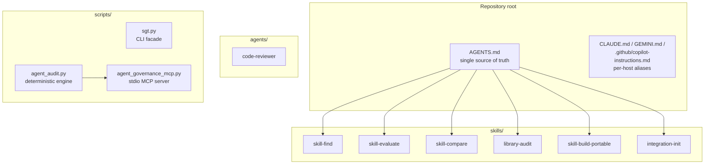
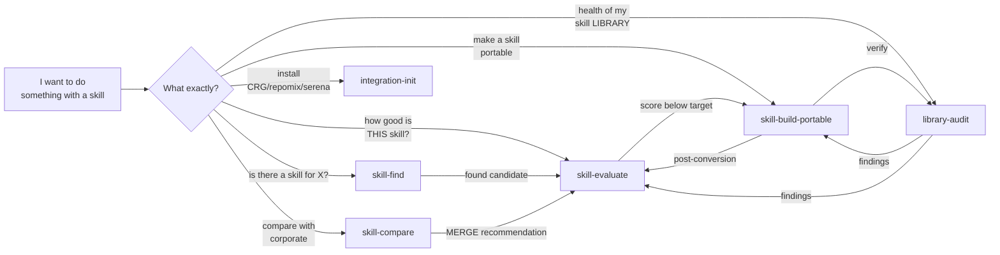
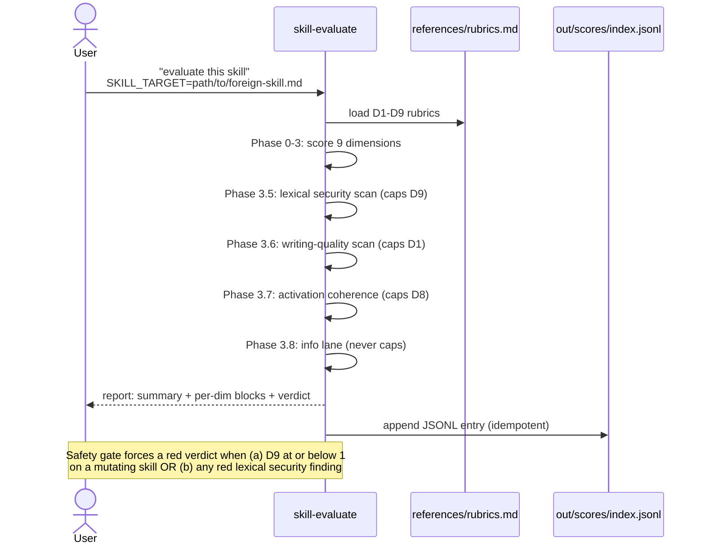
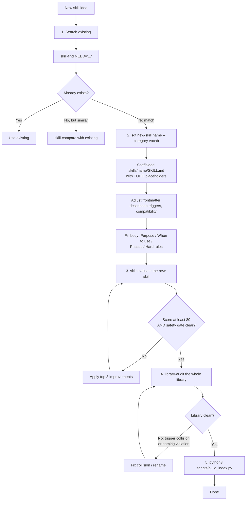
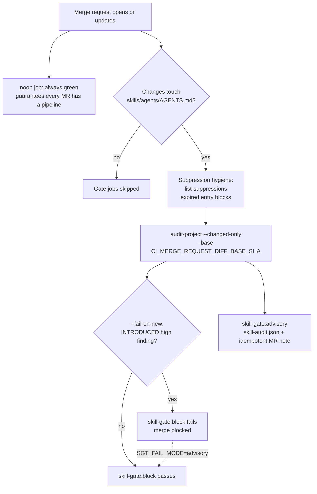
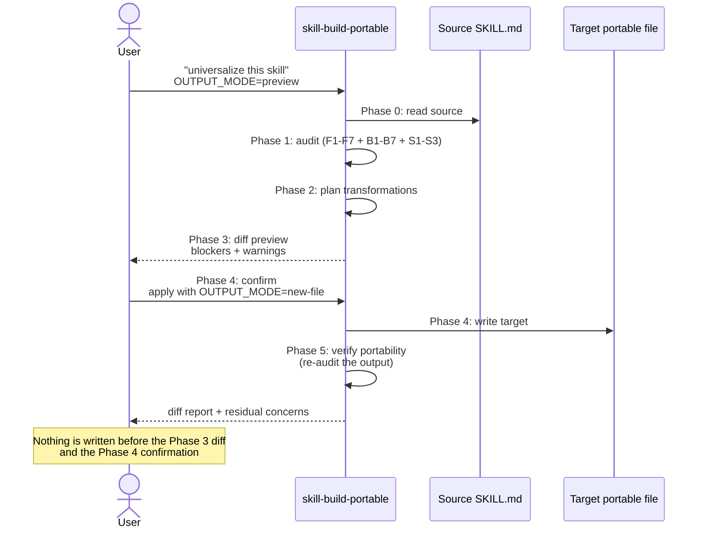
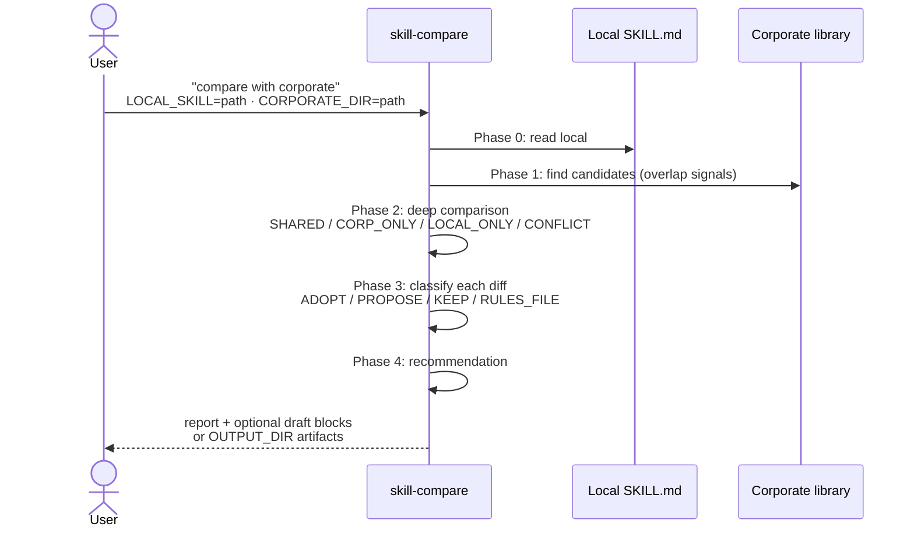

# Skill Governance Toolkit - User Guide

> **Audience:** skill author & maintainer · **Type:** how-to (workflows) · **Prerequisite:** [QUICKSTART](../QUICKSTART.md)

Universal meta-skill toolkit for teams adopting `AGENTS.md` and `SKILL.md`
standards. It helps discover, evaluate, compare, audit, and port agent skills
without forking source files per AI host.

This guide walks the eight core workflows (Use Cases 1-8). It deliberately does
not duplicate reference material — deep content lives in the canonical docs
linked from each section; the [documentation hub](README.md) indexes all of them.

This guide is the English companion to `docs/user-guide.ru.md`.

Not sure where to begin? `python3 scripts/sgt.py quickstart` prints the doctor
summary, the next command to run, and a compact intent-to-skill map
(`--format json` for automation).

---

## What This Toolkit Contains



Two complementary layers operate on your skills:

- **Six LLM meta-skills** (`skills/`) — quality judgment, comparison, porting.
- **One deterministic audit engine** (`agent_audit.py`) — reproducible
  safety/structure checks for CI gates, available as CLI, MCP server, or Docker
  image (Use Case 4).

Plus `agents/code-reviewer.md`, a dispatchable read-only TypeScript reviewer
(Use Case 8).

---

## Skill Map



| Need | Use |
|---|---|
| Find whether a useful skill already exists | `skill-find` |
| Score one `SKILL.md` across quality, safety, and writing dimensions | `skill-evaluate` |
| Compare a local skill with a corporate or upstream version | `skill-compare` |
| Audit the whole skill library | `library-audit` |
| Convert a host-specific skill into a portable one | `skill-build-portable` |
| Install optional integrations | `integration-init` |

Scope rule:

| Prefix | Scope |
|---|---|
| `skill-*` | One skill |
| `library-*` | Whole library |
| `integration-*` | Optional external tooling |

---

## Use Case 1 - Adopt an External Skill

When a teammate or upstream repository provides a `SKILL.md`, evaluate it
before adding it to your library.



```text
evaluate this skill
SKILL_TARGET=path/to/external/SKILL.md
```

Expected output:

| Section | Purpose |
|---|---|
| Summary table | One-line D1-D9 score overview |
| Per-dimension findings | Evidence, risk, and concrete improvement for each dimension |
| Safety gate | Blocks unsafe mutating skills even when the average score looks acceptable |
| Top 3 improvements | Highest-impact fixes |
| Verdict | Adopt, adopt after fixes, rewrite, or reject |

Decision guide:

| Verdict | Action |
|---|---|
| 🟢 Green (80–100), safety gate clear | Adopt as-is |
| 🟡 Yellow (60–79) | Adopt after the top fixes |
| 🟠 Orange (40–59) | Prefer a better alternative or rewrite first |
| 🔴 Red (< 40) or safety gate triggered | Do not adopt until the safety issues are fixed (the gate fires on D9 ≤ 1 for a mutating skill, or any 🔴 lexical security finding) |

---

## Use Case 2 - Create a New Skill

Start from the scaffolder — `sgt new-skill` generates a governance-clean
skeleton (portable frontmatter, closed-vocab `metainfo`, phase structure) so the
gate and `skill-evaluate` start from a passing baseline — then fill it in and
evaluate it.

```bash
python3 scripts/sgt.py new-skill prompt-evaluate --category governance
```



While filling the scaffolded TODOs:

- Keep the frontmatter portable — do not add host-specific fields like
  `allowed-tools:`.
- Write 2–5 concrete trigger phrases into `description` — it drives activation.
- Add workflow phases, hard rules, inputs, outputs, and verification.
- Iterate on `skill-evaluate` findings until the score and safety gate pass,
  then run `library-audit` and rebuild `skills/INDEX.jsonl`.

The shape every skill must have, in miniature:

```markdown
---
name: skill-example
description: One specific workflow. Use when "trigger one", "trigger two".
metainfo: { category: governance, tier: preview }  # + compatibility, license
---
> **Skill type:** Detect-only   <!-- required declaration (SKILL021) -->
```

The full canonical skeleton — every required section, the `metainfo` schema,
where prohibitions go, and the «Skill type» contract — is in the
[skill authoring standard](skill-authoring-standard.md). The scaffolder emits it
for you; consult the standard when editing by hand.

---

## Use Case 3 - Audit a Skill Library

Use `library-audit` before releases and after major skill changes.


```text
audit my skills
```

It checks:

| Category | Examples |
|---|---|
| Handoff contracts | Trigger uniqueness, predecessor/successor consistency |
| Token budget | Always-on cost, oversized skill bodies |
| Naming | Kebab-case, closed-vocabulary verbs, `{entity}-{action}` pattern |
| Portability | Missing compatibility metadata, host-specific fields |
| Multi-tool compatibility | `allowed-tools:`, per-skill tool mappings, missing sequential fallback for sub-agent paths |
| Security | Secrets, credential paths, dangerous shell, prompt-injection risks |
| Metainfo | Required `category` and `tier`, closed vocabulary compliance |

The report is written to `out/library-audit/library-audit-{YYYY-MM-DD}.md`.
Large runs checkpoint under `.skill-state/library-audit/` — if the run stops
midway, rerunning the skill resumes from the last checkpoint (see
[State Persistence](#state-persistence---resumable-runs)).

---

## Use Case 4 - Deterministic Audit Engine: CLI, MCP, Docker

`library-audit` is an agent skill. The deterministic audit engine is a
separate read-only layer for CI, local checks, and MCP clients. It indexes
project assets, applies deterministic rules, and returns structured findings —
it does not replace human or LLM interpretation.

Pick a delivery mode:

- **CLI** — `scripts/agent_audit.py`, for local checks and CI scripting.
- **MCP server** — `scripts/agent_governance_mcp.py`, the same engine exposed
  as tools to Claude / Codex / Cursor / VS Code agents.
- **Docker** — a sandboxed MCP image (`--network none`, read-only mount) for
  CI and zero-install use.

Setup, MCP/Docker configs, tools, profiles, and path behavior:
[agent governance engine](agent-governance-engine.md). The full rule catalog
with rationale: [checks reference](checks-reference.md).

### CLI

```bash
# Discover agent-related assets
python3 scripts/agent_audit.py discover .

# Audit a full project
python3 scripts/agent_audit.py audit-project . --profile release-ready --format json

# Absolute gate: fail when ANY high-severity finding exists in the tree
python3 scripts/agent_audit.py audit-project . --profile release-ready --fail-on high

# MR/PR gate scope: audit only changed assets, block only INTRODUCED findings
python3 scripts/agent_audit.py audit-project . --changed-only --base origin/main --fail-on-new high

# Audit one SKILL.md
python3 scripts/agent_audit.py audit-skill skills/skill-evaluate/SKILL.md

# Inspect rules
python3 scripts/agent_audit.py rules
python3 scripts/agent_audit.py explain-rule SKILL009
```

Every JSON report includes `engine_version` and `rules_version`, so a verdict
is traceable to the engine and policy that produced it. Core safety rules carry
a **severity floor** a custom catalog cannot weaken — the floor set is listed in
[checks-reference § Triggering examples and fixes](checks-reference.md#triggering-examples-and-fixes).

### GitHub Actions

`.github/workflows/ci.yml` runs the baseline checks on this repository. To put
the changed-only gate on a consuming GitHub repo, run `sgt ci-init --github`
and follow the [GitHub onboarding guide](github-onboarding.md).

### GitLab CI - Merge Request gate

A copy-ready template lives at `references/ci/gitlab-ci.yml` — copy it to the
root of the consuming repo as `.gitlab-ci.yml` (or run `sgt ci-init --gitlab`).
It audits only the skills/agents a merge request changes, using a tiered gate.
The **canonical rollout guide** — env vars, pinned toolkit SHA, clone auth,
image overrides for internal registries, the MR comment poster config, and the
exact test commands — is [GitLab onboarding](gitlab-onboarding.md).



| Job | Command | Effect |
|---|---|---|
| `skill-gate:block` | `audit-project . --changed-only --base $CI_MERGE_REQUEST_DIFF_BASE_SHA --fail-on-new high` | Newly introduced high-severity findings fail the pipeline and block the merge (pre-existing high findings on touched legacy assets do not block) |
| `skill-gate:advisory` | same with `--fail-on none --format json` + `post_mr_comment.py` | Never blocks; publishes `skill-audit.json` and an idempotent MR comment |
| `noop` | `echo` on `alpine` | Always-green placeholder; with GitLab's "Pipelines must succeed" enabled, guarantees every MR has a pipeline |

Operational notes:

- `--changed-only` diffs committed `HEAD` against `--base` (three-dot diff), so
  an author is accountable only for the committed entities their MR touches.
  Running the gate locally via `sgt gate` fails fast on a dirty tree — commit
  or stash first, or pass `--allow-dirty`. Base-ref edge cases (empty base
  fails closed with exit 2, bad refs, `GIT_DEPTH`) are specified in the
  [CLI reference](cli-reference.md).
- The block job also runs suppression hygiene: an already-expired suppression
  blocks the MR. Procedure and SLA:
  [suppression runbook](security-suppression-runbook.md).
- Kill-switch: setting the CI/CD variable `SGT_FAIL_MODE=advisory` downgrades
  the gate fleet-wide to non-blocking — incident procedure in the
  [security incident runbook](security-incident-runbook.md).

---

## Use Case 4.5 - Asset security checks and the delta gate (since 1.12.0)

Beyond per-skill structure, the engine scans **every** governed asset for
content security issues, in these rule families:

- `SEC001`–`SEC003` — hidden bidi/invisible characters, homoglyph typosquats.
- `SEC010`–`SEC012` — dangerous instructions, inline secrets, and credential
  paths in non-skill assets.
- `REF001`–`REF004` / `SCR001`–`SCR003` — unsafe references and the content of
  referenced scripts (exfiltration, dangerous shell, secrets).
- `MCP001`/`MCP002` — `mcp__server__*` usage not declared in
  `metainfo.requires.mcp` (and vice versa).
- `HOOK001`/`HOOK002` — hook commands running dangerous shell or leaking secrets.

Full catalog with triggering examples and clean fixes:
[checks reference](checks-reference.md).

### The delta gate — block only what an MR introduces

The CI block job and the local `sgt gate` use `--fail-on-new`, not absolute
`--fail-on`. They block only on findings the MR **introduced** versus its base
ref; pre-existing findings stay advisory. This lets a team enable the suite over
a legacy library without an avalanche — see the
[security rollout guide](security-rollout-guide.md).

```bash
# Reproduce the exact CI block verdict locally (changed-only delta gate)
sgt gate --base main

# Raw engine equivalent
python3 scripts/agent_audit.py audit-project . --changed-only --base main --fail-on-new high
```

Every `agent_audit.py` and `sgt` subcommand, flag, env var, and exit code —
including the two scoping layers (`--changed-only` file scope vs `--fail-on-new`
finding scope) — is documented in the [CLI reference](cli-reference.md).

### Suppression

| Mechanism | Suppresses | How |
|---|---|---|
| Inline marker | advisory rules only | `<!-- sgt-ignore: RULEID reason=... -->` on/above the line |
| Central file | any rule (CODEOWNER-gated) | an entry in `references/audit-ignore.json` with `reason` + recommended `expires` |

A broken/expired/missing-reason suppression fails safe — the finding stays and an
`IGNORE001/002/003` record surfaces. Full procedure, SLA, and break-glass:
[suppression runbook](security-suppression-runbook.md).

Operator helpers — `validate-config`, `explain-finding`, `list-suppressions`,
`--format github` annotations: see the [CLI reference](cli-reference.md).

### Two checks, two moments — quality vs the gate

The deterministic gate checks **safety and structure**; quality (D1–D9) is
scored by the LLM-run `skill-evaluate`, which you run locally while authoring —
it never blocks a merge. A green MR means "safe and well-formed", **not**
"high-quality". The full picture, including the side-by-side diagram, is in
[the governance gate for authors](gate-for-authors.md).

---

## Use Case 5 - Make a Skill Portable

Use `skill-build-portable` when a skill is tied to one host or organization.



Common issues it fixes:

| Issue | Example | Expected fix |
|---|---|---|
| Host-specific frontmatter | `allowed-tools:` | Remove from portable skills |
| Claude-only fields | `model`, `effort`, `hooks`, `paths` | Remove or move to host-specific packaging |
| Organization-specific paths | `_audits/`, internal folders | Replace with portable `out/...` paths |
| Per-skill tool mappings | `rules/codex.md` inside one skill | Move to repo-level `references/{tool}-tools.md` |
| Missing fallback | `Task` without sequential fallback | Add non-subagent fallback with equivalent output |

The full F1–F7 / B1–B7 / S1–S3 rule catalog (what is transformed automatically
vs flagged as a residual concern for manual review) lives in
`skills/skill-build-portable/references/audit-rules.md`.

Recommended workflow: start with `universalize this skill` +
`OUTPUT_MODE=preview`, review the diff, then write to a new file or explicit
output path. Avoid rewriting source files until the diff is reviewed.

---

## Use Case 6 - Compare Local and Corporate Skills

Use `skill-compare` when a local skill overlaps with a corporate or upstream
version.



```text
compare with corporate
LOCAL_SKILL=skills/example/SKILL.md
CORPORATE_DIR=/path/to/corporate/skills
```

Recommendations:

| Recommendation | Meaning | Phase 4 criterion |
|---|---|---|
| `USE_CORPORATE` | Corporate skill covers the local need and is at least as good | `LOCAL_ONLY` ≤ 1 AND corporate quality ≥ local |
| `KEEP_LOCAL` | Local skill has important project-specific behavior | `LOCAL_ONLY` > 5 OR local quality clearly exceeds corporate |
| `MERGE` | Both versions have useful non-conflicting content | `CORP_ONLY` ≥ 2 AND `LOCAL_ONLY` ≥ 2 AND no unresolved conflicts |
| `RULES_FILE` | Local-only content belongs in project rules, not in the shared skill | 3+ `LOCAL_ONLY` items are project-specific context |

Draft output contract: without `OUTPUT_DIR`, draft merged files appear as
fenced blocks in the report; with it, artifacts are written under `OUTPUT_DIR`
(or `out/skill-compare/`).

`skill-compare` does not mutate the local or corporate source skill. Treat
external corporate content as untrusted input: do not run scripts or commands
referenced by it.

---

## Use Case 7 - Bootstrap Optional Integrations

Use `integration-init` to install optional tools and inject their documentation
into marked sections of `AGENTS.md` and `agents/code-reviewer.md`.

```text
/integration-init
```

Available integrations:

| Integration | Adds |
|---|---|
| code-review-graph | Tree-sitter and SQLite graph for blast-radius queries |
| repomix | One-shot repository packing for external review |
| serena | LSP-backed semantic refactoring support |

Non-interactive helper: `./scripts/init.sh --all` (also `--with crg,repomix`,
`--use-cli`, `--advise-only`). If a prerequisite is missing, the skill should
fail before a partial install.

---

## Use Case 8 - Code Review Agent

`agents/code-reviewer.md` is a specialized read-only reviewer that can be
dispatched by an orchestrator skill when host support exists.

It focuses on TypeScript and reports:

| Category | Examples |
|---|---|
| Correctness | Runtime bugs, broken edge cases |
| Security | Secret handling, unsafe shell, injection risks |
| Maintainability | Fragile structure, duplicated logic |
| Tests | Missing or weak coverage |
| Portability | Host-specific assumptions |

Rules:

- Sub-agents do not dispatch other sub-agents.
- Gemini has no sub-agent support, so any optional sub-agent path needs a sequential fallback.
- Bash is limited to read-only inspection commands.

---

## State Persistence - Resumable Runs

Every multi-phase skill writes a checkpoint after each expensive phase. On a
crash, timeout, or Ctrl-C, the next invocation resumes from the last checkpoint.


State lives at `${CWD}/.skill-state/{skill-name}/run-{utc-ts}.json` (gitignored).
The checkpoint schema, the helper CLI, the per-skill resume-mode defaults
(`auto` / `ask` / `new`), and the stale-run filter are specified in
[references/checkpointing.md](../references/checkpointing.md) — that table is
the single source of truth.

---

## Installation & Upgrades

The fastest path:

```bash
git clone https://github.com/{your-org}/skill-governance-toolkit ~/tools/skill-toolkit
cd ~/my-project
python3 ~/tools/skill-toolkit/scripts/sgt.py init    # guided install + verify
```

Everything else — plugin/extension installs per host, the interactive and
advanced installers, selective install by `--category` / `--tier` / `--skill`,
where files land per runtime, private-GitLab hosting, and the upgrade /
uninstall contract (what is preserved, what is never touched) — is in the
canonical [installation guide](installation.md). One-page version:
[QUICKSTART](../QUICKSTART.md). Read `CHANGELOG.md` before upgrading — renames
and removals are marked under **🔴 BREAKING**.

---

## Regular Maintenance

After adding, renaming, or significantly editing a skill:

```bash
python3 scripts/build_index.py
```

Weekly or before release, run the LLM-side audit (`audit my skills` →
`library-audit`). Before pushing a governed change, reproduce the CI verdict
locally:

```bash
sgt gate --base main
```

Score persistence trend: `out/scores/index.jsonl` is the append-only log of
every `skill-evaluate` run — track per-skill quality trends over time.

---

## Writing Rules for Skills

Keep skill bodies concise, single-language, active-voice, and table-driven —
the full rules (banned filler phrases, brevity heuristics, rationale) are in
[AGENTS.md § Writing Style](../AGENTS.md#writing-style). `skill-evaluate`
Phase 3.6 enforces them lexically and can cap D1.

---

## See Also

Everything intentionally not covered here — engine internals, the full check
catalog, CLI flags, the authoring standard, scoring rubrics, runbooks, and
tool-name mappings — is indexed in the [documentation hub](README.md).
Russian version of this guide: [user-guide.ru.md](user-guide.ru.md).

---

## License

MIT. See `LICENSE`.
