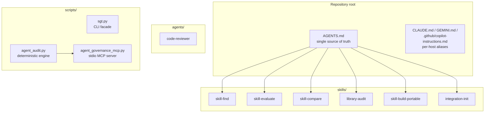
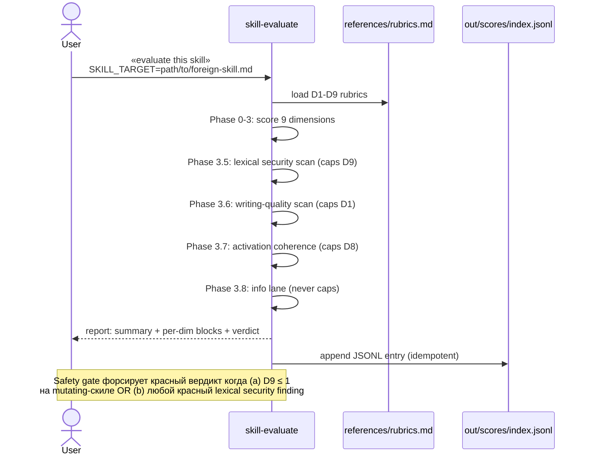
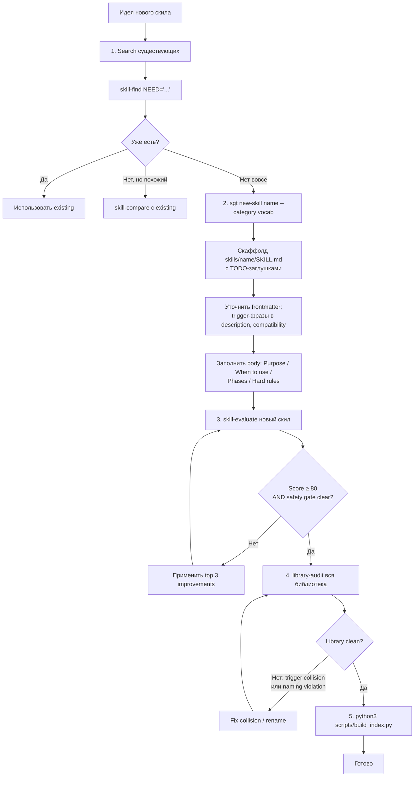
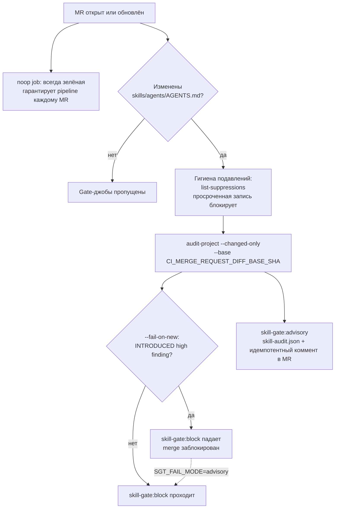
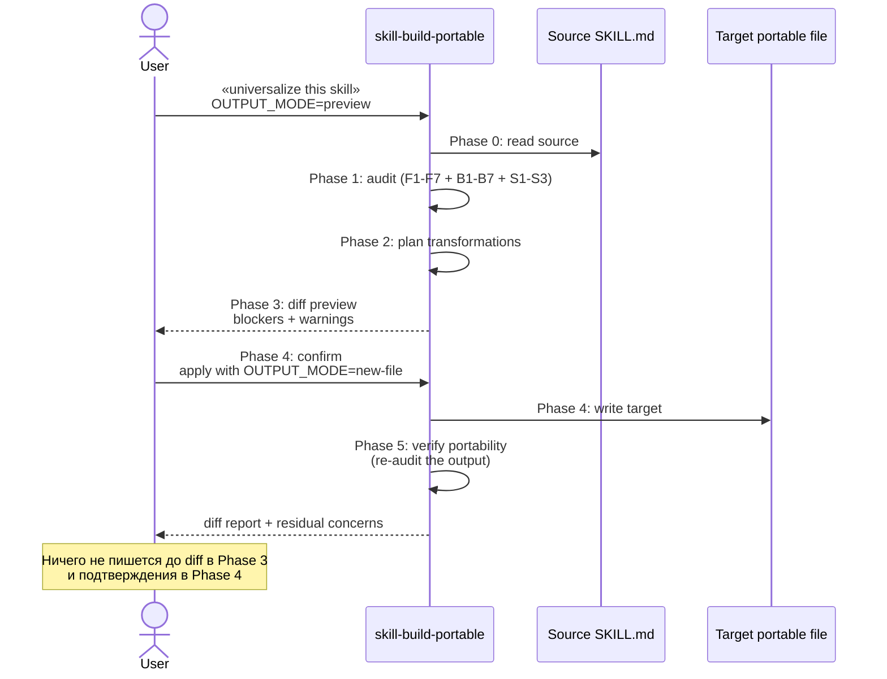
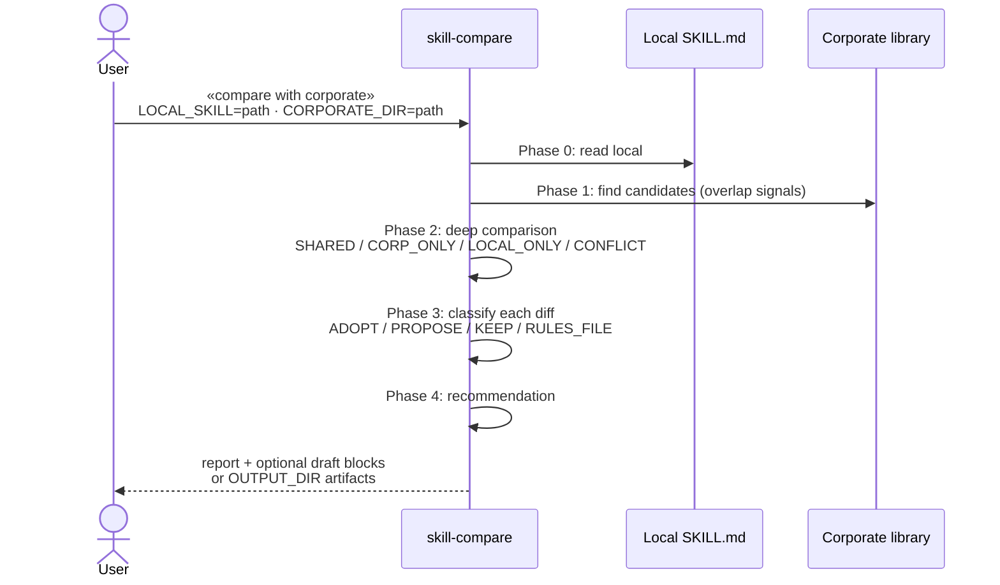
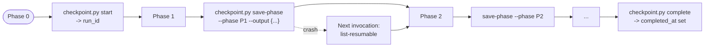

# Skill Governance Toolkit — руководство пользователя

> **Аудитория:** автор и мейнтейнер скилов · **Тип:** how-to (рабочие процессы) · **Пререквизит:** [QUICKSTART](../QUICKSTART.md)

> **Канонический источник — английский [`user-guide.md`](user-guide.md).** Этот
> перевод зеркалит его раздел в раздел; при расхождении доверяй английской
> версии.

Универсальный набор meta-навыков для команд, принявших стандарты `AGENTS.md`
и `SKILL.md`. Помогает находить, оценивать, сравнивать, аудитить и портировать
agent skills без форка исходников под каждый AI-host.

Этот гайд проводит через восемь ключевых рабочих процессов (Use case 1–8). Он
сознательно не дублирует справочный материал — глубокое содержимое живёт в
канонических документах, на которые ссылается каждый раздел;
[documentation hub](README.md) индексирует их все.

Не знаешь, с чего начать? `python3 scripts/sgt.py quickstart` печатает doctor
summary, следующую рекомендованную команду и компактную карту intent → skill
(`--format json` для автоматизации).

---

## Что внутри toolkit



Над твоими скилами работают два взаимодополняющих слоя:

- **Шесть LLM meta-скилов** (`skills/`) — суждение о качестве, сравнение,
  портирование.
- **Один детерминированный audit engine** (`agent_audit.py`) — воспроизводимые
  проверки безопасности/структуры для CI-гейтов; доступен как CLI, MCP server
  или Docker image (Use case 4).

Плюс `agents/code-reviewer.md` — диспатчабельный read-only TypeScript-ревьюер
(Use case 8).

---

## Карта скилов


| Потребность | Скил |
|---|---|
| Узнать, существует ли уже полезный скил | `skill-find` |
| Оценить один `SKILL.md` по качеству, безопасности и качеству текста | `skill-evaluate` |
| Сравнить локальный скил с корпоративной или upstream-версией | `skill-compare` |
| Проаудитить всю библиотеку скилов | `library-audit` |
| Превратить host-specific скил в портабельный | `skill-build-portable` |
| Поставить опциональные интеграции | `integration-init` |

Правило scope:

| Префикс | Scope |
|---|---|
| `skill-*` | Один скил |
| `library-*` | Вся библиотека |
| `integration-*` | Опциональный внешний тулинг |

---

## Use case 1 — Адаптация (adopt) внешнего скила

Когда коллега или upstream-репозиторий присылает `SKILL.md`, оцени его до
добавления в свою библиотеку.



```text
evaluate this skill
SKILL_TARGET=path/to/external/SKILL.md
```

Ожидаемый output:

| Секция | Назначение |
|---|---|
| Summary table | Обзор D1–D9 score одной строкой |
| Per-dimension findings | Evidence, риск и конкретное улучшение по каждому dimension |
| Safety gate | Блокирует небезопасные mutating-скилы, даже когда средний score выглядит приемлемо |
| Top 3 improvements | Фиксы с максимальным impact |
| Verdict | Adopt, adopt после фиксов, rewrite или reject |

Решение на основе вердикта:

| Verdict | Действие |
|---|---|
| 🟢 Green (80–100), safety gate чист | Adopt as-is |
| 🟡 Yellow (60–79) | Adopt после top-фиксов |
| 🟠 Orange (40–59) | Предпочесть альтернативу получше или сначала rewrite |
| 🔴 Red (< 40) или safety gate сработал | Не adopt'ить, пока не устранены safety-проблемы (gate срабатывает при D9 ≤ 1 на мутирующем скиле или любом 🔴 lexical security finding) |

---

## Use case 2 — Создание нового скила

Начинай со скаффолдера — `sgt new-skill` генерирует чистый по governance
скелет (portable frontmatter, закрытый словарь `metainfo`, структура фаз), так
что gate и `skill-evaluate` стартуют с проходного baseline — затем заполни его
и прогони оценку.

```bash
python3 scripts/sgt.py new-skill prompt-evaluate --category governance
```



Пока заполняешь скаффолдные TODO:

- Держи frontmatter портабельным — не добавляй host-specific полей вроде
  `allowed-tools:`.
- Впиши 2–5 конкретных trigger-фраз в `description` — он управляет активацией.
- Добавь фазы workflow, hard rules, inputs, outputs и verification.
- Итерируйся по findings `skill-evaluate`, пока score и safety gate не
  проходят, затем запусти `library-audit` и пересобери `skills/INDEX.jsonl`.

Форма, которую обязан иметь каждый скил, в миниатюре:

```markdown
---
name: skill-example
description: One specific workflow. Use when "trigger one", "trigger two".
metainfo: { category: governance, tier: preview }  # + compatibility, license
---
> **Skill type:** Detect-only   <!-- required declaration (SKILL021) -->
```

Полный канонический скелет — все обязательные секции, схема `metainfo`, куда
класть запреты и контракт «Skill type» — в
[skill authoring standard](skill-authoring-standard.md). Скаффолдер выдаёт его
за тебя; сверяйся со стандартом при ручном редактировании.

---

## Use case 3 — Аудит библиотеки скилов

Запускай `library-audit` перед релизами и после крупных изменений скилов.


```text
audit my skills
```

Что проверяет:

| Категория | Примеры |
|---|---|
| Handoff contracts | Уникальность триггеров, согласованность predecessor/successor |
| Token budget | Always-on стоимость, раздутые тела скилов |
| Naming | Kebab-case, закрытый словарь глаголов, паттерн `{entity}-{action}` |
| Portability | Отсутствующая compatibility-метадата, host-specific поля |
| Multi-tool compat | `allowed-tools:`, per-skill tool mappings, отсутствие sequential fallback для sub-agent путей |
| Security | Секреты, credential paths, опасный shell, риски prompt-injection |
| Metainfo | Обязательные `category` и `tier`, соответствие закрытому словарю |

Отчёт пишется в `out/library-audit/library-audit-{YYYY-MM-DD}.md`.
Большие прогоны чекпойнтятся в `.skill-state/library-audit/` — если прогон
оборвался на середине, повторный запуск скила продолжит с последнего
checkpoint (см. [State persistence](#state-persistence--resumable-runs)).

---

## Use case 4 — Детерминированный audit engine: CLI, MCP, Docker

`library-audit` — это agent skill. Детерминированный audit engine — отдельный
read-only слой для CI, локальных проверок и MCP-клиентов. Он индексирует
артефакты проекта, применяет детерминированные правила и возвращает structured
findings — он не заменяет человеческую или LLM-интерпретацию.

Выбери способ доставки:

- **CLI** — `scripts/agent_audit.py`, для локальных проверок и CI-скриптинга.
- **MCP server** — `scripts/agent_governance_mcp.py`, тот же engine как набор
  tools для агентов Claude / Codex / Cursor / VS Code.
- **Docker** — sandboxed MCP image (`--network none`, read-only mount) для CI
  и zero-install использования.

Setup, конфиги MCP/Docker, tools, профили и поведение путей:
[agent governance engine](agent-governance-engine.md). Полный каталог правил
с обоснованием: [checks reference](checks-reference.md).

### CLI

```bash
# Найти agent-related артефакты
python3 scripts/agent_audit.py discover .

# Полный аудит проекта
python3 scripts/agent_audit.py audit-project . --profile release-ready --format json

# Абсолютный gate: fail, если в дереве есть ХОТЬ ОДИН high-severity finding
python3 scripts/agent_audit.py audit-project . --profile release-ready --fail-on high

# Scope MR/PR-гейта: аудит только изменённых артефактов, блок только INTRODUCED findings
python3 scripts/agent_audit.py audit-project . --changed-only --base origin/main --fail-on-new high

# Аудит одного SKILL.md
python3 scripts/agent_audit.py audit-skill skills/skill-evaluate/SKILL.md

# Каталог правил
python3 scripts/agent_audit.py rules
python3 scripts/agent_audit.py explain-rule SKILL009
```

Каждый JSON-отчёт содержит `engine_version` и `rules_version` — вердикт
прослеживается до версии движка и политики, которые его произвели. Базовые
safety-правила несут **severity floor**, который custom-каталог не может
ослабить — набор floor-правил перечислен в
[checks-reference § Triggering examples and fixes](checks-reference.md#triggering-examples-and-fixes).

### GitHub Actions

`.github/workflows/ci.yml` гоняет baseline-проверки этого репозитория. Чтобы
поставить changed-only gate на consuming GitHub-репо, запусти
`sgt ci-init --github` и следуй
[GitHub onboarding guide](github-onboarding.md).

### GitLab CI — gate на merge request

Готовый шаблон лежит в `references/ci/gitlab-ci.yml` — скопируй его в корень
consuming-репозитория как `.gitlab-ci.yml` (или запусти `sgt ci-init --gitlab`).
Он аудитит только скилы/агенты, изменённые в merge request, по многоуровневой
схеме. **Канонический rollout-гайд** — env vars, запиненный toolkit SHA, auth
клона, переопределение образов для внутренних registry, конфиг постера
MR-комментариев и точные тестовые команды — это
[GitLab onboarding](gitlab-onboarding.md).



| Job | Команда | Эффект |
|---|---|---|
| `skill-gate:block` | `audit-project . --changed-only --base $CI_MERGE_REQUEST_DIFF_BASE_SHA --fail-on-new high` | Впервые внесённые high-severity findings роняют pipeline и блокируют merge (уже существовавшие high findings на затронутых legacy-ассетах не блокируют) |
| `skill-gate:advisory` | то же с `--fail-on none --format json` + `post_mr_comment.py` | Не блокирует; публикует `skill-audit.json` и идемпотентный коммент в MR |
| `noop` | `echo` на `alpine` | Всегда-зелёная заглушка; с включённым GitLab «Pipelines must succeed» гарантирует pipeline для каждого MR |

Операционные заметки:

- `--changed-only` сравнивает закоммиченный `HEAD` с `--base` (three-dot diff),
  так что автор отвечает только за закоммиченные сущности, которые тронул его
  MR. Локальный запуск гейта через `sgt gate` fail-fast'ится на «грязном»
  дереве — сначала закоммить или сделай stash, либо передай `--allow-dirty`.
  Граничные случаи base-ref (пустой base падает закрыто с exit 2, плохие refs,
  `GIT_DEPTH`) специфицированы в [CLI reference](cli-reference.md).
- Блокирующая джоба также гоняет гигиену подавлений: уже просроченное
  подавление блокирует MR. Процедура и SLA:
  [suppression runbook](security-suppression-runbook.md).
- Kill-switch: CI/CD-переменная `SGT_FAIL_MODE=advisory` переводит gate во
  всём флоте в non-blocking режим — процедура инцидента в
  [security incident runbook](security-incident-runbook.md).

---

## Use case 4.5 — Проверки безопасности артефактов и delta-gate (с 1.12.0)

Помимо структуры скила, движок сканирует **каждый** управляемый артефакт на
проблемы безопасности контента, по этим семействам правил:

- `SEC001`–`SEC003` — скрытые bidi/невидимые символы, homoglyph-тайпсквоттинг.
- `SEC010`–`SEC012` — опасные инструкции, inline-секреты и credential paths
  в не-скил артефактах.
- `REF001`–`REF004` / `SCR001`–`SCR003` — небезопасные ссылки и контент
  referenced-скриптов (exfiltration, опасный shell, секреты).
- `MCP001`/`MCP002` — использование `mcp__server__*` без объявления в
  `metainfo.requires.mcp` (и наоборот).
- `HOOK001`/`HOOK002` — команды хуков, запускающие опасный shell или
  утекающие секреты.

Полный каталог с примерами срабатывания и чистыми фиксами:
[checks reference](checks-reference.md).

### Delta-gate — блокирует только то, что вносит MR

Блокирующая CI-джоба и локальный `sgt gate` используют `--fail-on-new`, а не
абсолютный `--fail-on`. Они блокируют только findings, которые MR **внёс**
относительно базовой ветки; уже существующие остаются advisory. Это позволяет
команде включить набор правил поверх легаси-библиотеки без лавины ошибок — см.
[security rollout guide](security-rollout-guide.md).

```bash
# Воспроизвести точный вердикт блокирующей CI-джобы локально (changed-only delta-gate)
sgt gate --base main

# Эквивалент на сыром движке
python3 scripts/agent_audit.py audit-project . --changed-only --base main --fail-on-new high
```

Каждая подкоманда `agent_audit.py` и `sgt`, флаг, env var и exit code —
включая два слоя scoping (`--changed-only` — scope файлов vs `--fail-on-new` —
scope findings) — задокументированы в [CLI reference](cli-reference.md).

### Подавление findings

| Механизм | Подавляет | Как |
|---|---|---|
| Inline-маркер | только advisory-правила | `<!-- sgt-ignore: RULEID reason=... -->` на строке или над ней |
| Центральный файл | любое правило (gated через CODEOWNERS) | запись в `references/audit-ignore.json` с `reason` + рекомендуемым `expires` |

Сломанное/просроченное/без reason подавление fail-safe — finding остаётся, а
запись `IGNORE001/002/003` всплывает. Полная процедура, SLA и break-glass:
[suppression runbook](security-suppression-runbook.md).

Инструменты оператора — `validate-config`, `explain-finding`,
`list-suppressions`, аннотации `--format github`: см.
[CLI reference](cli-reference.md).

### Два контроля, два момента — качество vs гейт

Детерминированный гейт проверяет **безопасность и структуру**; качество
(D1–D9) скорит LLM-навык `skill-evaluate`, который ты запускаешь локально при
авторинге — он никогда не блокирует merge. Зелёный MR значит «безопасно и
корректно по структуре», **а не** «качественно». Полная картина, включая
side-by-side диаграмму, — в
[the governance gate for authors](gate-for-authors.md).

---

## Use case 5 — Сделать скил портабельным

Используй `skill-build-portable`, когда скил привязан к одному host или
организации.



Типичные проблемы, которые он чинит:

| Проблема | Пример | Ожидаемый фикс |
|---|---|---|
| Host-specific frontmatter | `allowed-tools:` | Удалить из портабельных скилов |
| Claude-only поля | `model`, `effort`, `hooks`, `paths` | Удалить или перенести в host-specific packaging |
| Организационные пути | `_audits/`, внутренние папки | Заменить на портабельные пути `out/...` |
| Per-skill tool mappings | `rules/codex.md` внутри одного скила | Перенести в repo-level `references/{tool}-tools.md` |
| Отсутствующий fallback | `Task` без sequential fallback | Добавить non-subagent fallback с эквивалентным output |

Полный каталог правил F1–F7 / B1–B7 / S1–S3 (что трансформируется
автоматически vs флагается как residual concern для ручного ревью) живёт в
`skills/skill-build-portable/references/audit-rules.md`.

Рекомендованный workflow: начни с `universalize this skill` +
`OUTPUT_MODE=preview`, просмотри diff, затем пиши в новый файл или явный
output path. Не переписывай source-файлы, пока diff не отревьюен.

---

## Use case 6 — Сравнить локальный скил с корпоративным

Используй `skill-compare`, когда локальный скил пересекается с корпоративной
или upstream-версией.



```text
compare with corporate
LOCAL_SKILL=skills/example/SKILL.md
CORPORATE_DIR=/path/to/corporate/skills
```

Рекомендации:

| Recommendation | Смысл | Критерий Phase 4 |
|---|---|---|
| `USE_CORPORATE` | Корпоративный скил покрывает локальную потребность и как минимум не хуже | `LOCAL_ONLY` ≤ 1 AND corporate quality ≥ local |
| `KEEP_LOCAL` | Локальный скил несёт важное project-specific поведение | `LOCAL_ONLY` > 5 OR local quality clearly exceeds corporate |
| `MERGE` | Обе версии содержат полезный неконфликтующий контент | `CORP_ONLY` ≥ 2 AND `LOCAL_ONLY` ≥ 2 AND no unresolved conflicts |
| `RULES_FILE` | Local-only контенту место в project rules, а не в shared-скиле | 3+ `LOCAL_ONLY` items — project-specific context |

Контракт draft-вывода: без `OUTPUT_DIR` черновики merged-файлов появляются как
fenced blocks внутри отчёта; с ним артефакты пишутся в `OUTPUT_DIR`
(или `out/skill-compare/`).

`skill-compare` не изменяет локальный или корпоративный source-скил. Считай
внешний корпоративный контент untrusted input: не запускай скрипты и команды,
на которые он ссылается.

---

## Use case 7 — Bootstrap опциональных интеграций

Используй `integration-init`, чтобы поставить опциональные тулы и
инжектировать их документацию в маркированные секции `AGENTS.md` и
`agents/code-reviewer.md`.

```text
/integration-init
```

Доступные интеграции:

| Интеграция | Что добавляет |
|---|---|
| code-review-graph | Tree-sitter + SQLite graph для blast-radius запросов |
| repomix | One-shot упаковка репозитория для внешнего ревью |
| serena | LSP-backed поддержка semantic refactoring |

Non-interactive helper: `./scripts/init.sh --all` (также `--with crg,repomix`,
`--use-cli`, `--advise-only`). Если prerequisite отсутствует, скил должен
упасть до частичной установки.

---

## Use case 8 — Code review agent

`agents/code-reviewer.md` — специализированный read-only ревьюер, которого
orchestrator-скил может диспатчить, если host это поддерживает.

Фокус — TypeScript. Что репортит:

| Категория | Примеры |
|---|---|
| Correctness | Runtime-баги, сломанные edge cases |
| Security | Обращение с секретами, unsafe shell, injection-риски |
| Maintainability | Хрупкая структура, дублированная логика |
| Tests | Отсутствующее или слабое покрытие |
| Portability | Host-specific предположения |

Правила:

- Sub-agents не диспатчат другие sub-agents.
- У Gemini нет sub-agent support — любой опциональный sub-agent path требует
  sequential fallback.
- Bash ограничен read-only inspection-командами.

---

## State persistence — resumable runs

Каждый multi-phase скил пишет checkpoint после каждой дорогой фазы. При
crash, timeout или Ctrl-C следующий вызов продолжит с последнего checkpoint.



State живёт в `${CWD}/.skill-state/{skill-name}/run-{utc-ts}.json` (gitignored).
Схема checkpoint, helper CLI, per-skill дефолты resume-режима
(`auto` / `ask` / `new`) и фильтр stale-прогонов специфицированы в
[references/checkpointing.md](../references/checkpointing.md) — та таблица и
есть single source of truth.

---

## Установка и обновления

Самый быстрый путь:

```bash
git clone https://github.com/{your-org}/skill-governance-toolkit ~/tools/skill-toolkit
cd ~/my-project
python3 ~/tools/skill-toolkit/scripts/sgt.py init    # установка с подсказками + проверка
```

Всё остальное — установка plugin/extension под каждый host, интерактивный и
advanced инсталляторы, выборочная установка по `--category` / `--tier` /
`--skill`, куда ложатся файлы в каждом runtime,
[хостинг на приватном GitLab](installation.md#private-gitlab) и контракт
upgrade / uninstall (что сохраняется, что никогда не трогается) — в
каноническом [installation guide](installation.md). Одностраничная версия:
[QUICKSTART](../QUICKSTART.md). Прочитай `CHANGELOG.md` перед обновлением —
переименования и удаления помечены **🔴 BREAKING**.

---

## Регулярное обслуживание

После добавления, переименования или существенной правки скила:

```bash
python3 scripts/build_index.py
```

Раз в неделю или перед релизом запускай LLM-аудит («audit my skills» →
`library-audit`). Перед push'ем governed-изменения воспроизведи вердикт CI
локально:

```bash
sgt gate --base main
```

Тренд score persistence: `out/scores/index.jsonl` — append-only лог каждого
запуска `skill-evaluate` — отслеживай тренды качества скилов во времени.

---

## Writing Rules — как писать скилы

Держи тела скилов концизными, моноязычными, в active voice и table-driven —
полные правила (banned filler phrases, эвристики краткости, обоснование) — в
[AGENTS.md § Writing Style](../AGENTS.md#writing-style). `skill-evaluate`
Phase 3.6 enforces их лексически и может capнуть D1.

---

## См. также

Всё, что сознательно не покрыто здесь — внутренности движка, полный каталог
проверок, флаги CLI, стандарт авторинга, рубрики скоринга, runbooks и
tool-name mappings — индексировано в [documentation hub](README.md).
Английская (каноническая) версия этого гайда: [user-guide.md](user-guide.md).

---

## License

MIT. См. `LICENSE`.
