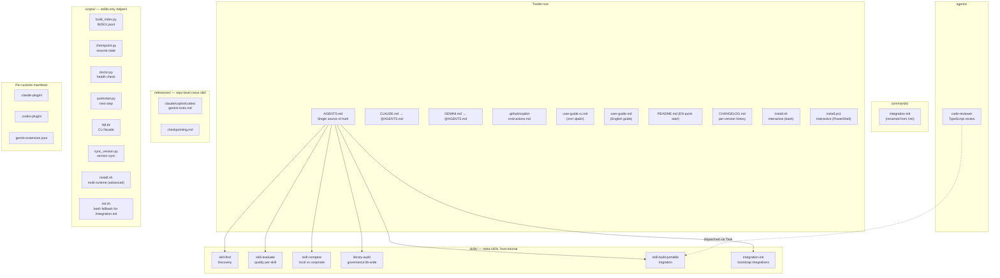
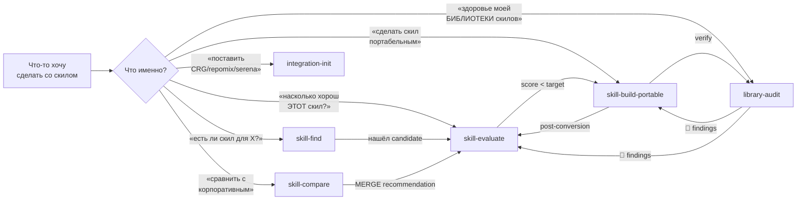
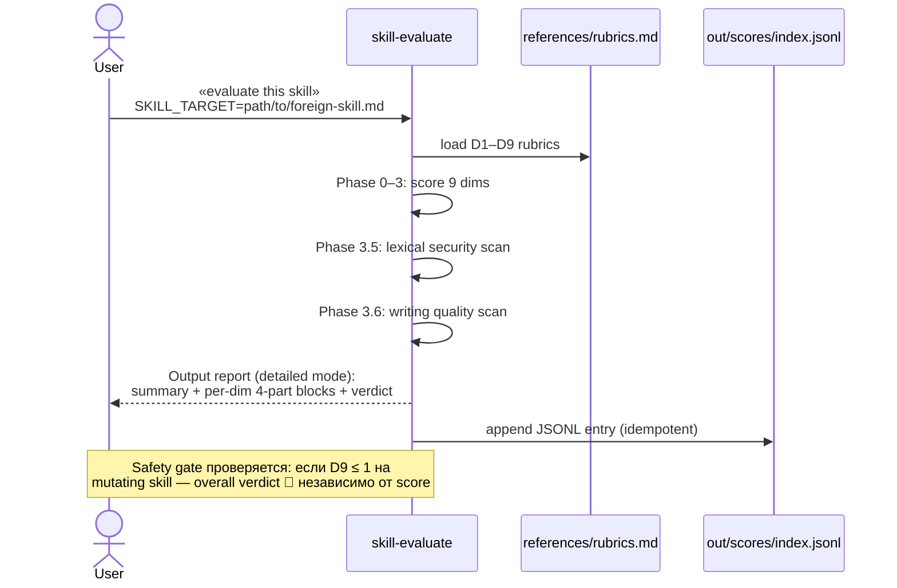
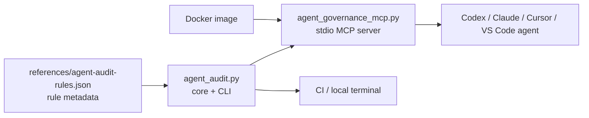
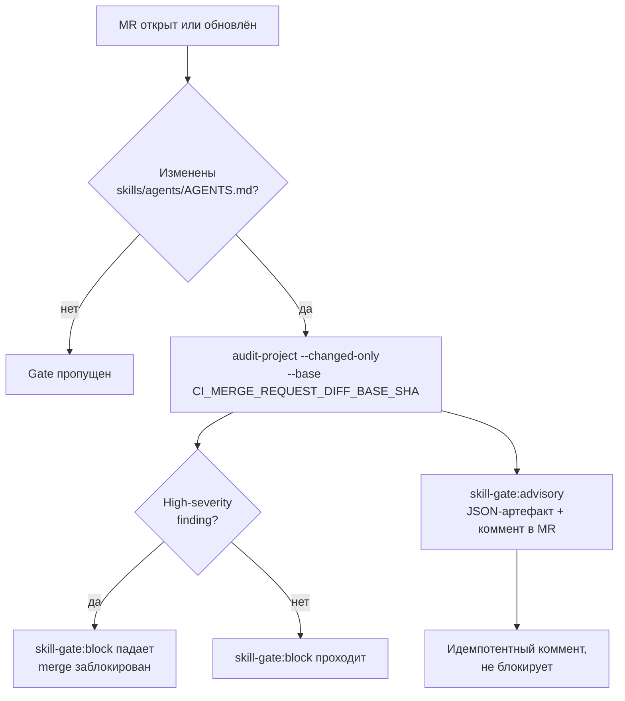
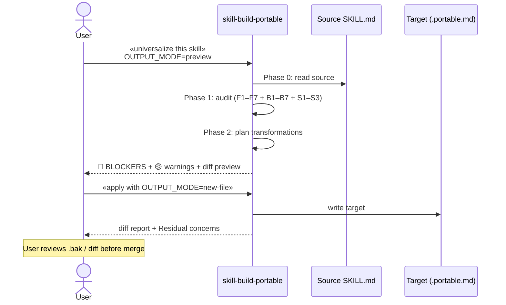
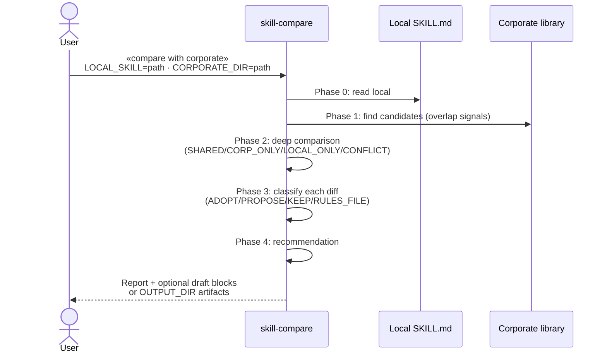

# Skill Governance Toolkit — руководство пользователя

> **Канонический источник — английский [`user-guide.md`](user-guide.md).** Этот
> перевод может отставать по версиям и разделам; при расхождении доверяй
> английской версии.

Универсальный набор meta-навыков для управления библиотекой Agent Skills
(SKILL.md по спецификации Anthropic Agent Skills + AGENTS.md по спецификации
Linux Foundation AAIF). Работает в Claude Code, GitHub Copilot, Cursor,
OpenAI Codex CLI и Google Gemini CLI **без форка исходников под каждый
тул**.

> **Язык документации.** Этот гайд — на русском для команды. Содержимое
> самих навыков (`skills/*/SKILL.md`, `references/*.md`) — только на
> английском. Это требование Phase 3.6 (writing quality scan) — один язык
> на тело навыка для max routing accuracy и token efficiency. Гайды для
> людей могут быть на любом языке; навыки для агентов — единообразны.

---

## Что внутри



---

## Статус компонентов и готовность к GitHub

| Компонент | Статус | Что это значит |
|---|---|---|
| Six meta-skills | `stable` | Подходят для обычного командного использования; breaking changes — только через release notes. |
| `agents/code-reviewer.md` | `stable` | Read-only TypeScript-first reviewer; Bash ограничен read-only inspection. |
| `scripts/doctor.py` | `stable` | Быстрая локальная проверка setup, Git state, свежести индекса и локальных артефактов. |
| `scripts/quickstart.py` | `stable` | Короткий next-step guide и карта intent → skill. |
| `scripts/sgt.py` | `stable` | Небольшой CLI facade для doctor, quickstart, skills list и self-audit. |
| `scripts/sync_version.py` | `stable` | Синхронизирует plugin manifests, `pyproject.toml` и README pins из root `VERSION`. |
| CLI/MCP/Docker audit engine | `preview` | Работает и покрыт тестами, но API tools/rules могут уточняться до первого tagged release. |
| Optional integrations | opt-in | CRG/repomix/serena ставятся только через `integration-init`; не являются baseline requirement. |

**Если непонятно, с чего начать:**

```bash
python3 scripts/sgt.py quickstart
python3 scripts/quickstart.py
```

Скрипт печатает doctor summary, следующий рекомендуемый command и короткую
карту intent → skill. Для автоматизации используй `--format json`.

**Быстрая проверка локального состояния:**

```bash
python3 scripts/doctor.py
```

Для автоматизации используй `--format json`. Doctor падает только на
actionable проблемах: отсутствующие обязательные файлы, stale
`skills/INDEX.jsonl` и похожие нарушения.

Используй `sgt.py`, если нужны стабильные command names:

```bash
python3 scripts/sgt.py doctor
python3 scripts/sgt.py skills
python3 scripts/sgt.py audit
```

**Перед публикацией / PR / релизом запускай:**

```bash
bash scripts/audit.sh
python3 scripts/test_install.py
python3 scripts/test_doctor.py
python3 scripts/test_quickstart.py
python3 scripts/test_sgt.py
python3 scripts/test_sync_version.py
python3 scripts/test_agent_audit.py
python3 scripts/agent_audit.py audit-project . --profile release-ready --fail-on any --format json
docker build -t agent-governance-mcp:local .
printf '%s\n' '{"jsonrpc":"2.0","id":1,"method":"tools/list","params":{}}' \
  | docker run --rm -i --network none -v "$PWD:/workspace:ro" agent-governance-mcp:local
```

GitHub Actions выполняет этот baseline автоматически в `.github/workflows/ci.yml`.

У версии один ручной источник: root `VERSION`. После изменения запускай:

```bash
python3 scripts/sync_version.py
python3 scripts/sync_version.py --check
```

Sync обновляет plugin manifests, `pyproject.toml` и pinned install examples.
Check выполняется внутри `scripts/audit.sh`.

**Перед установкой в проект посмотри план:**

```bash
./install.sh --dry-run
./install.ps1 -DryRun
./scripts/install.sh --claude --project --target-project=/path/to/project --dry-run
```

Dry-run mode использует те же skill filters и target paths, что реальная
установка, печатает план записей и выходит до изменения файлов.

---

## Шесть навыков и для чего они нужны



**Mental map по scope:**

| Scope | Skill | Использование |
|---|---|---|
| ОДИН скил | `skill-find` | дискавери — есть ли что-то готовое |
| ОДИН скил | `skill-evaluate` | quality scoring (D1–D9 + lexical security + writing quality) |
| ОДИН скил | `skill-compare` | local vs corporate 1:1 |
| ОДИН скил | `skill-build-portable` | трансформация в портабельный вид |
| ВСЯ библиотека | `library-audit` | cross-skill governance, library-wide token budget, aggregated security |
| ВСЕ интеграции | `integration-init` | bootstrap CRG/repomix/serena |

**Запомнить:** entity в имени = scope. `skill-*` = per-skill. `library-*` =
библиотека целиком. `integration-*` = интеграции.

---

## Use case 1 — Адаптация (adopt) внешнего скила

Сценарий: коллега прислал интересный SKILL.md из другого репо. Хочешь
понять можно ли его использовать.



**Что получаешь:**

1. **Summary table** D1–D9 одной строкой.
2. **Per-dim block** для каждого из 9 dim'ов:
   - What we check (правило)
   - What we found (file:line evidence)
   - Why it matters (downstream failure mode)
   - How to raise the score (конкретное действие)
3. **Overall verdict** — 🟢 / 🟡 / 🟠 / 🔴 + adopt decision.
4. **Top 3 priority improvements** через все dim'ы.
5. **Дополнительные секции** — frontmatter issues, lexical security, writing quality, agent pattern.

**Решение на основе verdict'а:**

| Verdict | Decision |
|---|---|
| 🟢 Green (80–100) + Safety gate not triggered | Adopt as-is |
| 🟡 Yellow (60–79) | Adopt после top-3 improvements |
| 🟠 Orange (40–59) | Не adopt'ить — слишком много работы; искать альтернативу |
| 🔴 Red (< 40) OR Safety gate triggered | Не adopt'ить, или сначала привести D9 ≥ 3 |

---

## Use case 2 — Создание нового скила с нуля

Toolkit намеренно НЕ имеет `skill-create` scaffolder'а (защита от
boilerplate). Workflow:


**Канонический скелет SKILL.md:**

```markdown
---
name: {entity}-{action}              # обязательное, ≤ 64 chars
description: |                       # обязательное, 100–1024 chars
  {1–2 sentence WHAT}
  Use when: «trigger phrase 1», «trigger phrase 2», «trigger phrase 3».
  Output: {что скил производит}.
compatibility: "Claude Code · ..."   # рекомендуется
license: MIT                          # рекомендуется
---

# {Skill Title}

**Purpose:** {1 sentence business value}

## When to use

**Always:**
- {trigger 1}
- {trigger 2}

**ESPECIALLY when:**
- {high-impact case}

**Skip / Don't use for:**
- {neighbor skill disambiguation}

**Don't skip when:**
- {counter-rationalization}

## Predecessor / Successor

## Required inputs

| Input | Type | Default | Description |

## Workflow

### Phase 0 — ...
### Phase N — ...

## Hard rules

- ❌ ...
- ✅ ...
```

---

## Use case 3 — Регулярный аудит библиотеки

Раз в неделю / перед релизом — `library-audit` весь skills/ directory.

```mermaid
flowchart LR
    U[User] -->|«audit my skills»| LA[library-audit]
    LA --> P0[P0: env setup]
    P0 --> P1[P1: handoff contracts]
    P1 --> P2[P2: token budget]
    P2 --> P3[P3: naming convention]
    P3 --> P4[P4: portability tag]
    P4 --> P45[P4.5: multi-tool compat]
    P45 --> P5[P5: security<br/>secrets/shell/cred paths]
    P5 --> P6[P6: aggregate + write report]
    P6 --> OUT["out/library-audit/<br/>library-audit-{date}.md"]
```



**Report structure** (Phase 6 detailed mode):

```
Layer 1: Category roll-up table (10-second decision)
Layer 2: Per-category 4-part block (What/Found/Why/Fix)
Layer 3: Recommendations (impact-ordered)
```

**Что покрыто:**

| Category | Что проверяет |
|---|---|
| Handoff contracts | Bidirectional refs · trigger uniqueness · body-based AskUserQuestion policy |
| Token budget | Always-on cost · per-skill body length · claims-vs-actual |
| Naming | Closed-vocab verbs (find/audit/evaluate/...) · `{entity}-{action}` pattern · kebab-case |
| Portability tag | `compatibility:` present · `portability:` value valid |
| Multi-tool compat | `allowed-tools:` absent · no per-skill `rules/{tool}.md` · Gemini Task fallback |
| Security | Hardcoded API keys · dangerous shell · credential-path reads (masks secrets) |

**State persistence:** аудит большой library может занять минуту-две. Skill
пишет checkpoint после каждой фазы в `${CWD}/.skill-state/library-audit/`.
Crash mid-audit → re-run продолжает с last checkpoint.

---

## Use case 3.5 — Запуск deterministic audit engine: CLI, MCP, Docker

`library-audit` — это agent skill: он удобен, когда аудит запускает LLM-host.
Для CI, локальной диагностики и подключения к разным AI-клиентам есть
отдельный read-only audit engine.

**Важно:** это preview-слой поверх stable skills. Он детерминированно
индексирует и проверяет agent assets, но не заменяет LLM-интерпретацию
findings и не применяет патчи сам.

Архитектура:



### Вариант A — CLI

CLI подходит для локальной проверки, CI и быстрого JSON-отчета без MCP.

```bash
# Найти agent-related артефакты
python3 scripts/agent_audit.py discover .

# Полный аудит проекта, JSON для CI/агента
python3 scripts/agent_audit.py audit-project . --profile release-ready --format json

# CI-режим: вернуть exit 1, если есть high findings
python3 scripts/agent_audit.py audit-project . --profile release-ready --fail-on high

# Scope merge request: аудит только изменённых относительно базовой ветки артефактов
python3 scripts/agent_audit.py audit-project . --changed-only --base origin/main --fail-on high

# Аудит одного SKILL.md
python3 scripts/agent_audit.py audit-skill skills/skill-evaluate/SKILL.md

# Каталог правил и объяснение конкретного rule_id
python3 scripts/agent_audit.py rules
python3 scripts/agent_audit.py explain-rule SKILL009
```

Профили:

| Profile | Когда использовать |
|---|---|
| `security` | Только safety-срез: dangerous shell, secrets, credential paths, external trust, local paths |
| `quality` | Структура, usability и portability без узкого security-only фокуса |
| `maintainability` | Полный набор правил для регулярной поддержки |
| `release-ready` | Полный pre-release audit |

### Вариант B — MCP server

MCP нужен, когда аудит должен вызываться из AI-клиента как tool call.
Сервер ничего не редактирует: он возвращает structured findings, а LLM уже
объясняет риски и предлагает правки.

Локальный запуск:

```bash
python3 scripts/agent_governance_mcp.py
```

Пример MCP config:

```json
{
  "mcpServers": {
    "agent-governance": {
      "command": "python3",
      "args": ["/path/to/skill-governance-toolkit/scripts/agent_governance_mcp.py"],
      "env": {
        "AGENT_GOVERNANCE_ROOT": "/path/to/project"
      }
    }
  }
}
```

По умолчанию MCP server принимает только пути внутри своей рабочей директории.
`AGENT_GOVERNANCE_ROOT` явно задает эту границу. `AGENT_GOVERNANCE_DEBUG=1`
включает tracebacks в MCP-ошибках; без него ошибки санитизированы.

Каталог rule metadata живет в `references/agent-audit-rules.json`. Для теста
или корпоративного каталога можно задать `AGENT_GOVERNANCE_RULES_PATH`.
Override-каталог обязан содержать все `rule_id`, которые использует engine;
если rule отсутствует, audit fail-fast.

Доступные tools:

| Tool | Что делает |
|---|---|
| `discover_agent_assets` | Находит `AGENTS.md`, `SKILL.md`, prompts, agent configs, aliases, MCP/plugin configs |
| `audit_skill` | Проверяет один `SKILL.md` |
| `audit_project` | Проверяет весь проект и возвращает findings с `severity`, `file`, `line`, `rule_id` |
| `explain_rule` | Объясняет конкретное правило |
| `get_rule_catalog` | Возвращает весь каталог правил |

### Вариант C — Docker

Docker удобен для воспроизводимого запуска в CI или корпоративной среде.
Проект монтируется read-only, сеть можно отключить.

```bash
# Собрать image
docker build -t agent-governance-mcp:local .

# Запустить MCP server против текущего проекта
docker run --rm -i \
  --network none \
  -v "$PWD:/workspace:ro" \
  agent-governance-mcp:local
```

Image запускается не от root. Если в CI checkout использует строгие file
permissions, запускай с UID/GID host-пользователя:

```bash
docker run --rm -i \
  --network none \
  --user "$(id -u):$(id -g)" \
  -v "$PWD:/workspace:ro" \
  agent-governance-mcp:local
```

Пример MCP config через Docker:

```json
{
  "mcpServers": {
    "agent-governance": {
      "command": "docker",
      "args": [
        "run",
        "--rm",
        "-i",
        "--network",
        "none",
        "-v",
        "/path/to/repo:/workspace:ro",
        "agent-governance-mcp:local"
      ]
    }
  }
}
```

В Docker передавай `root` как `/workspace`.

**Минусы Docker-варианта:**
- нужен установленный и запущенный Docker daemon;
- пути снаружи и внутри контейнера отличаются (`/path/to/repo` vs `/workspace`);
- на macOS/Windows volume mount может быть медленнее;
- если нужно читать файлы вне repo, их надо явно монтировать;
- для stdio MCP обязателен `-i`, иначе сервер завершится сразу.

**Безопасный baseline:** `--network none` + `-v "$PWD:/workspace:ro"`.

### Вариант D — GitHub Actions

В репозитории есть CI workflow:

```text
.github/workflows/ci.yml
```

Он проверяет:

| Job | Что запускает |
|---|---|
| `audit` | `scripts/audit.sh`, behavior tests, release-ready audit gate |
| `docker` | Docker build, MCP `tools/list`, Docker `audit_project /workspace` |

Если добавляешь новый skill, меняешь rule catalog или MCP server, CI должен
оставаться зеленым. Для локального воспроизведения используй команды из
раздела «Статус компонентов и готовность к GitHub».

### Вариант E — GitLab CI: gate на merge request

Готовый шаблон лежит в `references/ci/gitlab-ci.yml`. Скопируй его в корень
целевого репозитория маркетплейса как `.gitlab-ci.yml`. Он аудитит только
изменённые в MR скиллы/агенты по многоуровневой схеме:



| Job | Команда | Эффект |
|---|---|---|
| `skill-gate:block` | `audit-project . --changed-only --base $CI_MERGE_REQUEST_DIFF_BASE_SHA --fail-on high` | High-severity findings роняют pipeline и блокируют merge |
| `skill-gate:advisory` | то же с `--fail-on none --format json` + `post_mr_comment.py` | Не блокирует; публикует `skill-audit.json` и идемпотентный коммент в MR |

`--changed-only` сравнивает рабочее дерево с `--base` (git ref) через three-dot
diff — автор отвечает только за изменённые в его MR сущности. Шаблон ставит
`GIT_DEPTH: 0`, чтобы базовый коммит был доступен.

Обработка base-ref:
- **Пустой `--base`** (например, отсутствует `CI_MERGE_REQUEST_DIFF_BASE_SHA`) ⟶
  fallback на **полный аудит** дерева с предупреждением в stderr — gate падает по
  governance, не по инфраструктуре.
- **Непустой, но плохой/недостижимый ref** ⟶ выход с кодом 2 и санитизированным
  сообщением.

Каждый JSON-отчёт содержит `engine_version` и `rules_version` — вердикт
прослеживается до версии движка и политики.

#### Постер комментариев в MR

`scripts/post_mr_comment.py` превращает advisory-`skill-audit.json` в один
идемпотентный комментарий MR, сгруппированный по severity. Повторный запуск
pipeline обновляет тот же комментарий (по скрытому маркеру), а не плодит дубли.

```bash
# Предпросмотр комментария без вызова API
python3 scripts/post_mr_comment.py skill-audit.json --dry-run
```

| Параметр | Источник | Назначение |
|---|---|---|
| `--api-url` | `CI_API_V4_URL` | База GitLab API (auto в CI) |
| `--project-id` | `CI_PROJECT_ID` | Целевой проект (auto в CI) |
| `--mr-iid` | `CI_MERGE_REQUEST_IID` | Целевой MR (auto в CI) |
| `--token-env` | `GITLAB_TOKEN` | **Имя** env-переменной с токеном (scope `api`) |

Токен читается из переменной окружения по имени — никогда не передаётся inline.
Без токена (или в `--dry-run`) постер печатает комментарий и пропускает вызов
API. Только stdlib: HTTP через `urllib`, без SDK.

---

## Use case 4 — Сделать скил портабельным

Сценарий: есть Claude-Code-only скил с `allowed-tools:`, `paths:`, org-specific путями. Хочешь чтобы работал везде.



**Что трансформируется автоматически:**

| Rule | Detection | Action |
|---|---|---|
| F1 `allowed-tools:` | grep frontmatter | удалить · добавить informational note в Hard rules |
| F2 `type:`, `status:`, `last_updated:` | grep frontmatter | удалить (не в agentskills.io spec) |
| F4 Claude-only fields (`paths`, `hooks`, `model`, `effort`...) | grep frontmatter | удалить · опц preserve as comment если `KEEP_CLAUDE_FALLBACK=true` |
| F7 missing `compatibility:` | grep frontmatter | добавить |
| B1 org-specific paths (`_audits/`, `outputs/`, `materials/raw/`) | grep body | replace на `out/...` |
| B5 per-skill `rules/{tool}.md` directory | ls | flag for removal · merge content в repo-level `references/` |
| B6 `Task` usage без Gemini fallback note | grep body | insert note |

**Что НЕ трансформируется автоматически** (residual concerns —
пользователь смотрит вручную):
- Description > 1024 chars → требует rewrite (mission-critical для активации).
- Description < 80 chars → too short, expand вручную.
- Body > 500 lines → split рекомендуется но не auto-split.

---

## Use case 5 — Сравнить локальный скил с корпоративным

Сценарий: команда А выработала local skill, в org-wide репе есть похожий
corporate. Хочешь понять что delta + merge / adopt / keep.



**Четыре рекомендации:**

| Recommendation | Когда |
|---|---|
| **USE_CORPORATE** | LOCAL_ONLY items ≤ 1 AND corporate quality ≥ local |
| **KEEP_LOCAL** | LOCAL_ONLY > 5 OR local quality clearly exceeds corporate |
| **MERGE** | CORP_ONLY ≥ 2 AND LOCAL_ONLY ≥ 2 AND no unresolved conflicts |
| **RULES_FILE** | 3+ LOCAL_ONLY items are project-specific context |

**Draft output contract:**

| `OUTPUT_DIR` | Поведение |
|---|---|
| не задан | merged SKILL.md / `rules/{project}.md` показываются как fenced blocks внутри отчета |
| задан | draft artifacts пишутся в `OUTPUT_DIR` или `out/skill-compare/`; source files не трогаются |

`skill-compare` никогда не изменяет local или corporate source skill. External
corporate content считается untrusted input: не выполнять scripts/commands,
на которые оно ссылается.

---

## Use case 6 — Bootstrap integrations (CRG / repomix / serena)

Сценарий: новый член команды клонировал toolkit. Нужно поставить
дополнительные инструменты для code review.

```
User: /integration-init
```

`integration-init` детектит environment, спрашивает (через AskUserQuestion)
которые тулы ставить, запускает native installers, инжектит per-tool
документацию в `AGENTS.md` и `agents/code-reviewer.md` через paired markers.

**Что доступно:**

| Integration | Что добавляет | Verified метрика |
|---|---|---|
| **code-review-graph** (CRG) | Tree-sitter + SQLite graph для blast-radius queries | 8.2× token reduction (verified на 6 OSS репах) |
| **repomix** | Один-shot packer (repo → один XML/markdown файл) | Orthogonal к CRG — для small repos / external review |
| **serena** | LSP-bridge для semantic refactoring (rename, find-refs) | Orthogonal — semantic vs structural |

**Non-interactive mode:**

```bash
./scripts/init.sh --all                           # все три, defaults
./scripts/init.sh --with crg --use-cli            # CRG only, CLI mode
./scripts/init.sh --advise-only --with crg,repomix  # print commands
```

**Hard prereq gating:** если выбрал CRG но `pipx` нет — Phase 0 fail'ится
с понятной ошибкой ДО попытки install (защита от mid-install crash).

---

## State persistence — resumable runs

Каждый multi-phase скил пишет checkpoint после каждой дорогой фазы. Crash
/ timeout / Ctrl-C — следующий вызов продолжит с last checkpoint.


**RESUME modes:**

| Mode | Скил use case |
|---|---|
| `auto` (default for validators) | Silent resume of latest unfinished run. Detect-only skills stay detect-only. |
| `ask` (default for gateways) | AskUserQuestion: resume latest / pick specific / start fresh. |
| `new` | Ignore prior state, start fresh. |

**Stale-run filter:** runs older than 24h (по `last_updated`) можно
отфильтровать через `checkpoint.py list-resumable --max-age-hours 24`.

State location: `${CWD}/.skill-state/{skill-name}/run-{utc-ts}.json`
(gitignored). Schema и helper CLI — `references/checkpointing.md`.

---

## Writing Style — как писать скилы

Каждый SKILL.md загружается в context агента на каждом relevant turn'е.
Концисный, моноязычный, без redundancy скил роутится точнее и стоит меньше
токенов. `skill-evaluate` Phase 3.6 enforces эти правила лексически.

**Hard rules** (полный список — в [`AGENTS.md`](../AGENTS.md#writing-style)):

1. **Один язык на body скила.** Английский recommended — frontmatter parsers
   и embedding models тренированы на английских корпусах. Mixing
   Cyrillic/CJK в Latin-script body — 🔴 D1 ≤ 3.
2. **Active voice, прямые императивы.** «Read the file» beats «The file
   should be read».
3. **Таблицы для parameter specs.** Не prose paragraphs.
4. **Списки (numbered OR bulleted) — для enumerable content.**
5. **Уникальные секции.** Restate только когда нужно для cross-reference
   (например Hard rules deliberately re-state).
6. **Banned filler phrases:** «It's important to note», «Make sure to»,
   «In conclusion» и т.п. — каждое +4–8 overhead токенов.

**Verification:** `skill-evaluate` на новый или rewritten скил — Phase 3.6
surfaces violations, D1 capped автоматически.

---

## Установка toolkit для команды

Два варианта distribution — выбрать один или скомбинировать.

### Variant A — Plugin marketplace (рекомендуется)

```bash
# Claude Code:
/plugin marketplace add {your-org}/skill-governance-toolkit
/plugin install skill-governance-toolkit@skill-governance-marketplace

# OpenAI Codex CLI:
codex plugins install {your-org}/skill-governance-toolkit

# Google Gemini CLI:
gemini extensions install https://github.com/{your-org}/skill-governance-toolkit

# GitHub Copilot: читает AGENTS.md нативно из project root — никакой
# install command не нужен, только положить файлы в репо.

# Cursor v2.2+: читает AGENTS.md нативно. Submodule или dotfiles.
```

### Variant B — Interactive installer (recommended для новичков)

```bash
git clone https://github.com/{your-org}/skill-governance-toolkit ~/tools/skill-toolkit
cd ~/tools/skill-toolkit

./install.sh                  # interactive: спросит host + scope, auto-detect upgrade
./install.sh --yes-default    # non-interactive: Claude + project scope (для CI)
./install.sh --force          # interactive, но force-wipe target dirs перед copy
```

Windows / cross-platform PowerShell users:
```powershell
./install.ps1                 # interactive (PowerShell 7+)
./install.ps1 -Force          # force-wipe + reinstall
./install.ps1 -YesDefault     # non-interactive default
```

### Variant C — Advanced installer с явными flags

Для продвинутых пользователей которые хотят полный контроль без prompt'ов:

```bash
./scripts/install.sh --all --global              # все 5 рантаймов, global
./scripts/install.sh --claude --project --upgrade   # один host, clean upgrade
./scripts/install.sh --help                      # full flag list
```

### Variant D — Выборочная установка (с 1.8.0)

По мере роста корпуса навыков ставить «всё» становится бессмысленно: команды
получают навыки, которые им не нужны, и тратят токены на их activation. С
1.8.0 у каждого скила во frontmatter есть блок `metainfo:` с `category` и
`tier`. Инсталлятор читает их из `skills/INDEX.jsonl` и фильтрует копирование.

```bash
# По категории — закрытый словарь см. docs/skill-authoring-standard.md
# Категории в текущем корпусе: governance (6 скилов), discovery (2 скила).
# Полный закрытый словарь (code-review, docs, testing, research, delivery)
# заработает когда добавишь скилы с такими тегами — пока эти значения
# дадут пустой filter → installer корректно бейлится с подсказкой.
./scripts/install.sh --claude --project --category discovery          # skill-find + skill-compare
./scripts/install.sh --claude --project --category discovery,governance # объединение

# По tier — по умолчанию stable+preview; experimental/internal только явным opt-in
./scripts/install.sh --claude --project --tier stable                 # только stable
./scripts/install.sh --claude --project --tier stable,experimental    # включить experimental

# По имени — переопределяет category и tier (когда явно знаешь что нужно)
./scripts/install.sh --claude --project --skill skill-find,skill-evaluate

# Интерактивное меню — показывает список категорий со счётчиками
./scripts/install.sh --claude --project --interactive
```

В каждой целевой папке (`.claude/skills/`, `.cursor/skills/` и т.д.) пишется
**отфильтрованный `INDEX.jsonl`** — он содержит ровно те скилы, что были
установлены. `skill-find` в этой инсталляции никогда не сообщит про скилы,
которых физически нет.

**Закрытый словарь `--category`:** `code-review` · `docs` · `testing` ·
`governance` · `discovery` · `research` · `delivery`. Добавление новой
категории требует записи в CHANGELOG — `library-audit` Phase 5.5 ловит
любое значение вне списка как drift.

**Семантика `tier`:**

| Tier | По умолчанию ставится? | Контракт стабильности |
|---|---|---|
| `stable` | ✓ | Публичный API. Breaking changes — только major version. |
| `preview` | ✓ | Скорее стабильно, breaking changes возможны в minor versions. |
| `experimental` | ✗ opt-in | Всё может поменяться; trigger phrases — не контракт. |
| `internal` | ✗ opt-in | Не для распространения наружу; аудитор ловит случайные leak'и в manifest'ах. |

Посмотреть текущую форму корпуса:

```bash
python3 scripts/filter_skills.py --index skills/INDEX.jsonl --list-categories
```

**Что устанавливается куда:**

| Runtime | Project rules | Skills | Sub-agents |
|---|---|---|---|
| Claude Code | `CLAUDE.md` (`@AGENTS.md`) | `~/.claude/skills/` или `./.claude/skills/` | `~/.claude/agents/` |
| Copilot | `AGENTS.md` + `.github/copilot-instructions.md` | workspace auto-discover | `agents/` через `agent` tool |
| Codex CLI | `AGENTS.md` | `~/.codex/skills/` | `agents/` через `spawn_agent` |
| Gemini CLI | `GEMINI.md` (`@./AGENTS.md`) | `~/.gemini/skills/` | — (нет sub-agent support) |
| Cursor v2.2+ | `AGENTS.md` (native) | `./.cursor/skills/` (auto-discover) | через Cursor marketplace |

---

## Обновление версии — clean upgrade

Когда выходит новая версия toolkit'а (например 1.5.1 → 1.5.2), есть два
пути в зависимости от как был поставлен toolkit. **Обязательно прочитай
[`CHANGELOG.md`](../CHANGELOG.md) перед обновлением** — breaking-changes
(переименования скилов, schema bumps) помечены **🔴 BREAKING** с
upgrade notes per version.

### Путь A — установлен через `claude plugin install`

Claude Code сам управляет filesystem state, нужно uninstall + install:

```bash
# 1. убрать текущую версию
claude plugin uninstall skill-governance-toolkit --scope project

# 2. если marketplace указывает на локальный репо который обновился — re-add
claude plugin marketplace remove skill-governance-marketplace --scope project
claude plugin marketplace add ./ --scope project

# 3. поставить новую
claude plugin install skill-governance-toolkit@skill-governance-marketplace --scope project
```

**Гарантированно чисто** — нет stale файлов от прошлой версии.

### Путь B — установлен через `./scripts/install.sh`

В v1.5.3+ есть два режима upgrade:

```bash
# Чистый upgrade (recommended) — rsync --delete убирает файлы которые
# были в старой версии но нет в новой (важно для renamed скилов).
# Сохраняет user-edited файлы вне наших managed-директорий.
./scripts/install.sh --claude --project --upgrade

# Nuclear option — wipe target dirs entirely, потом fresh copy.
# Используй когда --upgrade оставил unexpected state.
./scripts/install.sh --claude --project --force
```

**Без флага** (`./scripts/install.sh --claude --project` без `--upgrade`/
`--force`) install копирует поверх — старые файлы переписываются, но файлы
которые **только в старой версии** остаются (stale leftovers). Это
поведение по умолчанию — explicit `--upgrade` обязателен для clean state.

### Что сохраняется при upgrade

Эти директории НИКОГДА не трогаются upgrade'ом:

| Path | Что |
|---|---|
| `.skill-state/` | Resumable-run checkpoints (твоё runtime state) |
| `out/` | Audit reports, quality-score logs |
| `AGENTS.md` правки **вне** `<!-- skill-init: ... -->` маркеров | Твои additions к project rules. Marker blocks re-injected by integration-init на upgrade; вокруг них всё остаётся. |

### Что НЕ обновляется автоматически

- Внешние документы которые ссылались на старые имена скилов
  (`skill-init` → `integration-init`, `skill-audit` → `library-audit`).
  Найди-замени вручную в твоих project docs / playbooks.
- Custom hooks / scripts которые звали старое имя — обнови ссылки.

CHANGELOG помечает все renamed/removed items под **🔴 BREAKING**.

---

## Регулярное обслуживание

### Перегенерировать INDEX.jsonl

После add/rename/major-edit скила:

```bash
python3 scripts/build_index.py
```

`skill-find` использует INDEX.jsonl для fast-path discovery. Без него
fallback на per-file scan (медленнее).

### Weekly health-check

```
«audit my skills»
```

Host активирует `library-audit`, пишет `out/library-audit/library-audit-{date}.md`.
Запускать раз в неделю или перед каждым release.

### Score persistence trend

`out/scores/index.jsonl` — append-only лог всех `skill-evaluate` запусков.
Track quality trend skill'ов over time.

---

## Known limitations + roadmap

### External MCP-dependent skills (future static check)

Этот раздел не про встроенный `agent-governance` MCP server из Use case 3.5.
Он про будущие пользовательские skills, которые зависят от внешних MCP tools
вроде `mcp__slack__send_message` или `mcp__atlassian__create_issue`.

Текущая версия toolkit'а проверяет такие зависимости косвенно через D2
(Completeness — failure modes) и D6 (Portability). **Полная Phase 3.7 —
External dependency documentation check** запланирована в будущем release.
Что планируется проверять статически:

| Что | Как | Severity |
|---|---|---|
| Detection MCP usage | grep `mcp__*` patterns в body | informational |
| Setup docs present | `## Prerequisites` секция OR `references/dependencies.md` | 🔴 если MCP usage без docs |
| Graceful failure | Hard rules / Phase 0 fail-fast при MCP unavailable | 🟡 если missing |
| Auth scopes documented | grep body for «scope», «token», `${...}` | 🟡 — caps D9 authz |

**Что НИКОГДА не будет проверяться статически** (требует runtime):
- Actual MCP server availability
- Tool schema / version compatibility

Workaround сейчас: если пишешь skill, который требует внешний MCP server, добавь
`## Prerequisites` H2 section в body с (a) каким MCP-сервером скил
пользуется, (b) как его установить, (c) какие env vars / scopes нужны,
(d) поведение при отсутствии connection. Это удовлетворит D2 и D9 ручной
проверкой пока 3.7 не зашит.

### Прочие планируемые улучшения

- `skill-scaffold` (или просто template generator) — пока намеренно нет
  (защита от boilerplate-копипастов).
- Telemetry / usage tracking — какие скилы реально срабатывают, на каких
  trigger'ах — отдельная инфраструктура.

---

## Что в этом гайде не покрыто

- **Внутренняя архитектура checkpoint.py** — `references/checkpointing.md`.
- **Полный verb vocabulary + naming rules** — `skills/library-audit/references/naming-spec.md`.
- **D1–D9 rubrics в деталях** — `skills/skill-evaluate/references/rubrics.md`.
- **Lexical security regex catalog** — `skills/library-audit/references/security-spec.md`.
- **Per-runtime tool-name mapping** — `references/{claude,copilot,codex,gemini}-tools.md`.
- **MCP/CLI/Docker audit engine internals** — `docs/agent-governance-mcp.md`.
- **English version of this guide** — `docs/user-guide.md`.

---

## License

MIT. См. `LICENSE`.
